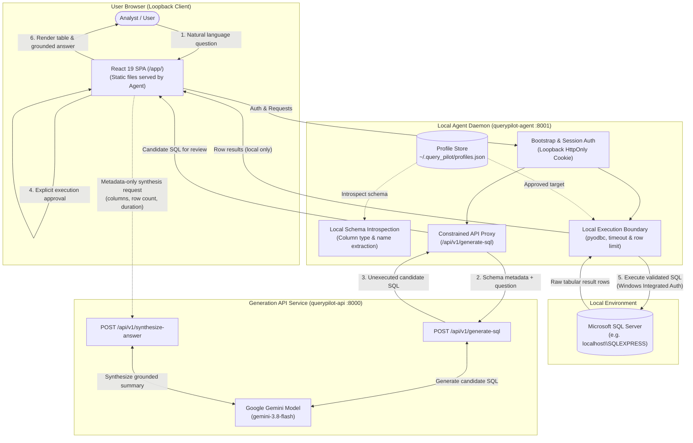

# QueryPilot 🧭

**QueryPilot** is an AI-powered autonomous data analyst that converts natural-language business questions into safe, validated SQL queries. It uses a stateful text-to-SQL reasoning engine and executes queries locally against enterprise relational databases under strict safety envelopes.

---

## Architecture Overview & Service Responsibilities

QueryPilot employs a **decoupled architecture** separating text-to-SQL generation from database query execution. The application consists of two distinct services designed to run concurrently during interactive local usage:

1. **`querypilot-api` (Generation API Service — Port `8000`)**:
   - Handles natural-language to SQL translation and query explanation using Google Gemini models.
   - Provides optional metadata-only answer synthesis based on column headers and row counts.
   - **Zero Database Access**: The API service has **no connection to customer databases** and stores no database credentials or connection strings.
   - **Privacy Boundary**: By default, grounded answer synthesis receives only column metadata and row counts—**never raw database row values or cell records**.

2. **`querypilot-agent` (Local Agent Daemon — Port `8001`)**:
   - Runs strictly on loopback (`http://127.0.0.1:8001/app/`) on the user's local machine.
   - Serves the production React/TypeScript web interface from pre-compiled static assets (`frontend/dist/`).
   - Authenticates local browser sessions using single-use bootstrap tokens and `HttpOnly` session cookies.
   - Manages approved database connection profiles in a local, permission-hardened profile store (`~/.query_pilot/profiles.json`).
   - Introspects database schemas locally and executes approved, user-reviewed SQL queries locally via `pyodbc` using **Windows Integrated Authentication**.



---

## Safety Invariants & Engineering Guardrails

1. **Loopback-Only Binding**: `querypilot-agent` binds strictly to `127.0.0.1` or `localhost`. Binding to public hostnames or non-loopback network interfaces fails closed immediately.
2. **Explicit Human-in-the-Loop Review**: Generated SQL statements are strictly unexecuted candidates until the user explicitly reviews the query in the UI and clicks **Run Query**.
3. **Approved Connection Profiles**: The frontend references registered profile IDs (e.g. `local_dev`). Clients cannot supply arbitrary connection strings or target arbitrary database servers. Profiles are managed strictly via the CLI (`querypilot-agent profile`); there is no browser-based profile creation wizard.
4. **Windows Integrated Authentication**: All database connections use `Trusted_Connection=yes`. SQL Server username/password profile authentication is unsupported to prevent storing cleartext credentials.
5. **Data Minimization**: Customer database rows remain strictly on the local machine and are never transmitted to the generation API. Schema structure and the user's question are sent to the model to generate candidate SQL.
6. **Concurrent Process Requirement**: Both `querypilot-api` and `querypilot-agent` must be running concurrently for interactive natural-language querying.
7. **Strict Database Execution Ceilings**: Local SQL execution is hard-clamped to a **15-second statement timeout** (`GLOBAL_MAX_TIMEOUT_SECONDS = 15`) and a **100-row result limit** (`GLOBAL_MAX_ROW_LIMIT = 100`). Profile configurations or queries requesting higher limits are strictly clamped down.
8. **Bounded Request Payloads**: The local agent daemon enforces a default request body limit of **65,536 bytes (64 KB)** with a configurable ceiling of **1 MiB (1,048,576 bytes)** (`AgentConfig.max_request_bytes`). The hosted API enforces a hard streaming ceiling of **1 MiB**.
9. **Distinct Proxy vs. SQL Timeouts**: The agent's `upstream_timeout_seconds` (default **30.0 seconds**) governs the HTTP reverse proxy to the generation API, completely distinct from the database query execution timeout (hard maximum 15 seconds).

---

## Prerequisites

### Prerequisites for Running the Application
* **Python**: `>=3.12` (as declared in `pyproject.toml`).
* **ODBC Driver**: Microsoft ODBC Driver 17 or 18 for SQL Server installed on Windows.
  *(Verify in PowerShell: `Get-OdbcDriver -Name "*SQL Server*"`).*
* **Database Instance**: Accessible Microsoft SQL Server instance (e.g., local `localhost\SQLEXPRESS` or network instance).
* **Database Permissions**: The active Windows user account must have login access and `CONNECT` / `SELECT` permissions on the target database.
* **API Key**: Google Gemini API key (`GEMINI_API_KEY`) for text-to-SQL generation.

### Prerequisites for Building Frontend Assets / Development
* **Node.js**: LTS `^20.19.0 || >=22.12.0`.
* **npm**: `>=10.0.0`.
* *(Note: Building the frontend is required when running from a git checkout because static assets are not committed to source control).*

---

## Quickstart (Local Windows PowerShell)

Follow these verified steps to configure, build, and launch QueryPilot from a repository checkout.

### Step 1: Create and Activate Virtual Environment
```powershell
python -m venv .venv
.\.venv\Scripts\Activate.ps1
```

### Step 2: Install Python Project in Editable Mode
```powershell
pip install -e .
```
> [!NOTE]
> `pip install -e .` registers the `querypilot-agent` and `querypilot-api` console entry points. However, it does **not** compile the frontend static assets.

### Step 3: Install Frontend Dependencies and Build Assets
Compile the React/TypeScript frontend into `frontend/dist/`:
```powershell
cd frontend
npm install
npm run build
cd ..
```

### Step 4: Set the Gemini API Key
Configure your Gemini API key in your current PowerShell session (replace with your personal API key):
```powershell
$env:GEMINI_API_KEY = "your_actual_gemini_api_key_here"
```

### Step 5: Register an Approved Database Connection Profile
Register your local SQL Server database using Windows Integrated Authentication (replace `localhost\SQLEXPRESS` and `MyDatabase` with your target instance and database):
```powershell
querypilot-agent profile add `
  --id "local_dev" `
  --name "Local Development Database" `
  --server "localhost\SQLEXPRESS" `
  --database "MyDatabase" `
  --driver "ODBC Driver 17 for SQL Server" `
  --yes
```
Verify the registration:
```powershell
querypilot-agent profile list
```

### Step 6: Start the Generation API Service (Terminal 1)
In your first terminal (with `.venv` activated and `GEMINI_API_KEY` set):
```powershell
querypilot-api
```
The API service will start on `http://127.0.0.1:8000`. Verify its health check in a separate window:
```powershell
Invoke-RestMethod -Uri "http://127.0.0.1:8000/health" -Method GET
```

### Step 7: Start the Local Agent Daemon (Terminal 2)
In a second terminal (with `.venv` activated):
```powershell
querypilot-agent --open-browser
```
The daemon starts on `http://127.0.0.1:8001` and opens your default browser to:
`http://127.0.0.1:8001/app/`

### Step 8: Authenticate, Review, and Execute
1. **Authentication**:
   - The UI presents the **Local Agent Authentication** dialog upon initial load.
   - Copy the single-use bootstrap token printed in your daemon terminal or read it from `~/.query_pilot/agent.token`.
   - Paste the token into the dialog and click **Authenticate**.
   - The frontend submits the token to `POST /agent/v1/auth/bootstrap`, which verifies the token, wipes the file on disk, and sets an ambient `qpt_session` `HttpOnly` session cookie.
2. **Profile Selection**: Select your registered profile (`Local Development Database`) from the dropdown.
3. **Ask a Question**: Enter a natural-language question (e.g. *"Show top 5 records by date"*).
4. **Review Candidate SQL**: The agent fetches your schema locally, requests candidate SQL from the API, and renders the unexecuted SQL in the review editor.
5. **Explicit Execution**: Click **Run Query**. The agent executes the SQL locally against your SQL Server database and displays the tabular results and execution metrics.

---

## CLI Reference

### `querypilot-agent`
```text
usage: querypilot-agent [-h] [--host HOST] [--port PORT] [--open-browser]
                        [--static-dir STATIC_DIR] [--upstream-api-url URL]
                        [--token-dir TOKEN_DIR] [--profiles-file PROFILES_FILE]
                        [--allow-dev-origin] {profile} ...

Root Options:
  --host HOST               Loopback host to bind (default: 127.0.0.1 or QUERYPILOT_AGENT_HOST).
  --port PORT               TCP port to bind (default: 8001 or QUERYPILOT_AGENT_PORT).
  --open-browser            Launch the system browser to the agent UI after startup.
  --static-dir DIR          Path to frontend production build (default: frontend/dist or QUERYPILOT_AGENT_STATIC_DIR).
  --upstream-api-url URL    Upstream generation API URL (default: http://127.0.0.1:8000 or QUERYPILOT_UPSTREAM_API_URL).
  --token-dir PATH          Directory for bootstrap token file (default: ~/.query_pilot or QUERYPILOT_TOKEN_DIR).
  --profiles-file PATH      Path to profiles JSON file (default: ~/.query_pilot/profiles.json or QUERYPILOT_PROFILES_FILE).
  --allow-dev-origin        Permit Vite development origin (http://127.0.0.1:5173). Intended only for local frontend development; do not enable in normal production mode.

Subcommands:
  profile add               Register an approved SQL Server database profile.
  profile list              List all registered database profiles.
  profile validate          Validate the profile configuration file syntax and permissions.
```

### `querypilot-api`
```text
usage: querypilot-api [-h] [--host HOST] [--port PORT] [--reload]

Options:
  --host HOST               Host to bind the API (default: 127.0.0.1 or QUERYPILOT_API_HOST).
  --port PORT               TCP port to bind the API (default: 8000 or QUERYPILOT_API_PORT).
  --reload                  Enable auto-reload for development.
```

---

## Technology Stack

The project technologies and libraries are verified directly against project manifests:

| Layer | Technology | Version | Purpose |
| :--- | :--- | :--- | :--- |
| **Frontend Framework** | React | `^19.2.4` | Declarative UI components and state management |
| **Frontend Language** | TypeScript | `~6.0.2` | Static type checking and verification |
| **Frontend Bundler** | Vite | `^8.3.0` | Ultra-fast build packaging and asset compilation |
| **Backend Framework** | FastAPI | `>=0.110.0` | Asynchronous/synchronous web routing and validation |
| **ASGI Web Server** | Uvicorn | `>=0.29.0` | High-performance ASGI server for local daemons |
| **Validation Models** | Pydantic / Settings | `>=2.7.0` | Strict request/response contract validation |
| **Deterministic SQL** | sqlglot | `>=25.0.0` | SQL parsing, AST inspection, dialect-specific query validation |
| **Database Driver** | pyodbc / SQLAlchemy | `>=5.1.0` / `>=2.0.0` | Parameterized local execution, pooling, and driver timeouts |
| **LLM Provider** | Google Gemini API | `google-genai >=0.1.0` | Gemini 3.8 Flash (`gemini-3.8-flash`) for text-to-SQL reasoning |
| **Test Suite** | pytest | `>=8.0.0` | Unit, offline integration, and regression test suites |

---

## Testing

Run offline unit and security test suites without connecting to databases or external APIs:

```powershell
# Run all offline unit and agent tests
pytest

# Run agent application and configuration tests
pytest tests/test_agent_app.py tests/test_agent_config.py tests/test_profile_onboarding.py

# Run frontend tests and linter
cd frontend
npm test
npm run lint
npm run build
cd ..
```

---

## Release Status & Verification Evidence

### 1. Controlled Preview Status
QueryPilot is currently authorized strictly as a **Controlled Preview** (for local development, invited testing, and authorized evaluations):
- **Loopback-Only Boundary**: `querypilot-agent` binds strictly to `127.0.0.1` / `localhost`.
- **Public Distribution Blocked (NO-GO)**: General distribution to PyPI, public release tags, and untrusted multi-user environments are **BLOCKED** until clean dependency resolution, live model verification, and working-tree cleanup are resolved.

### 2. Model Integration & Live Execution Evidence
- **Mocked Model Generation in B11/B12**: The B11 and B12 end-to-end browser journeys, real-process integration tests, and workflow demonstrations used **deterministic mocked model generation** to validate system orchestration, UI routing, security boundaries, and Windows Integrated Authentication without external dependencies.
- **Live Gemini Status**: **UNVERIFIED end-to-end**. Live Gemini generation has **not** been tested in an integrated browser-to-agent-to-API workflow during B11 or B12.
- **Offline Test Boundary**: Offline test suite execution (1,134 passed tests) verifies software contracts, syntax transformations, and security boundaries; it does **not** establish live Gemini model accuracy, response latency, token-limit behavior, or external service availability.
- **Live SQL Server Testing**: Live Microsoft SQL Server execution was tested against a real database instance (`QueryPilot_TestDB`) in earlier milestones (B9, B11-E, B11-F); milestone B12 testing was performed strictly offline with mocked database execution.

### 3. Packaging & Distribution Verification
- **Verified Wheel Smoke Test**: The distribution orchestration script (`python scripts/build_distribution.py`) compiles the React frontend into `frontend/dist/`, stages assets into `src/query_pilot/agent/static/`, and builds `dist/query_pilot-0.1.0-py3-none-any.whl`. Wheel asset serving has been verified using `pip install --no-deps` in an environment where runtime dependencies were already satisfied.
- **Unverified Clean Dependency Resolution**: A clean, dependency-resolved fresh installation (installing the wheel into a blank virtual environment without `--no-deps`) has **not yet passed verification** due to offline test sandbox constraints and the absence of pre-cached wheels.
- **CLI-Based Profile Setup**: Connection profile onboarding is performed strictly through the CLI (`querypilot-agent profile add`); there is **no browser-based profile creation wizard**.

---

## Operational Limitations & Security Boundaries

1. **Standalone Packaging**: A single-binary installer is not provided. Running QueryPilot requires a Python `>=3.12` environment and Node.js for initial frontend builds.
2. **Frontend Asset Bundling**: When running from a repository checkout, `npm run build` must be executed before starting `querypilot-agent`. The distribution wheel created via `scripts/build_distribution.py` bundles static assets, but fresh dependency-resolved installation from PyPI is not yet verified.
3. **Manual Two-Service Launch**: Both `querypilot-api` and `querypilot-agent` must be started in separate terminals.
4. **Hard Query Execution Ceilings**: Local query execution is hard-clamped to a **15-second statement timeout** (`GLOBAL_MAX_TIMEOUT_SECONDS = 15`) and a **100-row result limit** (`GLOBAL_MAX_ROW_LIMIT = 100`). Profile configurations or queries requesting higher limits are strictly clamped down.
5. **No Browser Profile Creation**: Profiles are configured strictly through the CLI (`querypilot-agent profile add`). The web UI provides selection of pre-registered profiles only.
6. **Windows ACL Boundaries**: Profile files in `~/.query_pilot/profiles.json` are hardened via Windows `icacls` to restrict access to the active user trustee. This provides standard operating system file discretionary access control; it does **not** provide hardware virtualization or an absolute guarantee against all explicit ACE configurations or multi-user filesystems.
7. **No Secret Encryption at Rest**: Connection profile metadata is stored in plaintext JSON. Passwords and secret credentials are prohibited from profile files.
8. **Stale Profile Lockfile Recovery**: If `querypilot-agent profile add` times out acquiring the cross-process lock (`profiles.json.lock`), confirm that no other `querypilot-agent` process is active before manually removing `~/.query_pilot/profiles.json.lock`.
9. **Compliance Disclaimer**: QueryPilot is an open-source development tool. It is not production-certified, HIPAA/SOC2 compliant, or certified under any regulatory framework.

---

## Documentation Links

- [Configuration & Troubleshooting Guide](docs/configuration.md)
- [Architecture & Decoupled Local Agent Specification](docs/architecture.md)
- [API Reference (Legacy Prototype)](docs/api.md)
- [Deployment Guide (Legacy Render Prototype)](docs/deployment.md)
- [Evaluation Benchmark Harness](data/evaluation/README.md)

