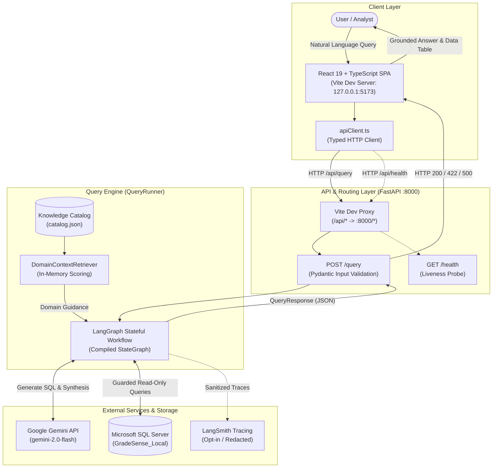
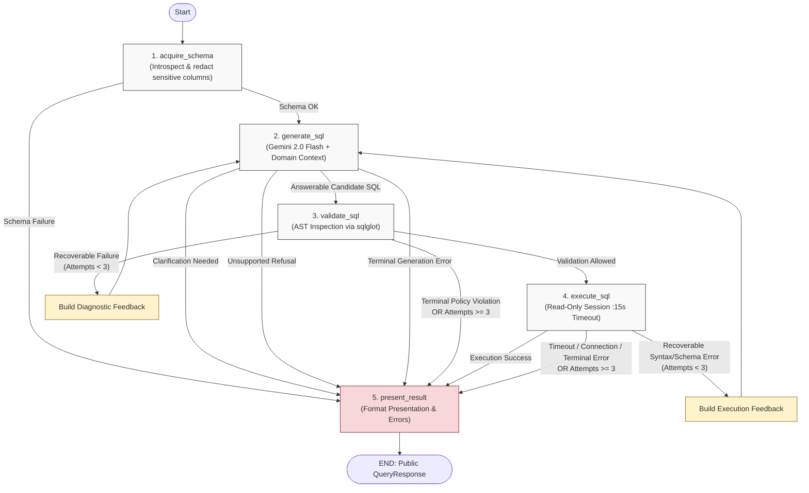

# QueryPilot 🧭

**QueryPilot** is an AI-powered autonomous data analyst that converts natural-language questions into SQL, safely validates queries, explores schemas, recovers from execution errors, and explains results using a stateful LangGraph workflow.

The core differentiator of QueryPilot is its **self-correcting, measurable agent workflow** backed by deterministic safety envelopes and strict database guardrails.

---

## Architecture Overview

QueryPilot bridges non-technical business questions and structured enterprise relational databases through a decoupled, multi-layer architecture:

1. **User Interface (React + TypeScript):** An interactive query workspace supporting natural-language questions, interactive clarification prompts, tabular result rendering, execution metrics, and active request cancellation.
2. **API & Serving (FastAPI):** A lightweight HTTP API providing request correlation (`X-Request-ID`), strict Pydantic input validation, and sanitized error responses.
3. **Agent Workflow (LangGraph):** A 5-stage stateful directed graph coordinating schema acquisition, retrieval-augmented SQL generation, deterministic AST validation, guarded read-only execution, and grounded answer synthesis.
4. **Deterministic Safety Envelopes:** Zero unvalidated query execution. All queries pass through `sqlglot` Abstract Syntax Tree (AST) validation before reaching the database, blocking mutations, sensitive credentials, unwhitelisted tables/columns, and multi-statement queries.
5. **Bounded Self-Correction:** When syntax, schema, or recoverable validation errors occur, diagnostic feedback is fed back into the generator for up to 3 bounded attempts.

### System Architecture & Request Flow



### LangGraph Workflow & Bounded Recovery

The core execution engine compiles a 5-node LangGraph `StateGraph`. Recoverable validation failures or correctable SQL syntax errors loop back to query generation with sanitized diagnostic feedback, strictly bounded by `MAX_GENERATION_ATTEMPTS = 3`.



---

## Technology Stack

The versions and libraries in use are verified directly against the project configuration:

| Layer | Technology | Version | Purpose |
| :--- | :--- | :--- | :--- |
| **Frontend Framework** | React | `^19.2.8` | Declarative user interface components and state management |
| **Frontend Language** | TypeScript | `~6.0.2` | Strict static typing and compile-time verification |
| **Frontend Tooling** | Vite | `^8.3.0` | Ultra-fast development server, HMR, and build packaging |
| **Frontend Linter** | Oxlint | `^1.81.0` | High-performance Rust-based code linting |
| **Backend Framework** | FastAPI | `>=0.110.0` | Modern, asynchronous/synchronous Python web API |
| **ASGI Web Server** | Uvicorn | `>=0.29.0` | High-performance local development ASGI server |
| **Agent Orchestration**| LangGraph | `>=1.0.0` | Stateful graph orchestration with bounded self-correction loops |
| **Validation Models** | Pydantic / Settings | `>=2.7.0` | Runtime request/response contract validation and environment parsing |
| **Deterministic SQL** | sqlglot | `>=25.0.0` | SQL parsing, AST inspection, dialect-specific query validation |
| **Database Engine** | SQL Server (T-SQL) | `>=2017` / Express | Target relational database engine with ODBC Driver 17 |
| **Database ORM/Core** | SQLAlchemy / pyodbc| `>=2.0.0` / `>=5.1.0`| Connection pooling, parameterized execution, read-only session control |
| **LLM Provider** | Google Gemini API | `google-genai >=0.1.0` | Gemini 2.0 Flash (`gemini-2.0-flash`) for structured text-to-SQL |
| **Observability** | LangSmith | `>=0.1.0` | Privacy-safe, opt-in tracing (redacts queries, tables, and secrets) |
| **Test Suite** | pytest | `>=8.0.0` | Comprehensive unit, offline integration, and regression suites |

---

## Engineering Guardrails

1. **Safety First:** Read-only database access, zero unvalidated SQL execution, and deterministic AST verification before running queries.
2. **Separation of Concerns:** Distinct boundaries between schema introspection, query generation, safety validation, query execution, and result interpretation.
3. **Bounded Recovery:** Strictly limited correction attempts (`MAX_GENERATION_ATTEMPTS = 3`) to avoid runaway execution loops.
4. **Data Privacy:** Sensitive columns (e.g., credentials, password hashes) are masked at the schema introspection layer and blocked at the AST validation layer.
5. **No Hallucinated Insights:** Grounded answers backed directly by verified scalar templates or explicitly tagged as `UNVERIFIED_NARRATIVE`.
6. **SQL Visibility Policy:** By default, generated SQL is hidden from the public client response (`include_sql=False`), protecting database internals while surfacing answers and tabular data.

---

## Getting Started (Local Development)

### 1. Prerequisites

Before installing, ensure your environment meets the minimum version requirements:

* **Python:** `>=3.12` (tested with Python 3.12 and 3.13)
* **Node.js:** `^20.19.0 || >=22.12.0` (LTS Node 20.19+ or Node 22.12+ required by modern Vite/Oxc lockfile dependencies)
* **npm:** `>=10.0.0`
* **Database:** Microsoft SQL Server Express or LocalDB with **ODBC Driver 17 for SQL Server** installed
* **Git**

### 2. Clone the Repository

```powershell
git clone https://github.com/Yash-Kakadiya/query-pilot.git
cd query-pilot
```

### 3. Backend Setup

Open your first terminal and set up the Python environment:

```powershell
# Create and activate Python virtual environment
python -m venv .venv
.\.venv\Scripts\Activate.ps1
# On Linux/macOS: source .venv/bin/activate

# Install required backend dependencies
pip install -r requirements.txt
```

### 4. Configure Environment Variables

Create your `.env` configuration file from the template:

```powershell
cp .env.example .env
```

Edit `.env` with your settings:
* **`GEMINI_API_KEY`**: Your Google Gemini API key (**required**).
* **`GEMINI_MODEL`**: `gemini-2.0-flash` (default).
* **`DB_SERVER`**: `localhost\SQLEXPRESS` (default for local SQL Server Express).
* **`DB_NAME`**: `GradeSense_Local` (default isolated testing database).
* **`DB_DRIVER`**: `ODBC Driver 17 for SQL Server`.
* **`DB_USE_TRUSTED_CONNECTION`**: `true` (uses Windows Integrated Authentication).
* **`LANGCHAIN_TRACING_V2`**: `false` (default: tracing is disabled).

> [!NOTE]
> Never commit `.env` or your API keys to version control.

### 5. Start the FastAPI Backend

In your first terminal, launch the Uvicorn server:

```powershell
uvicorn query_pilot.api.app:app --host 127.0.0.1 --port 8000
```

The API will be available at `http://127.0.0.1:8000`:
* OpenAPI Documentation (Swagger UI): `http://127.0.0.1:8000/docs`
* Alternative Documentation (ReDoc): `http://127.0.0.1:8000/redoc`
* Operational Health Check: `http://127.0.0.1:8000/health`

### 6. Frontend Setup & Startup

Open a **second terminal** and navigate to the frontend directory:

```powershell
cd frontend

# Install frontend dependencies
npm install

# Start the Vite development server
npm run dev
```

The Vite development server will start at:
* **Local Web App:** `http://127.0.0.1:5173` (or `http://localhost:5173`)

Vite automatically proxies any `/api/*` calls from the browser to the backend at `http://127.0.0.1:8000/*`.

### 7. Run Verification Checks & Tests

Execute the automated test suites:

* **Backend Offline Suite (516 tests, no database or external API needed):**
  ```powershell
  pytest -k "not live" --tb=short
  ```

* **Backend API & Model Tests:**
  ```powershell
  pytest tests/test_api.py tests/test_api_models.py -v
  ```

* **Frontend Code Quality & Build Checks:**
  ```powershell
  cd frontend
  npm run lint
  npm run build
  ```

---

## Product Limitations & Operational Safety

1. **Target Database Restriction:**
   QueryPilot currently enforces a strict security boundary in [src/query_pilot/db/connection.py](src/query_pilot/db/connection.py) restricting execution exclusively to a database named `GradeSense_Local`. Connecting to another database triggers a fatal `DatabaseSecurityError`.
2. **Health Check Semantics:**
   The `GET /health` endpoint is strictly an **application process liveness check**. It verifies that the FastAPI process is up and handling HTTP requests. It **does NOT** test downstream SQL Server connectivity or Gemini API availability.
3. **Local Reverse Proxy & Split-Origin Deployment:**
   The frontend defaults to Vite's local dev server proxy configured in `frontend/vite.config.ts`. For production deployments where the frontend and backend reside on distinct origins, configure `VITE_API_BASE_URL` on the frontend at build time and `CORS_ALLOWED_ORIGINS` on the backend (see [API Guide](docs/api.md) for deployment options). Unified deployments behind a reverse proxy do not require CORS.
4. **Windows Authentication Default:**
   Default configuration assumes Windows Integrated Authentication with SQL Server Express on `localhost`. Linux environments and containerized deployments require SQL Authentication credentials (`DB_USER`, `DB_PASSWORD`) and Linux Microsoft ODBC packages.
5. **SQL Visibility Policy:**
   In compliance with security best practices, the public API omits raw SQL statements from responses by default (`include_sql=False`).
6. **Observability Privacy:**
   LangSmith tracing is disabled by default (`LANGCHAIN_TRACING_V2=false`). When enabled, strict payload redaction strips questions, schemas, raw SQL, and errors to prevent data leakage.

---

## Evaluation Benchmarks

QueryPilot includes an offline baseline evaluation harness (`data/evaluation/baseline_questions.json`) comprising **34 curated cases**: the original 32 benchmark questions plus two clarification cases (`C001` and `C002`).

* **Capability:** Clarification-aware evaluation with bounded conversation-context forwarding. It verifies that query generation correctly requests clarification when questions are ambiguous and respects caller-supplied prior-turn intent.
* **Scope Boundary:** This evaluates single-request generation boundaries with forwarded turn context; it does not provide an end-to-end interactive, stateful multi-turn dialogue evaluation loop.
* **Historical Compatibility:** Historical 32-case evaluation artifacts remain preserved. Metrics from 32-case and 34-case datasets should not be compared directly without acknowledging the dataset difference.

For complete benchmark schemas and category distributions, see [`data/evaluation/README.md`](data/evaluation/README.md).
