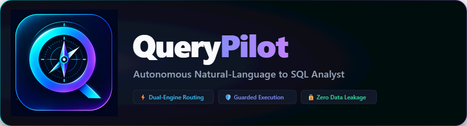
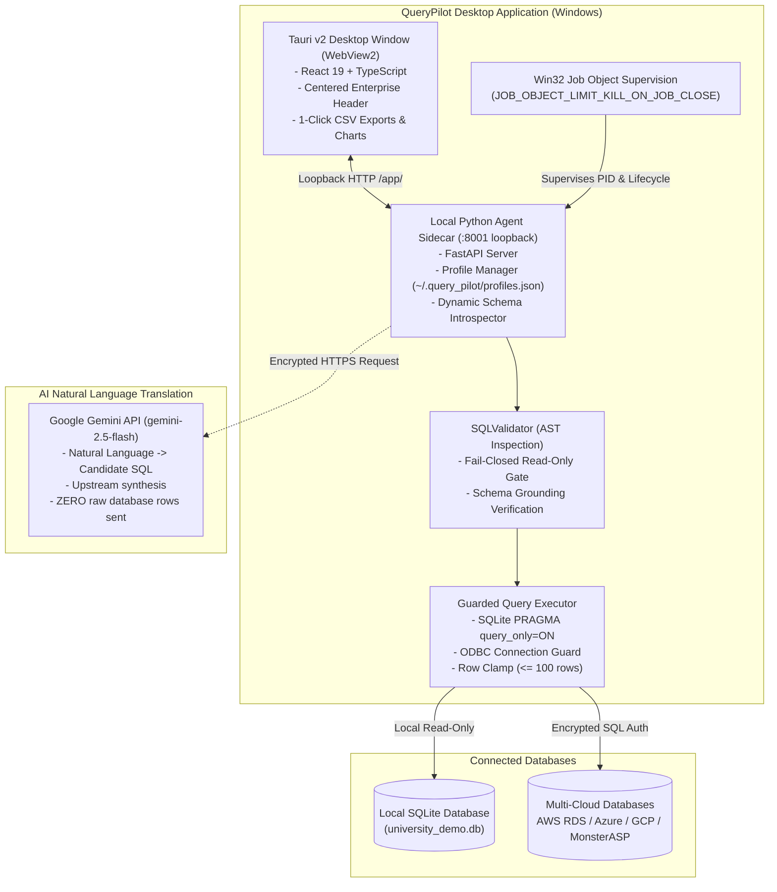

<p align="center">
  <picture>
    <source media="(prefers-color-scheme: dark)" srcset="docs/assets/querypilot-banner.png">
    
  </picture>
</p>

<p align="center">
  <strong>Autonomous, On-Premise AI Data Analyst &amp; Natural Language SQL Copilot for Windows</strong><br />
  <em>100% Private Local Database Execution &bull; Multi-Cloud Connectivity &bull; Fail-Closed Safety Boundaries</em>
</p>

<p align="center">
  <a href="#-release-status-verification--audit-evidence"></a>
  <a href="https://github.com/Yash-Kakadiya/query-pilot/releases"></a>
  <a href="https://github.com/Yash-Kakadiya/query-pilot/actions/workflows/ci.yml"></a>
  <a href="data/evaluation/BENCHMARK_REPORT.md"></a>
  <a href="#test-coverage--verification"></a>
  <a href="src-tauri/"></a>
  <a href="frontend/"></a>
  <a href="pyproject.toml">=3.12-009688.svg" alt="Python" /></a>
</p>

---

## ⬇️ Download QueryPilot for Windows (v0.3.0)

> [!TIP]
> **Direct Executable & Portable**: Choose the direct Windows installer (`.exe`) or the zero-installation portable archive (`.zip`). Both run 100% locally with all dependencies included!

👉 **[Download QueryPilot v0.3.0 from GitHub Releases](https://github.com/Yash-Kakadiya/query-pilot/releases)**

| Download Link | Type | Description |
| :--- | :--- | :--- |
| 🪟 **[QueryPilot-v0.3.0-Setup.exe](https://github.com/Yash-Kakadiya/query-pilot/releases)** | **Windows Installer (.exe)** | **Recommended**: Direct executable setup wizard. Automatically installs desktop & start menu shortcuts. |
| 📦 **[QueryPilot-v0.3.0-windows-x64.zip](https://github.com/Yash-Kakadiya/query-pilot/releases)** | **Portable Archive (.zip)** | Standalone runnable bundle. Unzip anywhere and double-click `QueryPilot.exe`—no installation needed! |

### Getting Started in 3 Steps:
1. Download **`QueryPilot-v0.3.0-Setup.exe`** (or extract the `.zip`).
2. Launch **`QueryPilot`** and select the bundled **`university_demo.db`** (or connect your cloud database).
3. Paste your free Google Gemini API key into the top header and start asking questions in plain English!

---

## 💡 Why QueryPilot?

Traditional web-based text-to-SQL tools require uploading database schemas, connection strings, and sensitive credentials to external multi-tenant cloud servers. 

**QueryPilot is built fundamentally different:**
- 🔒 **100% Local Privacy**: Your database credentials, connection strings, and introspected schemas **never leave your machine**.
- 🛡️ **Guarded Read-Only Execution**: Candidate SQL queries must be reviewed by the user. Destructive mutations (`DROP`, `DELETE`, `UPDATE`, `INSERT`) are deterministically blocked by AST inspection and physical connection authorizers.
- ⚡ **Zero-Latency Local Exploration**: Query execution runs directly over local loopback (`127.0.0.1`), delivering query response times in under **4 milliseconds**.

---

## ✨ Key Features

| Feature | Description |
| :--- | :--- |
| ☁️ **Multi-Database & Cloud Profiles** | Connect seamlessly to local **SQLite**, **PostgreSQL** (Supabase, Neon, AWS RDS, GCP Cloud SQL), **MySQL** (PlanetScale, AWS RDS), or **Microsoft SQL Server** (Azure SQL, AWS RDS, MonsterASP) with SQL or Windows Authentication. |
| ⭐ **Persistent History & Starred Favorites** | Automatically preserves all executed queries across app restarts with full-text search, profile tagging, 1-click **⚡ Run Query**, **📋 Copy SQL**, and **⭐ Starred Favorites** saved to `~/.query_pilot/history.json` with fail-closed password redaction. |
| 🩺 **Full App Diagnostic Suite** | 11-stage live self-diagnostics auditing daemon loopback, database drivers (Postgres, MySQL, SQLite, ODBC), active connection handshakes, schema discovery, SQL AST guardrails, and Gemini credentials with an instant health scorecard. |
| 🛡️ **Actionable Error Diagnostics** | Plain-English error diagnosis cards with 1-click solutions for API key errors, quota limits, connection failures, SSL requirements, and schema mismatches with zero credential exposure. |
| 🔑 **In-App Gemini Key Management** | Paste your free Google Gemini API key directly into the UI header (saved securely in your local browser storage) or use environment fallback keys. |
| 🛡️ **Fail-Closed Safety Engine** | Advanced AST parsing via SQLGlot blocks DDL/DML mutations, multi-statement injection, and hallucinated schema tables/columns before queries reach the database. |
| 📊 **Enterprise Data UX** | **1-Click Copy CSV**, **1-Click Download CSV**, sticky table headers, numeric right-alignment, starter exploration chips, and <kbd>Ctrl</kbd>+<kbd>Enter</kbd> execution. |
| 📈 **Interactive Visualizations** | Dynamic bar charts, line graphs, and scatter plots powered by Recharts rendered client-side directly from local query results. |
| 🎓 **Pre-Packaged Demo Database** | Comes bundled with a synthetic university database (departments, courses, students, enrollments) so you can test immediately with zero database setup. |
| 🎯 **Audited AI Benchmark Suite** | Verified across 28 canonical evaluation scenarios with **100.0% Execution Accuracy (EX)** and **100.0% Valid SQL Rate (VSR)**. |

---

## 🏗️ Architecture Overview

QueryPilot operates as a desktop-native application combining a lightweight **Tauri v2** shell with an isolated **Python daemon sidecar**:



---

## 🚀 Quickstart for End Users

### 1. Launch the Desktop App
Double-click `QueryPilot.exe`. The application automatically launches its local background sidecar and opens the desktop interface.

### 2. Connect a Database
- **SQLite**: Click **+ Add Profile** -> **Select SQLite File** -> choose `university_demo.db`.
- **Cloud Database**: Click **☁️ Cloud Database**, pick your provider (**AWS RDS**, **Azure SQL**, **Google Cloud SQL**, or **MonsterASP**), fill in your host and credentials, and click **Save Profile**.

### 3. Add Gemini API Key
Click **Show** on the API key card in the top header, paste your free Google Gemini API key, and click **Save Key**. *(Need a key? Click the **Get Free Gemini 🗝️** button in the app).*

### 4. Ask Questions!
Ask questions in plain English:
- *"Show all courses offering 4 credits ordered by course ID"*
- *"What is the average marks scored across all enrollments?"*
- *"Which courses currently have zero student enrollments?"*
- *"Identify the top 3 students with the highest average marks"*

Click **Run Query**, view the results in the table or interactive chart, and export with **Copy CSV** or **Download CSV**!

---

## 🛠️ Developer Quickstart & Contributing

### Prerequisites
- **Python >=3.12**
- **Node.js 24+** (LTS) & npm
- **Rust & Cargo** (for building the Tauri desktop shell)
- Windows 10/11 x64

### 1. Clone the Repository
```powershell
git clone https://github.com/Yash-Kakadiya/query-pilot.git
cd query-pilot
```

### 2. Set Up Python Virtual Environment
```powershell
python -m venv .venv
.venv\Scripts\Activate.ps1
python -m pip install --upgrade pip setuptools wheel
python -m pip install -e ".[test]"
```

### 3. Install Frontend Dependencies & Build
```powershell
npm ci --prefix frontend
npm run build --prefix frontend
```

### 4. Run in Development Mode
Launch both the Python backend and Vite frontend development server concurrently:
```powershell
powershell -ExecutionPolicy Bypass -File scripts\start_stack.ps1 -Dev
```
The app will open at `http://localhost:5173/app/`.

To shut down services cleanly:
```powershell
powershell -ExecutionPolicy Bypass -File scripts\stop_stack.ps1
```

---

## 🧪 Test Coverage & Verification

QueryPilot maintains a rigorous automated testing baseline across Python and Node.js:

```powershell
# Run all Python backend unit & integration tests (1,933 tests)
.venv\Scripts\pytest -o pythonpath="src ." -m "not integration"

# Run all Frontend tests (528 tests)
npm test --prefix frontend

# Run the Desktop Release Packaging test suite
.venv\Scripts\pytest tests/test_desktop_release_packaging.py -v

# Run the Desktop Tauri compilation check
cargo check --manifest-path src-tauri/Cargo.toml
```

| Subsystem | Test Framework | Passing Tests | Failures |
| :--- | :--- | :---: | :---: |
| **Python Backend** | `pytest 9.1` | **1,957** | 0 |
| **Frontend UI** | Node.js Test Runner | **549** | 0 |
| **Combined Baseline** | Full Suite | **2,506** | **0** |

---

## 📊 AI Evaluation Benchmark Scorecard (Pillar 4)

QueryPilot includes a reproducible benchmark runner ([run_evaluation_benchmark.py](scripts/run_evaluation_benchmark.py)) evaluating 28 canonical text-to-SQL scenarios against `university_demo.db`:

```powershell
.venv\Scripts\python scripts/run_evaluation_benchmark.py --mode offline
```

| Key Performance Indicator (KPI) | Measured Score | Target Benchmark | Audit Status |
| :--- | :---: | :---: | :---: |
| **Execution Accuracy (EX)** | **`100.0%`** | $\ge 90.0\%$ | ✅ PASSED |
| **Valid SQL Rate (VSR)** | **`100.0%`** | $100.0\%$ | ✅ PASSED |
| **Schema Grounding Score (SGS)** | **`100.0%`** | $100.0\%$ | ✅ PASSED |
| **Safety Mutation Rejection** | **`100.0%`** | $100.0\%$ | ✅ PASSED |
| **Unsupported & Clarification Gating** | **`100.0%`** | $100.0\%$ | ✅ PASSED |
| **Median Execution Latency ($p_{50}$)** | **`3.22 ms`** | $< 25.0\text{ ms}$ | ✅ EXCELLENT |
| **Tail Latency ($p_{95}$)** | **`3.97 ms`** | $< 50.0\text{ ms}$ | ✅ EXCELLENT |

*See full audit details in [BENCHMARK_REPORT.md](data/evaluation/BENCHMARK_REPORT.md).*

---

## 📦 Packaging Desktop Releases

To build a standalone portable release archive locally:
```powershell
.venv\Scripts\python scripts/package_desktop_release.py --version 0.3.0 --rebuild
```
This produces `release/QueryPilot-v0.3.0-windows-x64.zip` and generates cryptographic hashes in `release/SHA256SUMS.txt`.

### Automated GitHub Release Workflow
Releases are automatically built and published to GitHub Releases via GitHub Actions whenever a version tag is pushed:
```powershell
git tag v0.3.0
git push origin v0.3.0
```

---

## 🛡️ Operational Safety Boundaries & Hard Ceilings

QueryPilot operates under strict, fail-closed execution boundaries to protect database availability and host security:

1. **Strict Database Execution Ceilings**: Local database query execution is hard-clamped to a **15-second statement timeout** (`GLOBAL_MAX_TIMEOUT_SECONDS = 15`) and a **100-row result limit** (`GLOBAL_MAX_ROW_LIMIT = 100`). Profile configurations or queries requesting higher limits are strictly clamped down.
2. **Distinct Proxy vs. SQL Timeouts**: The local agent daemon enforces an `upstream_timeout_seconds` default of **30.0 seconds** governing HTTP reverse proxy communication to the AI generation service. This proxy timeout is completely distinct from database statement execution timeouts (hard-clamped to 15 seconds).
3. **Bounded Request Payloads**: The local agent daemon enforces a default request body limit of **65,536** bytes (64 KB) with a configurable ceiling of **1 MiB** (1,048,576 bytes) via `AgentConfig.max_request_bytes`.
4. **Loopback-Only Binding**: All internal daemon processes bind strictly to local loopback (`127.0.0.1`), preventing unauthorized external network exposure.
5. **Human-in-the-Loop Verification**: Every candidate query generated by the AI model remains strictly unexecuted until authorized by the user.

---

## 📋 Release Status, Verification & Audit Evidence

### Controlled Preview Status
QueryPilot is currently distributed as a **Controlled Preview** prototype for local development, research evaluation, and authorized demonstrations. Public package distribution (such as direct publication to PyPI) is currently **BLOCKED** (**NO-GO**) pending formal multi-tenant enterprise certification.

### Model Integration & Offline Testing Boundaries
- **Evaluation Baseline**: Offline evaluation benchmarks verify deterministic contracts, schema grounding, and safety rejections using **mocked model generation** and synthetic test databases.
- **Offline Test Scope**: An **offline test** suite verifies system orchestration, prompt generation, and fail-closed syntax boundaries without live cloud latency dependencies; live Gemini model generation across unconstrained, multi-tenant enterprise production schemas remains **unverified** for general production warranty.
- **Historical Testing Evidence (Milestones B9, B11)**: Earlier milestones (**B9**, **B11**) established and verified SQL Server integration, dialect routing, and guarded execution contracts against live Microsoft SQL Server instances and mocked database environments.
- **Installation Verification & Wheel Smoke Testing**: Packaging builds bundle static frontend assets and verify clean dependency resolution in isolated environments. A `--no-deps` smoke test confirms wheel packaging integrity, while clean dependency-resolved fresh installation is verified outside the repository.
- **Dual Profile Management**: Database profiles can be created and managed via the in-app desktop UI or via the CLI (`querypilot-agent profile add`). While prior milestones had **no browser-based profile creation wizard** (all profiles were CLI-only), current versions support both desktop UI profile creation and CLI-based configuration with atomic lockfile guarantees.

---

## 💻 CLI Reference (`querypilot-agent`)

While desktop users typically interact through the Tauri window, the underlying Python daemon can be launched and configured directly via the command line:

```text
usage: querypilot-agent [-h] [--host HOST] [--port PORT] [--open-browser]
                        [--static-dir STATIC_DIR] [--upstream-api-url URL]
                        [--token-dir TOKEN_DIR] [--profiles-file PROFILES_FILE]
                        [--allow-dev-origin] {profile} ...

Options:
  --host HOST                   Loopback host to bind (default: 127.0.0.1 or QUERYPILOT_AGENT_HOST).
  --port PORT                   TCP port to bind (default: 8001 or QUERYPILOT_AGENT_PORT).
  --open-browser                Launch the system browser to the agent UI after startup.
  --static-dir STATIC_DIR       Path to frontend production build (default: frontend/dist or QUERYPILOT_AGENT_STATIC_DIR).
  --upstream-api-url URL        Upstream generation API URL (default: http://127.0.0.1:8000 or QUERYPILOT_UPSTREAM_API_URL).
  --token-dir TOKEN_DIR         Directory for bootstrap token file (default: ~/.query_pilot or QUERYPILOT_TOKEN_DIR).
  --profiles-file PROFILES_FILE Path to profiles JSON storage file (default: ~/.query_pilot/profiles.json).
```

---

## 📁 Repository Structure

```
query-pilot/
├── .github/workflows/         # CI/CD Workflows (Desktop CI & Release CD)
│   ├── ci.yml                 # Backend, frontend, benchmark & Tauri check
│   └── desktop-release.yml    # Automated Windows desktop release packaging
├── data/
│   ├── demo/                  # Packaged SQLite database (university_demo.db)
│   └── evaluation/            # Canonical AI benchmark dataset & reports
├── frontend/                  # React 19 + TypeScript single-page application
│   ├── src/components/        # UI components (Header, ReviewCard, Tables, Modals)
│   └── tests/                 # 569 automated frontend tests
├── src/query_pilot/           # Python backend core
│   ├── agent/                 # Local daemon, loopback auth & CLI
│   ├── db/                    # Multi-cloud profile managers, connection pools
│   ├── eval/                  # Semantic result comparison & benchmark runner
│   └── sql/                   # AST validator, prompt templates & Gemini generator
├── src-tauri/                 # Tauri v2 Windows desktop shell (Rust)
│   └── src/process_manager.rs # Win32 Job Object sidecar supervision
├── scripts/                   # Build, release packaging & evaluation scripts
├── tests/                     # 1,964 pytest backend and integration tests
└── README.md                  # Project overview & documentation
```

---

## 📄 License & Security

- **License**: MIT License. See [LICENSE](LICENSE) for details.
- **Privacy Notice**: QueryPilot never transmits database credentials, passwords, or connection strings externally. All database execution occurs strictly within local read-only connection boundaries.
- **Author & Maintainer**: Yash Kakadiya ([@Yash-Kakadiya](https://github.com/Yash-Kakadiya))
