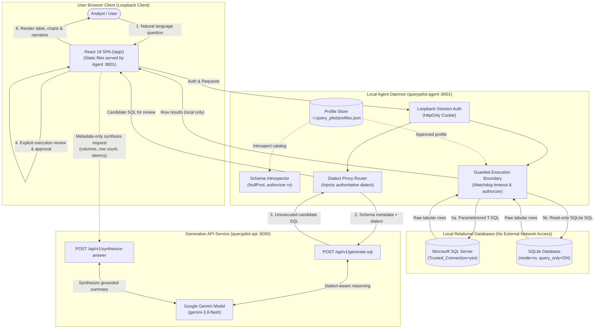

# QueryPilot 🧭
**Autonomous Natural-Language to SQL Analyst with Dual-Engine Dialect Routing & Guarded Local Execution**

[](#release-status--verification-evidence)
[](pyproject.toml)
[](frontend/)
[](src/query_pilot/)
[](#testing)
[](#supported-database-engines)

> [!IMPORTANT]
> **Controlled Technical Preview**: QueryPilot is an open-source technical prototype authorized strictly for local development, research evaluation, and authorized demonstrations. It is **not** certified under SOC2, HIPAA, or general enterprise production compliance frameworks. Public distribution to PyPI is currently blocked until final release criteria are met.

---

## ⚡ Instant Quickstart (Zero-Credential SQLite Evaluation)

Evaluators can run QueryPilot's complete text-to-SQL analytical workflow immediately against a deterministic synthetic university database—without installing Microsoft SQL Server:

```powershell
# 1. Generate the synthetic university database (5 departments, 10 courses, 16 students, 30 enrollments)
python scripts/generate_university_sqlite_db.py --overwrite

# 2. Launch both backend services concurrently and open the React UI in your browser
powershell -ExecutionPolicy Bypass -File scripts\start_stack.ps1
```
*(On initial load, copy the single-use bootstrap token printed in the daemon window, select the pre-registered `University Demonstration DB`, and execute your first analytical query! To shut down all services cleanly, run `powershell -ExecutionPolicy Bypass -File scripts\stop_stack.ps1`).*

---

## 🎬 30–60 Second Demonstration Storyboard

| Phase | Time Window | Action & User Experience | Safety Invariant / Architectural Guardrail |
| :--- | :---: | :--- | :--- |
| **1. Natural-Language Question** | `0:00–0:10` | User enters an analytical question in the web UI: *"What is the total number of students in each department?"* | UI enforces maximum query length ($\le 1000$ chars) and dispatches request to the local agent loopback proxy. |
| **2. Schema Discovery & Generation** | `0:10–0:25` | Local agent introspects table schemas, authoritatively sets `dialect="sqlite"`, forwards context to Gemini, and renders candidate SQL. | **Unexecuted Candidate Invariant**: Candidate SQL is displayed with syntax highlighting and explicit warning badge: *"Unexecuted candidate SQL. Review the query and click Execute Query on Database."* |
| **3. Human Review & Authorization** | `0:25–0:35` | User reviews candidate SQL (e.g. `LEFT JOIN students`), optionally edits statement inline, and clicks **Run Query**. | **Human-in-the-Loop Review**: No database execution occurs without explicit authorization. Destructive queries (`DROP`, `DELETE`) are blocked by physical connection authorizers. |
| **4. Guarded Execution & Visualization** | `0:35–0:48` | Query runs locally in `0.36 ms`. Tabular rows display department counts. User toggles **📈 Interactive Chart**; Recharts renders client-side. | **Strict Data Boundary**: Raw data rows are held in local browser memory and never transmitted to Google Gemini or external services. Authentic zeros are preserved at the baseline. |
| **5. Contextual Follow-Up** | `0:48–1:00` | User asks follow-up query: *"Which courses have no student enrollments?"* followed by *"Which departments offer them?"* | **Bounded Semantic Memory**: Only bounded metadata (question, columns, resolved intent) is sent; pronoun *"them"* is resolved across turns with FIFO window. |

---

## 📸 Recommended Application Screenshots & UI Showcase

When presenting QueryPilot in portfolios, technical reviews, or demonstrations, capture the following five views from the live interface:

| Screen / Artifact | UI Component | Key Visual Elements | How to Reproduce |
| :--- | :--- | :--- | :--- |
| **1. Candidate SQL Review Card** | [`LocalExecutionResults.tsx`](frontend/src/components/LocalExecutionResults.tsx) | Syntax-highlighted SQL, analytical explanation box, green **Execute Query on Database** action button, safety disclaimer badge. | Ask any question; inspect the review card prior to execution. |
| **2. Interactive Result Visualization** | [`ResultVisualizer.tsx`](frontend/src/components/ResultVisualizer.tsx) | Interactive Recharts Bar/Line/Scatter chart, data table with column headers, row counts, and latency metrics (`< 1 ms`). | Click "Run Query" on Q1; toggle to **📈 Interactive Chart**. |
| **3. Dual-Engine Onboarding Modal** | [`ProfileOnboardingModal.tsx`](frontend/src/components/ProfileOnboardingModal.tsx) | Engine toggle (`[MSSQL] / [SQLite]`), canonical path validation, profile ID input, and instant **Test Connection** status. | Click **+ Add Profile** in the top navigation bar. |
| **4. Bounded Conversation History** | [`ConversationHistoryDrawer.tsx`](frontend/src/components/ConversationHistoryDrawer.tsx) | Slide-out drawer with 3 chronological turns, resolved intent badges, execution statuses, and **↩ Restore Turn** buttons. | Ask 2-3 queries; click **📜 Conversation History** in the header. |
| **5. Business Metrics Configuration** | [`MetricConfigModal.tsx`](frontend/src/components/MetricConfigModal.tsx) | Request-scoped metrics editor with metric name, description, formula, and applicable table tags. | Click **⚙ Metrics** in the candidate SQL review card. |

---

## Architecture Overview & Service Responsibilities

QueryPilot employs a **decoupled architecture** separating text-to-SQL generation from database query execution. The application consists of two distinct services designed to run concurrently during interactive local usage:

1. **`querypilot-api` (Generation API Service — Port `8000`)**:
   - Handles natural-language to SQL translation and query explanation using Google Gemini models.
   - Provides optional metadata-only answer synthesis based on column headers and row counts.
   - **Zero Database Access**: The API service has **no connection to customer databases** and stores no database credentials or connection strings.
   - **Data Flow Boundary**: In the tested decoupled workflow, query results are returned to the local browser. The SQL-generation request does not include query-result rows. The hosted synthesis request schema declares metadata fields (`question`, `candidate_sql`, column names, row count, execution duration) rather than a raw-rows field. Permitted text fields, such as the question and candidate SQL, are not scanned comprehensively for embedded row/cell values; this is a description of the implemented request/data-flow boundary, not a blanket guarantee that sensitive information can never be transmitted externally. The browser UI can also perform deterministic local answer rendering directly from client memory without invoking external synthesis (as demonstrated in Milestone B12-F5E2).

2. **`querypilot-agent` (Local Agent Daemon — Port `8001`)**:
   - Runs strictly on loopback (`http://127.0.0.1:8001/app/`) on the user's local machine.
   - Serves the production React/TypeScript web interface from pre-compiled static assets (`frontend/dist/`).
   - Authenticates local browser sessions using single-use bootstrap tokens and `HttpOnly` session cookies.
   - Manages approved database connection profiles in a local, permission-hardened profile store (`~/.query_pilot/profiles.json`).
   - Introspects database schemas locally and executes approved, user-reviewed SQL queries locally via `pyodbc` (Windows Integrated Authentication) or SQLite (physical authorizer callback).



---

## Supported Database Engines

QueryPilot supports dual-engine connectivity managed entirely through approved local connection profiles:

| Database Engine | Engine Identifier | Target Specification | Security & Execution Model |
| :--- | :--- | :--- | :--- |
| **Microsoft SQL Server** | `mssql` (default) | Loopback host + database name (`localhost`, `127.0.0.1`) | Windows Integrated Authentication (`Trusted_Connection=yes`), 15s driver timeout, 100-row limit. |
| **SQLite** | `sqlite` | Local canonical filesystem path (e.g. `data/demo/university_demo.db`) | Read-only URI mode (`mode=ro`), `PRAGMA query_only=ON`, physical authorizer denying DDL, DML, ATTACH, DETACH, PRAGMAs, and transactions. Path must exist as a regular file and cannot target protected OS or agent state. |

---

## 📊 Feature & Evidence Verification Matrix

| Capability / Feature | Architecture Layer | Verification Reality | Primary Evidence & Test Reference | Operational Ceilings & Boundaries |
| :--- | :--- | :--- | :--- | :--- |
| **Dual Dialect Routing** | Local Agent Proxy | **Live Demonstrated** & Test Verified | [`tests/test_api_dialect_routing.py`](tests/test_api_dialect_routing.py) | Injects authoritative dialect from profile (`sqlite` or `tsql`); rejects unsupported dialects with HTTP 422. |
| **Unexecuted Candidate Review** | Frontend & API | **Live Demonstrated** & Test Verified | [`tests/test_browser_recovery_journey.py`](tests/test_browser_recovery_journey.py) | SQL is strictly unexecuted until user clicks run; candidate editor allows user review and modification. |
| **Read-Only SQLite Boundary** | Local Agent Daemon | **Live Demonstrated** & Test Verified | [`tests/test_sqlite_authorizer.py`](tests/test_sqlite_authorizer.py) | Enforces `mode=ro`, `query_only=ON`, physical C-authorizer callback denying DDL/DML, and path policy. |
| **Local Windows Integrated Auth** | Local Agent Daemon | **Live Demonstrated** (SQL Server) | [`tests/test_profile_create.py`](tests/test_profile_create.py) | Uses active Windows user context via `pyodbc` (`Trusted_Connection=yes`); zero passwords stored. |
| **Bounded Multi-Turn Memory** | Frontend & API | **Live Demonstrated** & Benchmark Verified | [`scripts/run_multi_turn_evaluation.py`](scripts/run_multi_turn_evaluation.py) | Max 3 prior turns with FIFO eviction; metadata only (`question`, `columns`, `intent`); zero SQL or rows. |
| **Deterministic Result Charts** | Frontend (Recharts) | **Test Verified** & UI Demonstrated | [`frontend/tests/resultVisualizer.test.ts`](frontend/tests/resultVisualizer.test.ts) | Auto-detects chart types; authentic 0s preserved; missing values as gaps; sampling for $>200$ points. |
| **Mutation Query Defense** | Agent & API | **Live Demonstrated** & Test Verified | [`tests/test_university_demo_dataset.py`](tests/test_university_demo_dataset.py) | `DROP TABLE`, `DELETE`, and multi-statement queries rejected with HTTP 400 before database execution. |
| **Metadata-Only Synthesis** | Hosted API / Gemini | **Live Demonstrated** & Test Verified | [`tests/test_university_demo_dataset.py`](tests/test_university_demo_dataset.py) | Transmits column headers, row counts, and latency to Gemini; raw rows remain strictly in browser. |
| **Offline Scripted Simulation** | CLI Script | **Offline Simulated** (No APIs) | [`scripts/demo_offline_pipeline.py`](scripts/demo_offline_pipeline.py) | Mocks candidate generation; exercises real `sqlglot` AST validation, vector metric matching, and SQLite memory DB. |

---

## Safety Invariants & Engineering Guardrails

1. **Loopback-Only Binding**: `querypilot-agent` binds strictly to `127.0.0.1` or `localhost`. Binding to public hostnames or non-loopback network interfaces fails closed immediately.
2. **Explicit Human-in-the-Loop Review**: Generated SQL statements are strictly unexecuted candidates until the user explicitly reviews the query in the UI and clicks **Execute Query on Database**.
3. **Approved Connection Profiles**: The frontend references registered profile IDs (e.g. `local_dev`, `university_demo`). Clients cannot supply arbitrary connection strings or target arbitrary database servers. Profiles can be registered via the browser onboarding modal (`+ Add Profile`) or through the CLI (`querypilot-agent profile add`), both enforcing identical security validations and loopback/path restrictions.
4. **Local Authentication & Read-Only SQLite Security**: SQL Server uses Windows Integrated Authentication (`Trusted_Connection=yes`). SQLite profiles enforce canonical path validation, `mode=ro` URI parameterization, and dedicated physical connection authorizers denying non-SELECT operations.
5. **Implemented Data-Flow Boundary**: In the tested decoupled workflow, query results are returned to the local browser. The SQL-generation request does not include query-result rows, and the hosted synthesis request schema declares metadata fields rather than a raw-rows field. Permitted text fields, such as the question and candidate SQL, are not scanned comprehensively for embedded row/cell values; this is a description of the implemented request/data-flow boundary, not a blanket guarantee that sensitive information can never be transmitted externally. Avoid including sensitive personal information in query text or database identifiers.
6. **Concurrent Process Requirement**: Both `querypilot-api` and `querypilot-agent` must be running concurrently for interactive natural-language querying.
7. **Strict Database Execution Ceilings**: Local SQL execution is hard-clamped to a **15-second statement timeout** (`GLOBAL_MAX_TIMEOUT_SECONDS = 15`) and a **100-row result limit** (`GLOBAL_MAX_ROW_LIMIT = 100`). Profile configurations or queries requesting higher limits are strictly clamped down.
8. **Bounded Request Payloads**: The local agent daemon enforces a default request body limit of **65,536 bytes (64 KB)** with a configurable ceiling of **1 MiB (1,048,576 bytes)** (`AgentConfig.max_request_bytes`). The hosted API enforces a hard streaming ceiling of **1 MiB**.
9. **Distinct Proxy vs. SQL Timeouts**: The agent's `upstream_timeout_seconds` (default **30.0 seconds**) governs the HTTP reverse proxy to the generation API, completely distinct from the database query execution timeout (hard maximum 15 seconds).
10. **Bounded In-Memory Multi-Turn Context**: Multi-turn conversational SQL is bounded to a maximum of **3 prior turns** with automatic FIFO sliding-window eviction. Conversation context is held strictly in volatile client memory and contains only semantic metadata (`user_question`, `result_columns`, and optional `resolved_intent`). All SQL query text (`sql`, `executed_sql`, `candidate_sql`, `query`), database rows, cell records, and credentials are strictly prohibited and rejected by Pydantic schema validation. Context is wiped immediately upon clicking **New Topic**, switching connection profiles, session invalidation, or logout. Every turn requires explicit human review and authorization before local database execution.

---

## Prerequisites

### Prerequisites for SQLite Demonstration & Evaluation (Zero-Credential Mode)
To run QueryPilot entirely against the synthetic SQLite university demonstration database, only standard developer runtimes are required:
* **Python**: `>=3.12` (as declared in `pyproject.toml`).
* **Node.js & npm**: Node.js LTS `^20.19.0 || >=22.12.0`, `npm >=10.0.0` (for React frontend build).
* **Gemini API Key**: Google Gemini API key (`GEMINI_API_KEY`) for natural-language text-to-SQL generation.
*(Zero Microsoft SQL Server instances, ODBC drivers, or enterprise database credentials are required!)*

### Additional Prerequisites for Microsoft SQL Server Profiles
If connecting to an enterprise Microsoft SQL Server database:
* **ODBC Driver**: Microsoft ODBC Driver 17 or 18 for SQL Server installed on Windows.
  *(Verify in PowerShell: `Get-OdbcDriver -Name "*SQL Server*"`).*
* **Database Instance**: Accessible Microsoft SQL Server instance (e.g., local `localhost\SQLEXPRESS` or network instance).
* **Database Permissions**: Active Windows user account with login access and `CONNECT` / `SELECT` permissions.

---

## Quickstart (Local Windows PowerShell)

Follow these verified steps to configure, build, and launch QueryPilot from a repository checkout.

### Step 1: Create and Activate Virtual Environment
```powershell
python -m venv .venv
.\.venv\Scripts\Activate.ps1
```

### Step 2: Install Python Project in Editable Mode
```powershell
pip install -e .
```
> [!NOTE]
> `pip install -e .` registers the `querypilot-agent` and `querypilot-api` console entry points. However, it does **not** compile the frontend static assets.

### Step 3: Install Frontend Dependencies and Build Assets
Compile the React/TypeScript frontend into `frontend/dist/`:
```powershell
cd frontend
npm install
npm run build
cd ..
```

### Step 4: Set the Gemini API Key
Configure your Gemini API key in your current PowerShell session (replace with your personal API key):
```powershell
$env:GEMINI_API_KEY = "your_actual_gemini_api_key_here"
```

### Step 5: Register an Approved Database Connection Profile
Register your local SQL Server database using Windows Integrated Authentication (replace `localhost\SQLEXPRESS` and `MyDatabase` with your target instance and database):
```powershell
querypilot-agent profile add `
  --id "local_dev" `
  --name "Local Development Database" `
  --server "localhost\SQLEXPRESS" `
  --database "MyDatabase" `
  --driver "ODBC Driver 17 for SQL Server" `
  --yes
```
Verify the registration:
```powershell
querypilot-agent profile list
```

### Step 6: Start the QueryPilot Services

#### Option A: One-Command Service Launcher (Recommended)
You can launch both the Generation API (port 8000) and Local Agent Daemon (port 8001) concurrently in dedicated background windows and open the browser automatically:
```powershell
powershell -ExecutionPolicy Bypass -File scripts\start_stack.ps1
```
*(To cleanly stop all QueryPilot services later, run `powershell -ExecutionPolicy Bypass -File scripts\stop_stack.ps1`).*

#### Option B: Manual Two-Terminal Launch
If launching services individually in separate terminal windows:
* **Terminal 1 — Generation API Service**:
  ```powershell
  querypilot-api
  ```
  *(Starts on `http://127.0.0.1:8000`. Health check: `http://127.0.0.1:8000/health`).*

* **Terminal 2 — Local Agent Daemon**:
  ```powershell
  querypilot-agent --open-browser
  ```
  *(Starts on `http://127.0.0.1:8001` and opens `http://127.0.0.1:8001/app/`).*

---

## SQLite Demonstration Quickstart (Zero External Database Setup)

If you do not have Microsoft SQL Server installed, you can run QueryPilot entirely against a synthetic SQLite university database:

### 1. Generate the Synthetic University SQLite Database
```powershell
python scripts/generate_university_sqlite_db.py --overwrite
```
This creates a deterministic demonstration database at `data/demo/university_demo.db` with 5 departments, 10 courses, 16 students, and 30 enrollments (including edge cases such as unenrolled students and courses).

### 2. Launch the Application Stack
```powershell
powershell -ExecutionPolicy Bypass -File scripts\start_stack.ps1
```

### 3. Onboard the SQLite Profile in the UI
1. Open the UI at `http://127.0.0.1:8001/app/`.
2. Click **+ Add Profile**.
3. Toggle the engine selection to **SQLite**.
4. Set **Profile ID** to `university_demo` and paste the full canonical path to `data/demo/university_demo.db`.
5. Click **Create Profile** and run **Test Connection**.

For complete golden-path demonstration questions, analytical validation rules, and conversational workflows, refer to the [SQLite Demonstration Guide](docs/sqlite_demo_guide.md).

### Step 8: Authenticate, Review, and Execute
1. **Authentication**:
   - The UI presents the **Local Agent Authentication** dialog upon initial load.
   - Copy the single-use bootstrap token printed in your daemon terminal or read it from `~/.query_pilot/agent.token`.
   - Paste the token into the dialog and click **Authenticate**.
   - The frontend submits the token to `POST /agent/v1/auth/bootstrap`, which verifies the token, wipes the file on disk, and sets an ambient `qpt_session` `HttpOnly` session cookie.
2. **Profile Selection**: Select your registered profile (`Local Development Database`) from the dropdown.
3. **Ask a Question**: Enter a natural-language question (e.g. *"Show top 5 records by date"*).
4. **Review Candidate SQL**: The agent fetches your schema locally, requests candidate SQL from the API, and renders the unexecuted SQL in the review editor.
5. **Explicit Execution**: Click **Execute Query on Database** in the candidate review card. The agent executes the SQL locally against your SQL Server database and displays the tabular results and execution metrics.
6. **Multi-Turn Follow-Up & Topic Reset**: You can ask sequential follow-up queries within the same active profile. QueryPilot retains at most 3 prior turns in volatile browser memory (question and result columns only; zero SQL or raw rows) to contextualize generation. To start a fresh conversation, click **+ New Topic** to clear volatile conversation history immediately.
7. **Configure Business Metrics**: Click **⚙ Metrics** in the candidate SQL toolbar to define up to 5 request-scoped business metrics (e.g. *"At-Risk Attendance Rate"*). Definitions include name (<= 100 chars), description (<= 500 chars), optional formula (<= 500 chars), and up to 10 applicable tables selected from the active projected schema. The total JSON payload is capped at 8,192 UTF-8 bytes and resides strictly in volatile browser memory.
8. **Interactive Data Visualization**: Toggle between **📄 Table View** and **📈 Interactive Chart** in the results pane. QueryPilot auto-detects suitable visual representations (Bar, Line, or Scatter) based on column data types:
   - **True Missing Values**: Missing, null, undefined, or non-numeric values are plotted as gaps (`null`), never falsified as zero.
   - **Numeric Zero Preservation**: Authentic zero values (`0`, `"0"`) are preserved at the baseline.
   - **Deterministic Large Dataset Sampling**: Datasets exceeding point thresholds (200 points for line/scatter, 100 categories for bar) are sampled using deterministic uniform stride (`sampleUniformStride`), preserving endpoints and chronological spans.
   - **Strict Privacy**: Chart rendering occurs 100% locally in browser memory; raw rows are never transmitted across network boundaries.
9. **Conversation History Drawer**: Open **📜 Conversation History** to review up to 3 bounded chronological turns with metadata (turn number, question, resolved intent, row count, execution status, timestamp). Clicking **↩ Restore Turn** repopulates the question editor and truncates subsequent turns to preserve a clean chronological branch point.

---

## Reproducible Zero-Credential Offline Demonstration

New developers can run and verify QueryPilot's analysis workflow immediately—without a Google Gemini API key, without Microsoft SQL Server, and without database credentials:

```powershell
# Run the reproducible offline walkthrough (scripted simulation)
python scripts/demo_offline_pipeline.py

# Or run with interactive human review approval prompts
python scripts/demo_offline_pipeline.py --interactive
```

### Demonstration Scope & Methodological Disclosures
- **Synthetic Academic Dataset**: Built on an in-memory SQLite database (`UniversityDemo`) containing 4 tables: `departments`, `courses`, `students`, and `enrollments` (including attendance rates `< 0.75`, a valid numeric zero `0.0`, and a `NULL` missing value).
- **Turn 1 (Metric Retrieval & Execution)**:
  - Question: *"Which students have at-risk attendance?"*
  - Retrieval: Matches `At-Risk Attendance Rate` (`enrollments.attendance_rate < 0.75`).
  - Executed Query: `SELECT s.student_id, s.full_name, e.attendance_rate, c.title as course_title FROM students s JOIN enrollments e ON s.student_id = e.student_id JOIN courses c ON e.course_id = c.course_id WHERE e.attendance_rate < 0.75 ORDER BY e.attendance_rate ASC;`
  - Output: 3 records returned (Alex Rivera: 0.0, Alex Rivera: 0.68, Taylor Kim: 0.71).
- **Turn 2 (Pronoun Continuity & Follow-Up)**:
  - Follow-up Question: *"Filter them by computer science department."*
  - Context Grounding: Programmatic `ConversationTurnContext` preserves `At-Risk Attendance Rate` via antecedent pronoun *"them"*.
  - Refined Query: Joins `departments d` filtering on `d.name = 'Computer Science'`.
  - Output: 2 records returned (Alex Rivera: 0.68, Taylor Kim: 0.71).
- **Genuinely Invoked**: `match_business_metrics()`, `render_business_metrics_context()`, `SQLValidator.validate()` (real AST analysis via `sqlglot`), and SQLite in-memory database execution.
- **Representative SQL**: Candidate SQL queries are deterministic synthetic statements demonstrating the text-to-SQL output contract without calling the external Gemini API.
- **Review Approval**: Programmatically simulated in default mode, or stepped through interactively with explicit approve (`[y]/yes`) or reject (`[n]/no`) prompts when `--interactive` is passed. Rejection immediately aborts and prevents database execution.
- **Safety Invariant Verified**: Multi-statement and mutating queries (`DELETE FROM students; DROP TABLE departments;`) are parsed and rejected by `SQLValidator` before reaching the database, proving that database integrity is defended.

---

## Troubleshooting & Common Operational Errors

### 1. HTTP 503 "Service Unavailable" on `/app/`
- **Cause**: The React static build assets in `frontend/dist/` are missing.
- **Resolution**: Build the frontend assets before launching the agent:
  ```powershell
  cd frontend; npm install; npm run build; cd ..
  ```

### 2. Stale Profile Lockfile (`profiles.json.lock`)
- **Cause**: A previous agent process terminated abruptly while modifying `~/.query_pilot/profiles.json`.
- **Resolution**: Ensure no `querypilot-agent` processes are running, then remove the stale lockfile:
  ```powershell
  Remove-Item ~/.query_pilot/profiles.json.lock -Force
  ```

### 3. Single-Use Bootstrap Token Expired or Rejected
- **Cause**: The bootstrap token in `~/.query_pilot/agent.token` was already consumed or expired (tokens expire after 5 minutes).
- **Resolution**: Restart `querypilot-agent` to provision a fresh token, or authenticate within 5 minutes of startup.

### 4. Statement Timed Out (15-Second Limit)
- **Cause**: The local database engine halted query execution because it exceeded the hard-clamped 15-second statement ceiling (`GLOBAL_MAX_TIMEOUT_SECONDS = 15`).
- **Resolution**: Add indexes on filtered columns or refine the query to limit search ranges. The agent automatically terminates the database connection to release server locks.

### 5. Result Truncated (100-Row Profile Ceiling)
- **Cause**: The query returned more than the configured profile row limit (maximum 100 rows).
- **Resolution**: Add explicit `TOP`, `LIMIT`, or more selective `WHERE` clauses to target specific subsets.

### 6. Upstream Generation Timeout (HTTP 504)
- **Cause**: The generation API service took longer than `upstream_timeout_seconds` (default 30.0s) to return candidate SQL.
- **Resolution**: Verify network connectivity to Google Gemini API and ensure `querypilot-api` is healthy.

---

## CLI Reference

### `querypilot-agent`
```text
usage: querypilot-agent [-h] [--host HOST] [--port PORT] [--open-browser]
                        [--static-dir STATIC_DIR] [--upstream-api-url URL]
                        [--token-dir TOKEN_DIR] [--profiles-file PROFILES_FILE]
                        [--allow-dev-origin] {profile} ...

Root Options:
  --host HOST               Loopback host to bind (default: 127.0.0.1 or QUERYPILOT_AGENT_HOST).
  --port PORT               TCP port to bind (default: 8001 or QUERYPILOT_AGENT_PORT).
  --open-browser            Launch the system browser to the agent UI after startup.
  --static-dir DIR          Path to frontend production build (default: frontend/dist or QUERYPILOT_AGENT_STATIC_DIR).
  --upstream-api-url URL    Upstream generation API URL (default: http://127.0.0.1:8000 or QUERYPILOT_UPSTREAM_API_URL).
  --token-dir PATH          Directory for bootstrap token file (default: ~/.query_pilot or QUERYPILOT_TOKEN_DIR).
  --profiles-file PATH      Path to profiles JSON file (default: ~/.query_pilot/profiles.json or QUERYPILOT_PROFILES_FILE).
  --allow-dev-origin        Permit Vite development origin (http://127.0.0.1:5173). Intended only for local frontend development; do not enable in normal production mode.

Subcommands:
  profile add               Register an approved SQL Server database profile.
  profile list              List all registered database profiles.
  profile validate          Validate the profile configuration file syntax and permissions.
```

### `querypilot-api`
```text
usage: querypilot-api [-h] [--host HOST] [--port PORT] [--reload]

Options:
  --host HOST               Host to bind the API (default: 127.0.0.1 or QUERYPILOT_API_HOST).
  --port PORT               TCP port to bind the API (default: 8000 or QUERYPILOT_API_PORT).
  --reload                  Enable auto-reload for development.
```

---

## Technology Stack

The project technologies and libraries are verified directly against project manifests:

| Layer | Technology | Version | Purpose |
| :--- | :--- | :--- | :--- |
| **Frontend Framework** | React | `^19.2.8` | Declarative UI components and state management |
| **Frontend Language** | TypeScript | `~6.0.2` | Static type checking and verification |
| **Data Visualization** | Recharts | `^3.10.1` | Client-side Bar, Line, and Scatter charts (dynamically code-split) |
| **Frontend Bundler** | Vite | `^8.3.0` | Ultra-fast build packaging, code-splitting, and asset compilation |
| **Backend Framework** | FastAPI | `>=0.110.0` | Asynchronous/synchronous web routing and validation |
| **ASGI Web Server** | Uvicorn | `>=0.29.0` | High-performance ASGI server for local daemons |
| **Validation Models** | Pydantic / Settings | `>=2.7.0` | Strict request/response contract validation |
| **Deterministic SQL** | sqlglot | `>=25.0.0` | SQL parsing, AST inspection, dialect-specific query validation |
| **Database Driver** | pyodbc / SQLAlchemy | `>=5.1.0` / `>=2.0.0` | Parameterized local execution, pooling, and driver timeouts |
| **LLM Provider** | Google Gemini API | `google-genai >=0.1.0` | Gemini 3.8 Flash (`gemini-3.8-flash` configured default; `gemini-3.5-flash-lite` validated in live milestone tests) |
| **Test Suite** | pytest | `>=8.0.0` | Unit, offline integration, and regression test suites |

---

## Testing

Run offline unit and security test suites without connecting to databases or external APIs:

```powershell
# Run all offline unit and agent tests
pytest

# Run agent application and configuration tests
pytest tests/test_agent_app.py tests/test_agent_config.py tests/test_profile_onboarding.py

# Run frontend tests and linter
cd frontend
npm test
npm run lint
npm run build
cd ..

# Run the deterministic multi-turn conversational benchmark
python scripts/run_multi_turn_evaluation.py

# Run the deterministic business metrics & schema retrieval benchmark
python scripts/run_business_metrics_evaluation.py

# Run the end-to-end zero-credential offline demo
python scripts/demo_offline_pipeline.py
```

---

## Release Status & Verification Evidence

### 1. Controlled Preview Status
QueryPilot is currently authorized strictly as a **Controlled Preview** (for local development, invited testing, and authorized evaluations):
- **Loopback-Only Boundary**: `querypilot-agent` binds strictly to `127.0.0.1` / `localhost`.
- **Public Distribution Blocked (NO-GO)**: General distribution to PyPI, public release tags, and untrusted multi-user environments are **BLOCKED** until clean dependency resolution, live model verification, and working-tree cleanup are resolved.

### 2. Model Integration & Live Execution Evidence
- **Live Gemini Synthetic Verification (Milestone B12-F5D)**: Completed four bounded live Gemini requests (`gemini-3.5-flash-lite`, one attempt per request) using synthetic inputs: answerable read-only SQL generation, refusal of an unsupported/mutating request, clarification prompting for an ambiguous request, and metadata-only answer synthesis.
- **Controlled End-to-End Browser Journey (Milestone B12-F5E2)**: Verified the complete browser workflow against the dedicated `QueryPilot_TestDB`: live schema introspection and type normalization (`NVARCHAR(100)`), sensitive-column redaction (`password_hash` omitted), exactly one live Gemini candidate generation call, explicit human-in-the-loop authorization, and execution of a read-only query returning two records (`record_count: 2`).
- **Generation vs. Synthesis Execution Boundaries**: In Milestone B12-F5E2, zero database execution calls occurred during candidate SQL generation, and the browser UI workflow rendered a deterministic local answer directly from client memory without invoking Gemini for synthesis.
- **Offline Test Reconciled Baseline (Milestone B13-M1)**: In the historical test run for Milestone B13-M1, the offline Python test suite reported **1,240 passed, 62 deselected, 35 warnings** when executing `pytest -o pythonpath=. -m "not integration"` (the 62 deselected tests are live database integration tests excluded by the filter). The frontend test suite (`npm test --prefix frontend`) reported **328 passed**. These counts represent milestone-specific historical evidence rather than permanent guarantees. Run test commands directly to establish current repository state.
- **Deterministic Multi-Turn Evaluation Benchmark**: The offline multi-turn benchmark runner (`python scripts/run_multi_turn_evaluation.py`) executes 10 canonical multi-turn conversational scenarios (`MT-01`–`MT-10`), verifying prompt grounding, FIFO sliding-window eviction, topic/profile reset boundaries, sensitive data exclusion, and offline recovery harness isolation. The full benchmark report is available in [Multi-Turn Evaluation Benchmark Report](data/evaluation/multi_turn_evaluation_report.md).
- **Deterministic Clarification Evaluation Benchmark**: The offline clarification benchmark runner (`python scripts/run_clarification_evaluation.py`) executes 10 canonical clarification scenarios (`CLAR-01`–`CLAR-10`), verifying lexical/temporal/aggregation/scope ambiguity patterns, negative controls on direct answerable and unsupported queries, defensive question reformulation and fallback derivation, option bounds ($n \le 5$), case-insensitive ID uniqueness, and cross-field status invariants. The full benchmark report is available in [Clarification Evaluation Benchmark Report](data/evaluation/clarification_evaluation_report.md).

### 3. Packaging & Distribution Verification
- **Verified Wheel Smoke Test & Deterministic Build**: The distribution orchestration script (`python scripts/build_distribution.py`) stages static frontend assets into an isolated build directory and packages `dist/query_pilot-0.1.0-py3-none-any.whl` without mutating the source tree. Deterministic builds enforce `SOURCE_DATE_EPOCH` (derived automatically from Git commit metadata or an explicit environment variable) to ensure byte-identical wheel outputs for the same revision. When rebuilding packages after frontend modifications, use `python scripts/build_distribution.py --rebuild-frontend` (pre-existing `frontend/dist/` assets are reused by default without content-hash verification).
- **Verified Clean Dependency Resolution**: Clean dependency-resolved installation has been verified in an isolated virtual environment outside the repository checkout via `python scripts/verify_clean_install.py --mode dependency-resolved` (and opt-in test `QUERYPILOT_TEST_CLEAN_INSTALL=1`). This mode installs all runtime dependencies from configured package indexes/ambient caches without `--no-deps` and without `.pth` linkage, confirms module origin isolation strictly in `site-packages`, validates CLI help banners, and verifies loopback static serving on `127.0.0.1:<port>/app/`.
- **Unverified True Offline Installation**: True offline installation using an isolated wheelhouse (`pip install --no-index --find-links <dir>`) is supported by the verification harness (`--mode offline --wheelhouse <dir>`), but remains **unverified** because an offline wheelhouse of all pre-downloaded binary dependencies (notably compiled C-extensions such as `pyodbc`) is not maintained in the repository.
- **Historical Testing Evidence (Milestones B9, B11)**: Earlier milestones (B9, B11) verified system orchestration and offline contracts using mocked model generation and mocked database execution, with live SQL Server execution verified in dedicated test databases.
- **Testing Boundaries & Unverified Production Workloads**: Offline test suites verify deterministic contracts and security boundaries; unverified live Gemini model generation across external multi-tenant workloads remains unverified for general release.
- **Dual Profile Onboarding**: Database profiles can be added through the browser onboarding dialog (`+ Add Profile`) or via the CLI (`querypilot-agent profile add`). Prior to Milestone B12-F8, there was no browser-based profile creation wizard (all profiles were CLI-only); starting in B12-F8, both entry points enforce loopback host policies and atomic file locking into `~/.query_pilot/profiles.json`.

---

## Operational Limitations & Security Boundaries

1. **Standalone Packaging**: A single-binary installer is not provided. Running QueryPilot requires a Python `>=3.12` environment and Node.js for initial frontend builds.
2. **Frontend Asset Bundling**: When running from a repository checkout, `npm run build` must be executed before starting `querypilot-agent`. The distribution wheel created via `scripts/build_distribution.py` bundles static assets and has verified clean dependency installation in an isolated virtual environment (`scripts/verify_clean_install.py`); public distribution from PyPI remains blocked.
3. **Manual Two-Service Launch**: Both `querypilot-api` and `querypilot-agent` must be started in separate terminals.
4. **Hard Query Execution Ceilings**: Local query execution is hard-clamped to a **15-second statement timeout** (`GLOBAL_MAX_TIMEOUT_SECONDS = 15`) and a **100-row result limit** (`GLOBAL_MAX_ROW_LIMIT = 100`). Profile configurations or queries requesting higher limits are strictly clamped down.
5. **Loopback Target Restrictions**: Database profiles must target local instances (`localhost`, `127.0.0.1`, `[::1]`, `.\INSTANCE`). Arbitrary remote database targets are restricted to prevent SSRF.
6. **Windows ACL Boundaries**: Profile files in `~/.query_pilot/profiles.json` are hardened via Windows `icacls` to restrict access to the active user trustee. This provides standard operating system file discretionary access control; it does **not** provide hardware virtualization or an absolute guarantee against all explicit ACE configurations or multi-user filesystems.
7. **No Secret Encryption at Rest**: Connection profile metadata is stored in plaintext JSON. Passwords and secret credentials are prohibited from profile files.
8. **Stale Profile Lockfile Recovery**: If `querypilot-agent profile add` times out acquiring the cross-process lock (`profiles.json.lock`), confirm that no other `querypilot-agent` process is active before manually removing `~/.query_pilot/profiles.json.lock`.
9. **Compliance Disclaimer**: QueryPilot is an open-source development tool. It is not production-certified, HIPAA/SOC2 compliant, or certified under any regulatory framework.

---

## Documentation Links

- [Configuration & Troubleshooting Guide](docs/configuration.md)
- [Architecture & Decoupled Local Agent Specification](docs/architecture.md)
- [API Reference (Legacy Prototype)](docs/api.md)
- [Deployment Guide (Legacy Render Prototype)](docs/deployment.md)
- [Evaluation Framework Specification](docs/evaluation.md)
- [Evaluation Benchmark Dataset Documentation](data/evaluation/README.md)
- [Multi-Turn Evaluation Benchmark Report](data/evaluation/multi_turn_evaluation_report.md)
- [Clarification Evaluation Benchmark Report](data/evaluation/clarification_evaluation_report.md)
- [Explanation Evaluation Benchmark Report](data/evaluation/explanation_evaluation_report.md)
