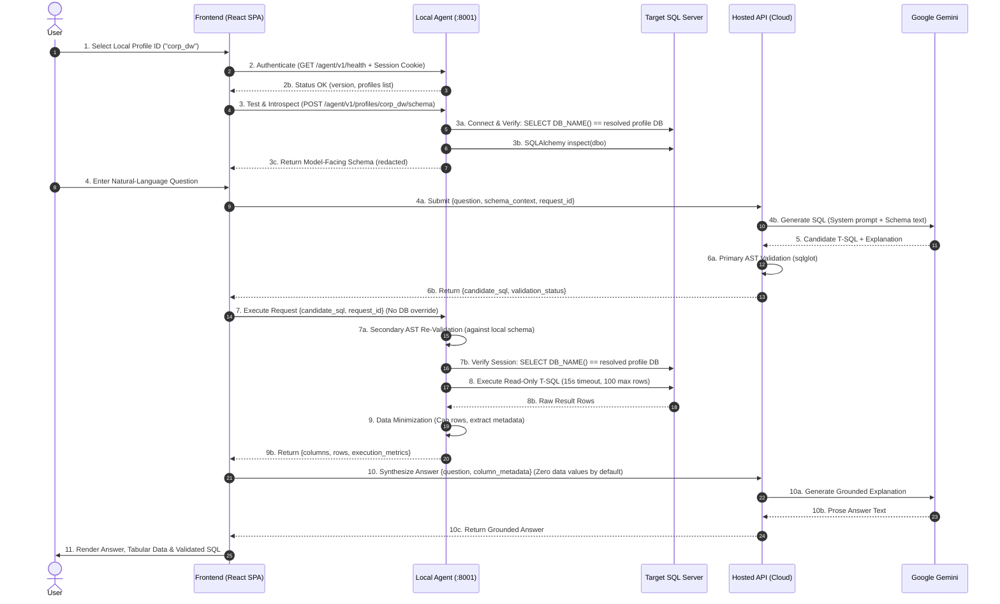
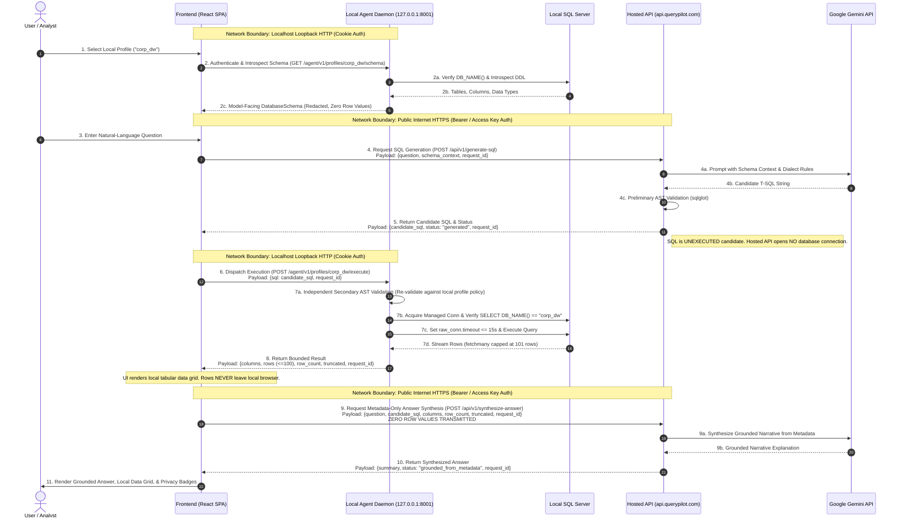

# QueryPilot Architecture & Local Agent Specification

**Version:** 2.12 (Hosted Workflow Integration Architecture & Contract Specification — Milestone F28-A7)  
**Status:** In Progress (Local-Agent Foundation, Execution Boundary, Dynamic Introspection, Bounded Query Execution, & Exception-Chain Privacy Implemented & Audited; Hosted Workflow Integration Architecture & Contract Specified; Implementation Deferred to Subsequent Phases)  
**Target Relational Engine:** Microsoft SQL Server (T-SQL) exclusively for MVP

---

## 1. Executive Summary & Original Goal

The founding product objective of QueryPilot is:

> *"An authorized user connects their own deployed database, QueryPilot discovers its schema, generates a read-only SQL query from a natural-language question, validates it, executes it against that exact database, and produces a grounded answer from the actual results."*

In the current implementation, QueryPilot operates as a single-database prototype bound to `GradeSense_Local` at the connection and configuration layers, while using a static GradeSense knowledge catalog. However, the core query reasoning pipeline—**SQL AST Validation** (`sqlglot`), **Deterministic Schema Formatting**, **SQLAlchemy Introspection**, and **Scalar Answer Grounding**—is already schema-agnostic.

To fulfill the original product goal while strictly protecting enterprise data privacy and private network isolation, the product decision is confirmed: **Option A: A Separate Local Agent**.

Under Option A:
- The **Hosted API** (or shared pipeline) orchestrates query generation and answer synthesis via Google Gemini.
- The **Local Agent** runs locally on the user's workstation or internal network, directly manages SQL Server credentials, introspects schemas, and executes approved, read-only SQL queries under driver-level timeouts and row bounds.
- **Database execution is strictly delegated to the Local Agent.** The Hosted API never receives database credentials, never touches the client's SQL Server port, and never executes database queries in local mode.

```
┌─────────────────────────────────────────────────────────────────────────────┐
│                               USER BROWSER                                  │
│                                                                             │
│   React 19 SPA (Local Agent Loopback: http://127.0.0.1:8001/app/)           │
│   - Natural Language Query Workspace                                        │
│   - Local Connection Profile Selector & Auth Status                         │
│   - Tabular Results & Grounded Explanation UI                               │
└───────────────────────┬───────────────────────────────┬─────────────────────┘
                        │                               │
       1. Question &    │              2. Authenticated │ 4. Local Execution
          Schema Context│                 RPC (Cookie)  │    Results / Rows
                        ▼                               ▼
┌───────────────────────────────┐     ┌───────────────────────────────────────┐
│     QUERYPILOT HOSTED API     │     │       QUERYPILOT LOCAL AGENT          │
│        (Cloud / Render)       │     │    (User LAN / localhost:8001)        │
│                               │     │                                       │
│ - Request Correlation         │     │ - Local Connection Profile Vault      │
│ - Schema-Grounded Text-to-SQL │     │ - Credentials Stored Locally (0600)   │
│ - AST Safety Verification     │     │ - Dynamic Schema Introspection        │
│ - Grounded Answer Synthesis   │     │ - Secondary AST Re-Validation         │
│ - (Never connects to DB)      │     │ - Session Verification: DB_NAME()     │
└───────────────┬───────────────┘     │ - Guarded Read-Only Execution         │
                │                     │ - Driver Timeout & 100-Row Ceiling    │
                │ Prompts &           └───────────────────┬───────────────────┘
                │ Redacted Schema                         │
                ▼                                         │ Read-Only T-SQL
┌───────────────────────────────┐                         ▼
│       GOOGLE GEMINI API       │     ┌───────────────────────────────────────┐
│     (gemini-3.8-flash)        │     │       TARGET SQL SERVER (MSSQL)       │
└───────────────────────────────┘     │  (localhost\SQLEXPRESS or Enterprise) │
                                      └───────────────────────────────────────┘
```

---

## 2. Current Architecture & Verified Coupling Findings

A source code audit of QueryPilot reveals the exact points of coupling across the codebase:

| Component | File Path & Symbols | Nature of Coupling | Architectural Remediation |
| :--- | :--- | :--- | :--- |
| **Connection Security** | `src/query_pilot/db/connection.py`<br>`ALLOWED_TARGET_DATABASE = "GradeSense_Local"` (L20)<br>`verify_database_context(conn, expected_db=...)` (L33-67) | Hardcoded security boundary rejecting any database other than `GradeSense_Local`. | Parameterize `expected_db` from the trusted connection profile. The underlying function signature *already* accepts `expected_db: str`; only callers and default were locked. |
| **Connection Factory** | `src/query_pilot/db/connection.py`<br>`create_db_engine()` (L69)<br>`get_connection()` (L104) | Uses global `DatabaseSettings` and defaults to `ALLOWED_TARGET_DATABASE`. | Accept explicit connection parameters or a scoped profile. |
| **Static Configuration** | `src/query_pilot/config.py`<br>`DatabaseSettings.DB_NAME = "GradeSense_Local"` (L34) | Single-tenant static `.env` configuration. | Support connection profiles while retaining `GradeSense_Local` as local development fallback. |
| **Read-Only Executor** | `src/query_pilot/db/executor.py`<br>`ReadOnlySQLExecutor.execute()` (L216) | Explicitly passes `expected_db=ALLOWED_TARGET_DATABASE`. | Pass `expected_db=self.settings.DB_NAME` or target profile database name. |
| **Introspector** | `src/query_pilot/db/introspection.py`<br>`introspect_raw()` (L104-105) | Calls `get_connection()` with default `expected_db`. | Pass target database name to connection context. Introspection logic itself is already 100% dynamic. |
| **Domain RAG** | `src/query_pilot/rag/retriever.py`<br>`DEFAULT_CATALOG_PATH` (L20)<br>`TABLE_ALIAS_MAP` (L38-84) | Statically loads education catalog `catalog.json` and maps colloquial terms to GradeSense tables (`Users`, `Students`, `Faculties`, etc.). | Make domain retriever optional (`retriever=None`). For custom databases, generator relies purely on schema context and column comments. |
| **AST Validator** | `src/query_pilot/sql/validator.py`<br>`SQLValidator(schema: DatabaseSchema)` (L47-66) | Resolves dynamically against `schema.tables` and `schema.database_name`. | **Dynamic-Ready.** Fully schema-agnostic. No changes required. |
| **Schema Formatter** | `src/query_pilot/sql/generation.py`<br>`format_schema_context(schema)` (L463-515) | Formats tables, columns, data types, primary keys, and foreign keys into Markdown. | **Dynamic-Ready.** Fully schema-agnostic. No changes required. |
| **Workflow State** | `src/query_pilot/graph/workflow.py`<br>`self._schema` (L285)<br>`self._engine` (L279) | Caches single schema and engine as instance attributes. | Decouple schema caching by `profile_id`; resolve target engine per execution. |
| **API Serving** | `src/query_pilot/api/app.py`<br>`get_runner()` (L45-51) | Singleton `QueryRunner` stored on `app.state`. | Resolve execution target per request or delegate execution to local agent. |

---

## 3. End-to-End Request & Data Flow (Option A)

The sequence diagram and 11-step execution flow below define the authoritative contract for a local-database query.



### Detailed Step-by-Step Breakdown

1. **Profile Selection (UI):** User selects an approved local profile ID (e.g. `"corp_dw"`) from a dropdown populated by the agent. The browser *never* provides connection strings, server hostnames, or expected database names.
2. **Local Agent Authentication (UI $\rightarrow$ Agent):** The browser authenticates to the Local Agent (`GET /agent/v1/health`) using a secure loopback session cookie (`qpt_session`) obtained via a secure one-time `POST` bootstrap exchange. The agent verifies that the `Host` header is loopback.
3. **Connection Verification & Schema Discovery (Agent $\rightarrow$ MSSQL):** The frontend requests schema introspection for the selected profile (`POST /agent/v1/profiles/{profile_id}/schema`). The Local Agent independently resolves the connection and database name from its local configuration, connects, verifies `SELECT DB_NAME()`, introspects tables/columns via SQLAlchemy, redacts sensitive columns (`SensitiveColumnPolicy`), and returns a sanitized `DatabaseSchema` JSON payload to the browser.
4. **Question & Schema Submission for SQL Generation (UI $\rightarrow$ Hosted API):** The user enters a question. The frontend forwards the question, sanitized `DatabaseSchema`, and `request_id` to the Hosted API (`POST /api/query/generate-sql`).
5. **LLM SQL Generation (Hosted API $\rightarrow$ Gemini):** The Hosted API constructs the prompt using `format_schema_context(schema)` and invokes Gemini 3.8 Flash. Gemini returns structured JSON containing candidate T-SQL, assumptions, and explanation.
6. **Primary AST Validation (Hosted API):** The Hosted API runs deterministic AST validation using `SQLValidator(schema).validate(candidate_sql)`. Mutating statements, multi-statements, unknown tables, and sensitive columns are rejected. Approved candidate SQL is returned to the frontend.
7. **Local Execution Delegation & Secondary Re-Validation (UI $\rightarrow$ Agent):** The frontend submits the validated candidate SQL to the Local Agent (`POST /agent/v1/profiles/{profile_id}/execute`). The payload contains strictly `{ "candidate_sql": "...", "request_id": "..." }`. Any client attempt to supply or override connection parameters or target database names is rejected with HTTP 400. The Local Agent **independently re-validates the SQL AST** against its local schema (defense-in-depth).
8. **Active DB Verification & Read-Only Execution (Agent $\rightarrow$ MSSQL):** The Local Agent opens a connection, executes `SELECT DB_NAME()` to verify session context against the trusted profile configuration, and executes the read-only T-SQL statement with driver timeouts (15s) and row-fetching limits (100 rows).
9. **Data Minimization & Redaction (Agent):** The Local Agent formats rows into JSON-safe records for the local frontend. By default, **zero database row values** leave the local machine.
10. **Grounded Answer Synthesis (UI $\rightarrow$ Hosted API $\rightarrow$ Gemini):** By default, the frontend sends only the question and column metadata (`{ "columns": [...], "row_count": N }`) to the Hosted API (`POST /api/query/synthesize-answer`). Zero database result values are sent by default. Only under explicit user opt-in are non-sensitive aggregate summaries forwarded.
11. **Presentation & Display (UI):** The UI renders tabular result records, grounded narrative answer, validation badges, execution latency, and (if enabled) the validated SQL query, clearly distinguishing local data from hosted model responses.

---

## 4. Component Responsibility Boundary

| Responsibility | Frontend (UI) | Hosted API (Cloud) | Local Agent (Localhost) | Gemini API | Target Database |
| :--- | :---: | :---: | :---: | :---: | :---: |
| **UI Interaction & Visualization** | **Owner** | - | - | - | - |
| **Credential Storage (Passwords/UIDs)**| - | - | **Owner (Local Disk 0600)** | - | - |
| **ODBC / TDS Database Connectivity** | - | - | **Owner** | - | Target |
| **Active DB Check (`SELECT DB_NAME()`)**| - | - | **Owner** | - | Target |
| **Dynamic Schema Introspection** | - | - | **Owner** | - | Target |
| **Sensitive Column Masking** | - | - | **Owner** | - | - |
| **Prompt Assembly & Dialect Guidance**| - | **Owner** | - | - | - |
| **Candidate Text-to-SQL Generation** | - | Coordinates | - | **Owner** | - |
| **AST SQL Safety Validation** | - | **Primary Validator** | **Secondary Gate (Defense)** | - | - |
| **Read-Only Database Execution** | - | - | **Owner** | - | Target |
| **Query Timeout & Row Limit Guards** | - | - | **Owner** | - | - |
| **Answer Synthesis & Grounding** | - | **Owner** | - | Secondary | - |

---

## 5. Local-Agent Authority, Confidentiality & Execution Envelopes

### 5.1 Clarifying Database Integrity, Query Authority & Data Confidentiality

To establish a sound security model, three distinct security properties must be separated:

1. **Database Integrity:**
   - *Goal:* Preventing unauthorized modifications, writes, schema alterations, or data corruption.
   - *Reality:* Read-only SQL prevents database modification **only to the extent enforced by database privileges and the execution boundary policy**. If the underlying database user has write privileges, relying on AST validation alone is insufficient. Therefore, the database user must be restricted at the database engine level (`db_datareader`), and the agent must enforce read-only session settings.
2. **Query Authority:**
   - *Goal:* Restricting which database operations, system functions, procedures, and tables a client is permitted to invoke.
   - *Reality:* Query authority is enforced via AST validation (`sqlglot`). It ensures that only `SELECT` expressions referencing approved tables and columns are parsed and executed, blocking administrative procedures (`xp_*`, `sp_*`) and multi-statement queries.
3. **Data Confidentiality:**
   - *Goal:* Ensuring that unauthorized observers or external services cannot read, infer, or exfiltrate sensitive data.
   - *Reality:* **Read-only SQL does NOT prevent sensitive data disclosure.** A syntactically valid, read-only `SELECT * FROM Customers` can exfiltrate entire databases. AST validation restricts the grammatical structure of queries, but **cannot judge the business sensitivity of data rows** unless explicit schema-level denylists and data-minimization boundaries are enforced.
   - **Conclusion:** AST validation alone does not prevent data exfiltration or arbitrary information leakage. Confidentiality requires least-privilege database user rights, sensitive-column masking at introspection, hard row-count boundaries, and a strict default policy of zero data transmission to external APIs.

### 5.2 Agent-Controlled Execution Target (Zero Browser Authorization Authority)

- **The browser has zero authority over connection targets:** The frontend may supply an approved `profile_id` (e.g. `"corp_dw"`), but cannot choose, provide, or override:
  - Database name (`database_name`)
  - Server hostname or IP address (`server`)
  - ODBC driver (`driver`)
  - Authentication method or credentials
- **Local Resolution:** The Local Agent resolves all connection parameters and the expected database name exclusively from its trusted configuration file (`~/.query_pilot/profiles.json`) on the local disk.
- **Strict Boundary Rejection:**
  - If a request attempts to supply connection override parameters (`server`, `db_name`, `user`), the agent immediately rejects the request with HTTP 400 Bad Request.
  - If a request references an unregistered `profile_id`, the agent returns HTTP 404 Profile Not Found.
  - At the execution boundary, the agent queries `SELECT DB_NAME()` on the live connection. If the active database does not strictly match the trusted profile configuration, execution is aborted and a `DatabaseSecurityError` is raised.
- **Local Enforcement of Schema & Sensitivity:** The profile's permitted schema, table whitelist, and sensitive-column policies are loaded from local configuration and enforced locally by the agent's secondary AST validator.

### 5.3 Execution Cost vs. Result Set Bounds & Resource Envelopes

A critical architectural distinction is made between **returned-row limits** and **query execution cost limits**:

```
┌─────────────────────────────────────────────────────────────────────────────┐
│                       RESOURCE PROTECTION ENVELOPES                         │
├──────────────────────────────────────┬──────────────────────────────────────┤
│  Query Execution Cost (DB Engine)    │    Returned Result Size (Network/UI) │
│  - Driver Timeout: 15 seconds        │    - Row Fetch Ceiling: 100 rows     │
│  - Poisoned Connection Invalidation  │    - Request Payload Cap: 64 KB      │
│  - Concurrency Semaphore: max 2      │    - Truncation Flag: truncated=True │
└──────────────────────────────────────┴──────────────────────────────────────┘
```

1. **Returned-Row Limits (Network & UI Memory Protection):**
   - *Threat:* A query returning 1,000,000 rows exhausts agent memory or crashes the browser UI.
   - *Enforcement:* The agent executes `cursor.fetchmany(101)`. If 101 rows are returned, the result is sliced to 100, `truncated = True` is flagged, and the cursor is immediately closed.
2. **Query Execution Cost Limits (Database Compute & Lock Protection):**
   - *Threat:* A query with unindexed Cartesian joins or table scans locks the SQL Server database and starves resources, even if it returns few rows.
   - *Enforcement:*
     - **Driver-Level Timeout:** Pyodbc cursor timeout is set to `timeout_seconds = 15`. If execution exceeds 15 seconds, the driver issues `cursor.cancel()`.
     - **Poisoned Connection Cleanup:** If a query times out or driver cancellation fails, the underlying connection is treated as **poisoned** and potentially unstable. The agent calls `connection.invalidate()` and closes the socket immediately; it is **never returned to the connection pool**.
3. **Request-Size Enforcement:** HTTP request bodies exceeding `64 KB` are rejected with HTTP 413 Payload Too Large before parsing.
4. **Concurrency Semaphore:** The Local Agent maintains an in-process semaphore (`asyncio.Semaphore(2)`). If more than 2 execution requests arrive simultaneously, excess requests are rejected immediately with HTTP 429 Too Many Requests.
5. **Fail-Closed Guarantee:** Any timeout, connection termination, or validation error fails closed; the agent returns an error response and **never** passes invalid or partial results to downstream synthesis.

---

## 6. Browser-Token Handling & Threat Model

### 6.1 Bootstrap-Token Provisioning & One-Time POST Exchange

To eliminate URL leakage, browser history caching, shoulder surfing, and referrer leakage, **bootstrap tokens are never transported via URL query strings**.

1. **Token Generation:** On launch, the Local Agent generates a cryptographically secure 256-bit bootstrap token via `secrets.token_hex(32)`.
2. **Storage & Console Output:**
   - The token is written to `~/.query_pilot/agent.token` with strict OS permissions (`0600` on POSIX, restricted user ACL on Windows).
   - The agent console displays:
     ```text
     ===============================================================
     QueryPilot Local Agent Ready
     Open UI:           http://127.0.0.1:8001/app/
     Bootstrap Token:   4f8b2d1...c9e0
     ===============================================================
     ```
   - Notice that the link printed to the terminal contains **no query parameters or secrets**.
3. **One-Time POST Exchange:**
   - The user opens `http://127.0.0.1:8001/app/` in their web browser.
   - The local frontend static shell displays an onboarding modal prompting the user for the bootstrap token.
   - The frontend issues an asynchronous HTTP POST request to the local agent:
     - **Endpoint:** `POST /agent/v1/auth/bootstrap`
     - **Headers:** `Content-Type: application/json`
     - **Body:** `{ "bootstrap_token": "<token_hex>" }`
   - The Local Agent verifies the token in constant time using `secrets.compare_digest`.
4. **Single-Use Consumption & Replay Prevention:**
   - Upon successful verification, the bootstrap token is **immediately consumed and invalidated** in server memory and wiped from disk (`agent.token` is deleted or securely zeroed).
   - Any subsequent attempt to reuse the consumed bootstrap token returns HTTP 401 Unauthorized.
5. **Logging & Telemetry Protection:**
   - **Bootstrap tokens and authentication request bodies must NEVER be written to access logs, application logs, console logs, traces, analytics, or error messages.**
   - HTTP server logging middleware specifically skips or redacts the request payload on all `/agent/v1/auth/*` endpoints.
6. **Cache-Control & Referrer Headers During Bootstrap:**
   - The bootstrap endpoint and the UI shell responses strictly enforce:
     ```http
     Cache-Control: no-store, no-cache, must-revalidate, max-age=0
     Pragma: no-cache
     Referrer-Policy: no-referrer
     ```
7. **Third-Party Asset Isolation:**
   - The bootstrap page is completely self-contained; it **does not load third-party scripts, external fonts (e.g. Google Fonts), external stylesheets, or analytics beacons**.
   - The page enforces a strict Content Security Policy (CSP):
     ```http
     Content-Security-Policy: default-src 'self'; script-src 'self'; style-src 'self'; font-src 'self'; connect-src 'self'; img-src 'self' data:; frame-ancestors 'none';
     ```
   - The page does not navigate to external destinations while handling credentials.

### 6.2 Session Security, Expiry, Logout & Revocation

1. **Session Cookie Issuance:**
   - Upon successful bootstrap token exchange via `POST /agent/v1/auth/bootstrap`, the agent responds with:
     ```http
     HTTP/1.1 200 OK
     Set-Cookie: qpt_session=<session_id>; HttpOnly; SameSite=Strict; Path=/
     ```
   - `Secure=False` is used because loopback HTTP (`127.0.0.1`) does not require or support TLS certificates in standard desktop environments; loopback packets never leave local machine memory.
   - **Protection against Direct JS Exposure:** Frontend JavaScript cannot read or inspect the session credential via `document.cookie`.
2. **Session Lifetime & Expiry:**
   - **Absolute Expiry:** Active sessions expire after a maximum duration of 12 hours.
   - **Inactivity Timeout:** Sessions expire after 1 hour of continuous inactivity.
3. **Explicit Logout:**
   - The user or UI can call `POST /agent/v1/auth/logout`.
   - The agent destroys the session state in memory and returns an expired `Set-Cookie` header (`Max-Age=0`).
4. **Token Rotation & Revocation:**
   - Executing `querypilot-agent --rotate-token` or calling `POST /agent/v1/auth/rotate-token` immediately invalidates **all active sessions** and issues a fresh bootstrap token.
   - Terminating the agent process destroys all in-memory sessions instantly.

### 6.3 Tri-Layer Defense-in-Depth Loopback Architecture

The relationship between loopback bindings, accepted Host headers, and supported frontend origins is structured as three distinct, non-redundant defense layers:

```
┌─────────────────────────────────────────────────────────────────────────────┐
│                    TRI-LAYER LOOPBACK DEFENSE ARCHITECTURE                  │
├─────────────────────────────────────────────────────────────────────────────┤
│ 1. Socket Binding Layer (OS Kernel)                                         │
│    - Binds strictly to 127.0.0.1:8001 (IPv4) and [::1]:8001 (IPv6).        │
│    - External network interfaces (LAN/WAN) reject incoming TCP packets.     │
├─────────────────────────────────────────────────────────────────────────────┤
│ 2. Host Header Validation Layer (HTTP Request Pre-Routing)                  │
│    - Validates request.headers.get("Host") before processing.               │
│    - Strictly accepts: 127.0.0.1:8001 and localhost:8001.                   │
│    - All other Host headers (e.g. rebind.evil.com) rejected with HTTP 400.  │
├─────────────────────────────────────────────────────────────────────────────┤
│ 3. Origin Header Validation Layer (Browser CORS / Preflight)                │
│    - Validates request.headers.get("Origin") on cross-origin requests.      │
│    - Approved origins: http://127.0.0.1:8001 and http://127.0.0.1:5173.    │
│    - External origins (e.g. https://evil.com) rejected with HTTP 403.       │
└─────────────────────────────────────────────────────────────────────────────┘
```

1. **Socket Binding Layer (Network Boundary):**
   - The Local Agent binds exclusively to loopback addresses (`127.0.0.1:8001` and `[::1]:8001`). Binding to `0.0.0.0` or public network adapters is explicitly blocked in application startup code.
   - The OS network stack ensures that packets arriving on physical Ethernet or Wi-Fi interfaces cannot reach these sockets.
2. **Host Header Validation Layer (DNS Rebinding Defense):**
   - Defends against browser-based DNS rebinding attacks where an external attacker controls a public DNS record (e.g. `rebind.attacker.com`) that resolves with a TTL of 0 to `127.0.0.1`.
   - Even if the browser sends TCP packets to `127.0.0.1:8001`, the request carries `Host: rebind.attacker.com`. The agent checks the Host header before routing and rejects the request with HTTP 400 Bad Request.
3. **Origin Header Validation Layer (Cross-Origin Defense):**
   - When a browser makes a cross-origin request or preflight, it attaches an `Origin` header that cannot be modified by JavaScript.
   - The agent strictly validates this header against allowed origins:
     - `http://127.0.0.1:8001` (primary supported mode: agent-hosted UI)
     - `http://127.0.0.1:5173` (local Vite development mode)
   - Any external web page attempting to invoke agent endpoints via browser `fetch()` is rejected with HTTP 403 Forbidden.

### 6.4 Cross-Site Request Forgery (CSRF) Protections

1. **SameSite=Strict Enforcement:** The session cookie is marked `SameSite=Strict`. Modern browsers will not attach the cookie to any cross-site request, preventing ordinary cross-site link navigation or form submission attacks.
2. **Mandatory Custom Header for State-Changing Requests:**
   - All state-changing endpoints (`POST /agent/v1/auth/bootstrap`, `POST /agent/v1/profiles/.../execute`, `POST /agent/v1/profiles/.../schema`, `POST /agent/v1/auth/logout`) require:
     - Header: `X-QueryPilot-Request: 1`
     - Header: `Content-Type: application/json`
   - **Browser Security Boundary:** External websites cannot send custom headers or `application/json` payloads without triggering a CORS preflight (`OPTIONS`). Because the agent rejects unapproved `Origin` values on preflight, foreign browser origins are blocked before executing any action.

### 6.5 Precise Threat Analysis: What Protections Reduce vs. What They Eliminate

Security mitigations must be accurately characterized; no single control eliminates all attack vectors:

| Threat Vector | Mechanism Implemented | What the Control Reduces | What the Control Does NOT Eliminate (Residual Risk) |
| :--- | :--- | :--- | :--- |
| **DNS Rebinding** | Host-Header Validation (`127.0.0.1:8001`, `localhost:8001`) | **Reduces** attacks by web browsers navigating to attacker-controlled domains resolving to `127.0.0.1`. | **Does not prevent** non-browser software or local scripts from sending arbitrary Host headers directly over TCP. |
| **Cross-Site Request Forgery (CSRF)** | `SameSite=Strict` cookie + mandatory `X-QueryPilot-Request` header | **Reduces** cross-origin browser requests from submitting unauthorized actions to loopback. | **Does not prevent** requests originating from within the same origin or via non-browser clients on the host. |
| **Mixed Content Blocking** | Agent-Hosted UI (`http://127.0.0.1:8001/app/`) | **Eliminates** browser HTTPS $\rightarrow$ HTTP mixed-content blocks and cross-origin CORS overhead. | **Does not eliminate** XSS risk within the frontend application. |
| **Same-Origin XSS** | CSP `default-src 'self'`, no inline scripts | **Reduces** the likelihood of script injection into the React application. | **Does not eliminate** impact if an XSS vulnerability exists. Malicious JS running in the UI origin can issue authenticated `fetch()` calls via the ambient session cookie. (Mitigated by secondary AST validation and least-privilege DB credentials). |
| **Co-Located OS User Software** | File permissions (`0600`), user-only ACLs | **Reduces** access by other users on a multi-user machine. | **Does not eliminate** access by other processes running as the **same OS user**, which have equal access to files and loopback sockets. |

---

## 7. Data Disclosure & Privacy Policy

### 7.1 Data Transmission Classification Table

| Data Classification Item | Stays Local (User Machine)? | Reaches Hosted API? | Reaches Gemini API? | Invariant & Handling Rule |
| :--- | :---: | :---: | :---: | :--- |
| **Raw DB Passwords & Usernames** | **YES** | **NEVER** | **NEVER** | Stored in local config (`0600`); never transmitted over network. |
| **Raw Connection Strings / Hostnames** | **YES** | **NEVER** | **NEVER** | Never leaves local agent memory. |
| **Bootstrap Token & Auth Payloads** | **YES** | **NEVER** | **NEVER** | Single-use POST body; omitted from all logs and traces. |
| **Internal Database & Schema Names** | Yes | Yes (Metadata) | Yes (Metadata) | Included in prompt as metadata context (`DATABASE NAME: {name}`). |
| **Table & Column Names** | Yes | Yes | Yes | Model-facing columns only; sensitive columns redacted. |
| **Schema Descriptions (`MS_Description`)** | Yes | Yes | Yes | Transmitted as context; sensitive keywords redacted. |
| **Sample Row Values in Schema** | **YES** | **NEVER** | **NEVER** | Schema introspection never samples row values. |
| **Natural Language Questions** | Yes | Yes | Yes | User input; sent to Gemini for SQL translation. |
| **Candidate SQL Statement** | Yes | Yes | Yes | Proposed by Gemini; validated by AST on both sides. |
| **Raw Query Execution Rowsets** | **YES** | **NEVER** | **NEVER** | Full database rows stay in browser/local agent memory. |
| **Derived Scalar Summaries & Aggregates**| **YES (Default)** | **RESTRICTED** | **RESTRICTED** | **Zero result values sent by default.** Sent only under strict opt-in. |
| **Execution Error Diagnostics** | Yes | Sanitized | Sanitized | Sanitized error codes (e.g. `UNKNOWN_COLUMN`); raw SQL/ODBC traces stripped. |
| **Final Answer Text & Latency Telemetry**| Yes | Yes | Yes | User-facing prose answer and performance token counts. |

### 7.2 Strict Data-Minimization & Hosted Disclosure Policy

1. **Default Policy: Zero Result Values to Hosted Model:**
   - By default, **no database result rows, cell values, or scalar numbers are transmitted to the Hosted API or Gemini**.
   - Answer synthesis operates strictly on column names and row count metadata:
     ```json
     {
       "status": "SUCCESS",
       "row_count": 42,
       "columns": ["department_name", "enrolled_count"]
     }
     ```
   - The model generates a structured confirmation (e.g., *"Found 42 matching departments for your query. Results are displayed in the table below."*) without observing private enterprise data.
2. **Aggregates and Filtered Results Treated as Potentially Sensitive:**
   - Mathematical aggregates (`COUNT`, `AVG`, `SUM`, `MIN`, `MAX`) and filtered query results are **potentially sensitive** and can reveal confidential individual data:
     - Example: `SELECT AVG(salary) FROM Employees WHERE title = 'CEO'` (or where a filter isolates a single person or tiny team) directly reveals private compensation.
     - Example: `SELECT COUNT(*) FROM Patients WHERE diagnosis = 'RareCondition' AND clinic_id = 2` reveals sensitive medical conditions.
   - Therefore, aggregates are **never** assumed to be safe or public by default.
3. **Group Size Thresholds are NOT a Guarantee of Anonymity:**
   - Requiring a minimum group size ($N \ge 5$) is merely a basic heuristic against trivial 1-row disclosures; **it is NOT, by itself, a guarantee of anonymity or differential privacy**.
   - Differencing attacks, quasi-identifiers (e.g. role + department + tenure), or background external knowledge can easily reconstruct individual records from aggregate metrics.
   - **No Unsupported Privacy Claims:** The QueryPilot MVP does **not** claim to provide formal differential privacy or mathematically certified k-anonymity.
4. **Explicit, User-Visible Opt-In Before Transmission:**
   - Before ANY result-derived values or aggregates can be forwarded to the Hosted API for answer synthesis, the user must explicitly enable an opt-in toggle in the UI:
     `[ ] Allow QueryPilot to send aggregated summary numbers to Google Gemini for narrative explanation`.
   - This setting is **strictly disabled by default**.
5. **Opt-In Does NOT Override Access Policies:**
   - Explicit user opt-in **does not override** sensitive-column restrictions (`SensitiveColumnPolicy`), denied tables, or database user permissions.
   - Even if the user enables opt-in:
     - Sensitive columns (`PasswordHash`, `SSN`, `SecretKey`, etc.) remain strictly masked and blocked by AST validation.
     - Raw rows and individual string names are **never** forwarded.
     - Unwhitelisted tables remain strictly blocked.
6. **Strict Data Leakage Invariants:**
   - Database credentials, raw connection strings, server hostnames, bootstrap tokens, and raw rowsets must **never** enter prompts, logs, traces, or error messages.
7. **User-Visible UI Disclosure Badges:**
   - The UI displays clear visual badges distinguishing locally computed results from external AI processing:
     - **Green Badge:** `[🔒 Computed Locally — Never Leaves This Machine]` displayed above the Tabular Results grid.
     - **Amber Badge:** `[☁️ Hosted AI Summary (Zero Database Rows Transmitted)]` or `[☁️ Hosted AI Summary (Aggregates Transmitted Under User Consent)]` displayed on the Answer card.

---

## 8. Trusted Connection Profiles & Execution Isolation

### 8.1 Connection Profile Structure
Stored in `~/.query_pilot/profiles.json` on the user's local machine:

```json
{
  "profiles": {
    "corp_dw": {
      "profile_id": "corp_dw",
      "display_name": "Corporate Data Warehouse",
      "server": "localhost\\SQLEXPRESS",
      "database_name": "GradeSense_Local",
      "schema_name": "dbo",
      "driver": "ODBC Driver 17 for SQL Server",
      "engine_type": "mssql",
      "use_trusted_connection": true,
      "timeout_seconds": 15,
      "max_row_limit": 100
    }
  },
  "default_profile_id": "corp_dw"
}
```

### 8.2 Profile Authorization & Invariant Enforcement

1. **Agent-Controlled Execution Target:** The browser supplies only `profile_id`. The Local Agent resolves server, port, credentials, and `expected_db` exclusively from local disk.
2. **Strict Loopback Target Boundary:** Server targets must point to the local machine (`localhost`, `127.0.0.1`, `[::1]`, `.\INSTANCE`, `localhost\INSTANCE`). Arbitrary remote database endpoints are forbidden.
3. **Windows Integrated Authentication Only:** Password persistence and cleartext credential parameters (`user`, `password`, `token`) are recursively rejected by security validation (`extra = "forbid"`).
4. **Replacement of `ALLOWED_TARGET_DATABASE`:**
   - When a connection is established for profile `P`, the Local Agent executes:
     ```sql
     SELECT DB_NAME();
     ```
   - If the returned database name does not strictly match `P.database_name` (case-insensitive, trimmed), the connection is terminated immediately and a fatal `DatabaseSecurityError` is raised.
   - Browser requests attempting to pass `expected_db` are rejected with HTTP 400.
5. **Decoupled 5-Stage Onboarding & Execution Flow:**
   - Stage 1: Validation (`POST /agent/v1/profiles/validate-config`) — 100% offline regex and syntax check.
   - Stage 2: Persistence (`POST /agent/v1/profiles`) — Saves to `~/.query_pilot/profiles.json` under `.lock`. Does not prove reachability.
   - Stage 3: Explicit Connection Test (`POST /agent/v1/profiles/{id}/test-connection`) — Temporary `NullPool` engine tests `SELECT DB_NAME()`. Disposed immediately.
   - Stage 4: Selection & Introspection (`GET /agent/v1/profiles/{id}/schema`) — Discovers tables and redacts sensitive columns.
   - Stage 5: Execution (`POST /agent/v1/profiles/{id}/execute`) — Read-only AST validation and bounded local execution.

### 8.3 Scoping & Cache Invalidation

- **Engine Isolation:** The Local Agent maintains an in-memory dictionary of SQLAlchemy engines:
  ```python
  self._engines: Dict[str, Engine] = {}
  ```
  Engines are keyed strictly by `profile_id`. A connection for Profile A never shares or uses the connection pool of Profile B.
- **Schema Cache TTL:** Model-facing schemas are cached in memory keyed by `profile_id` with a 1-hour TTL.
- **Revocation & Cleanup:** If a profile is deleted from `profiles.json`, the agent disposes of the corresponding SQLAlchemy engine pool (`engine.dispose()`) and purges its schema cache. Subsequent requests for that profile fail closed with HTTP 404 Profile Not Found.

---

## 9. Refined Implementation Dependency Order

```
[Phase 1: Architecture & Security Design (Docs Only)]
                     ↓
[Phase 2: Connection Profile & Execution Target Abstractions]
                     ↓
[Phase 3: Dynamic Schema Prompting & Decoupled Domain Guidance]
                     ↓
[Phase 4: Shared LangGraph Workflow Integration (Mocked Target)]
                     ↓
[Phase 5: QueryPilot Local Agent Standalone Service]
                     ↓
[Phase 6: Frontend Integration & Agent-Hosted UI Mode]
                     ↓
[Phase 7: Offline Security & Cross-Profile Regression Suite]
                     ↓
[Phase 8: Authorized Local SQL Server Integration Verification]
                     ↓
[Phase 9: Cloud-Mode Pre-Configured Database Profiles (Future)]
```

### Detailed Dependencies:
1. **Phase 1: Architecture & Security Design** *(Current Task)*: Establish authoritative contracts, threat model, confidentiality definitions, and testable security envelopes.
2. **Phase 2: Connection Profile & Execution Target Abstractions**: Create `ConnectionProfile` and `ExecutionTarget` protocol in `src/query_pilot/db/target.py` with mock target implementations. Parameterize `verify_database_context(conn, expected_db=...)` in `connection.py` and `executor.py`.
3. **Phase 3: Dynamic Schema Prompting & Decoupled Domain Guidance**: Update `GeminiSQLGenerator` to operate with `retriever=None`. Verify that prompts for arbitrary schemas contain zero GradeSense rules.
4. **Phase 4: Shared Workflow Integration**: Refactor `QueryPilotWorkflow` to accept an `ExecutionTarget` dependency. Bounded retry and self-correction loops remain identical.
5. **Phase 5: Local Agent Standalone Service**: Build `query_pilot_agent` with FastAPI, loopback binding, session cookie auth, Host header validation, and secondary AST validation.
6. **Phase 6: Frontend Integration**: Update React UI to support Local Agent mode (`http://127.0.0.1:8001/app/`), profile dropdown, and privacy disclosure badges.
7. **Phase 7: Offline Security & Cross-Profile Regression Suite**: Execute full offline test suite proving profile isolation, AST rejection, token enforcement, poisoned connection teardown, and active DB verification without network calls.
8. **Phase 8: Separately Authorized Real-Database Verification**: Run end-to-end integration tests against local SQL Server `GradeSense_Local` under explicit user approval.
9. **Phase 9: Cloud-Mode Multi-Tenant Architecture**: Design and implement server-side cloud database profiles for hosted deployments (deferred post-MVP).

---

## 10. Strengthened Security Acceptance Criteria

Security properties are divided into **automated behavior tests** and **manual verification checks**:

### 10.1 Automated Behavior Tests

1. **Authentication & Token Lifecycle:**
   - Request to `/agent/v1/health` without session cookie returns HTTP 401 Unauthorized.
   - Successful bootstrap exchange via `POST /agent/v1/auth/bootstrap` sets `HttpOnly`, `SameSite=Strict` cookie and returns HTTP 200.
   - Replay attempt of consumed bootstrap token returns HTTP 401 Unauthorized.
   - Request to `/agent/v1/auth/bootstrap` with GET returns HTTP 405 Method Not Allowed.
   - Verification that bootstrap token payload is absent from server logs, traces, and error outputs.
   - Expired or invalid session cookie returns HTTP 401.
   - Calling `/agent/v1/auth/logout` invalidates session cookie immediately.
   - Rotating token via CLI invalidates previous session cookies immediately.
2. **Boundary & Origin Defense:**
   - Request with `Host: evil.com` returns HTTP 400 Bad Request.
   - Request with `Origin: https://malicious.com` returns HTTP 403 Forbidden.
   - State-changing `POST` request missing `X-QueryPilot-Request` header returns HTTP 400/403.
   - Client request attempting to pass `expected_db` or connection credentials returns HTTP 400.
   - Responses from `/agent/v1/auth/*` and `/app/` include `Cache-Control: no-store` and `Referrer-Policy: no-referrer`.
3. **AST Rejection of Disallowed Tables & Sensitive Columns:**
   - Candidate SQL `DROP TABLE Students;` returns HTTP 422 `FORBIDDEN_OPERATION`.
   - Candidate SQL `SELECT * FROM sys.tables;` returns HTTP 422 `UNKNOWN_TABLE`.
   - Candidate SQL `SELECT PasswordHash FROM Users;` returns HTTP 422 `SENSITIVE_COLUMN`.
   - Candidate SQL with multi-statements `SELECT 1; SELECT 2;` returns HTTP 422 `MULTI_STATEMENT`.
4. **Active Database Mismatch Rejection:**
   - Mocked connection returning `DB_NAME() == "master"` when profile expects `"corp_dw"` triggers immediate `DatabaseSecurityError` and connection termination.
5. **Resource Protections & Poisoned Connection Disposal:**
   - Query running >15s triggers `QueryTimeoutError`, calls `cursor.cancel()`, and asserts that the connection is invalidated and discarded from the pool.
   - Query returning 200 rows is truncated to 100 with `truncated = True`.
   - Request body >64KB returns HTTP 413 Payload Too Large.
   - Exceeding 2 concurrent executions returns HTTP 429 Too Many Requests.
6. **Data Disclosure & Privacy Gate:**
   - By default, synthesis request payload is verified to contain **zero** cell values from query execution.
   - Even under user opt-in, queries touching sensitive columns (`PasswordHash`) assert that values are never transmitted.
   - Prompts sent to Gemini, server logs, and frontend responses are asserted free of connection strings, passwords, server hostnames, and sensitive column names.
7. **Non-Fabrication Gate:**
   - When database execution fails or is canceled, `AnswerSynthesisService` asserts that no success answer is produced (`grounded_answer is None`).

### 10.2 Manual Verification Properties

1. **Database User Least-Privilege Verification:**
   - Inspect SQL Server user properties in SSMS to confirm user belongs only to `db_datareader` role with no `db_datawriter` or `db_owner` permissions.
2. **Token File ACL Verification:**
   - Verify on Windows (`icacls ~/.query_pilot/agent.token`) or Linux (`ls -l`) that only the running user possesses read/write permissions (`0600`).
3. **Audit Log Inspection:**
   - Confirm that local agent execution logs record timestamps, profile IDs, query hashes, row counts, and latency, without writing raw row content, credentials, or bootstrap tokens to disk.

---

## 11. Open Decisions, Residual Risks & Recommended Defaults

| Decision / Risk Area | Options Considered | Recommended Default | Rationale |
| :--- | :--- | :--- | :--- |
| **UI Serving Mode** | A) Agent-hosted UI (`http://127.0.0.1:8001/app/`)<br>B) Hosted HTTPS UI talking to loopback HTTP | **A) Agent-hosted UI** | Completely eliminates browser Mixed Content blocking and cross-origin token transmission. |
| **Local Agent Packaging** | A) Standalone CLI module (`python -m query_pilot_agent`)<br>B) Compiled binary (PyInstaller)<br>C) Docker container | **A) Standalone CLI module** | Lowest developer friction; directly utilizes the user's existing Python venv, pyodbc, and system ODBC drivers on Windows. |
| **Default Result Disclosure** | A) Forward scalar aggregates automatically<br>B) Forward zero result values by default | **B) Zero result values by default** | Eliminates accidental disclosure of sensitive individual data through single-entity aggregates. |
| **Same-Origin XSS Residual Risk** | Malicious script in the UI could issue authorized requests via the `HttpOnly` session cookie. | **Accept residual risk; mitigate with strict CSP, secondary AST validation & least-privilege DB role** | Secondary AST validation guarantees that even under XSS, an attacker cannot execute mutating statements or query unwhitelisted tables. |
| **Dialect Expansion** | A) Implement PostgreSQL / MySQL now<br>B) Lock strictly to SQL Server (T-SQL) for MVP | **B) Strictly SQL Server for MVP** | Keeps the verification surface bounded and aligns with existing verified project dependencies. |

---

## 12. Implementation Status: Implemented Foundation vs. Planned Local Agent

### 12.1 Implemented Foundation (Phases 1–3)

The following components are implemented, tested, and active in the Python codebase:

1. **Connection Profile Specification (`src/query_pilot/db/profile.py`):**
   - `ConnectionProfile`: Strict, validated Pydantic model enforcing driver names (`ODBC Driver 17/18 for SQL Server`), connection target parameters, Windows Trusted Authentication vs. SQL Authentication rules, and optional table/schema whitelisting.
   - Resource Ceilings: Hard global limits enforced on profiles (`GLOBAL_MAX_TIMEOUT_SECONDS = 15`, `GLOBAL_MAX_ROW_LIMIT = 100`).
   - Sensitive Column Policies: Integration with canonical sensitive columns (`credit_card`, `ssn`, `password`, `token`, etc.) plus custom per-profile sensitive column denylists.
   - Profile Store (`ProfileStore`): In-memory and file-based store with explicit profile registration and fail-closed resolution (strictly raises `UnknownProfileError` without implicit fallback to `GradeSense_Local` or other databases), path traversal rejection, and file permission safety.
   - Client Override Defense (`FORBIDDEN_CLIENT_OVERRIDE_KEYS`, `ConnectionTargetOverrideError`): Recursive rejection of any client-supplied parameters attempting to dictate database names, servers, credentials, timeouts, or row bounds.

2. **Profile Connection Factory (`src/query_pilot/db/factory.py`):**
   - `ProfileConnectionFactory`: Centralized connection boundary producing frozen `ProfileEngineConfiguration` objects.
   - Strict Profile Isolation: Multiple profiles resolve completely independently with zero cross-tenant state leakage.
   - Derived Expected Database: `expected_db` is strictly derived from the trusted profile's `database_name` attribute; client requests can never inject or alter target databases.
   - Engine Instantiation & Lazy Connectivity: `factory.create_engine()` instantiates SQLAlchemy engines lazily with configured driver timeouts and connection pinging without opening network connections.
   - Session Verification Boundary: `factory.get_connection()` executes `SELECT DB_NAME()` on acquired connections and immediately raises `DatabaseSecurityError` if the active database does not match `expected_db`.

3. **Core Engine Construction Helper (`src/query_pilot/db/connection.py`):**
   - `create_profile_db_engine(profile)`: Factory function creating SQLAlchemy engines directly from validated `ConnectionProfile` objects, clamping timeouts to `GLOBAL_MAX_TIMEOUT_SECONDS` (15s).

4. **Profile Execution Boundary Contract (`src/query_pilot/db/profile_executor.py`):**
   - `ProfileExecutionBoundary` (alias `ProfileQueryExecutor`): Secure execution adapter accepting trusted, pre-resolved profile configuration.
   - Pre-Execution SQL Validation: Enforces mandatory AST validation against model-facing schema and sensitive-column policies prior to any database access.
   - Allowlist Table Enforcement: Automatically restricts SQL table references to the profile's `allowed_tables` whitelist.
   - Additive Sensitive Column Policies: Combines canonical default denylists with profile-specific sensitive columns; canonical defaults can never be weakened.
   - Resource Limit Separation: Driver connection-establishment timeout (`connect_args["timeout"]`) is cleanly separated from SQL statement execution timeout (`raw_conn.timeout` and `execution_options(timeout=...)`).
   - Bounded Result Fetching: Enforces cursor-level fetch ceilings (`fetchmany(max_row_limit + 1)`) strictly clamped <= 100 rows, safely detecting truncation without buffering unbounded rows in memory.
   - Session Identity Verification: Executes `SELECT DB_NAME()` on acquired connections and immediately closes connections on mismatch.
   - Sanitized Error Messages: Strips credentials, connection strings, and raw DBAPI tracebacks from error reporting.

5. **Profile-Aware Dynamic Schema Introspection (`src/query_pilot/db/profile_introspector.py`):**
   - `ProfileDatabaseIntrospector` (alias `ProfileSchemaIntrospector`): Profile-governed schema introspector accepting trusted `ConnectionProfile` or immutable `ProfileEngineConfiguration`.
   - Trusted Database Identity: Derives `expected_db` strictly from trusted profile configuration; verifies runtime session context (`SELECT DB_NAME()`) and immediately raises `DatabaseSecurityError` if mismatched.
   - Client Override Defense: Recursively checks untrusted client request payloads and rejects attempts to override connection targets, credentials, driver settings, or schemas (`ConnectionTargetOverrideError`).
   - Profile-Configured Schema: Strictly inspects the configured schema (`profile.schema_name` or defaults to `dbo`); rejects caller attempts to override schema boundaries.
   - Table Allowlist Filtering: Restricts introspection discovery to `profile.allowed_tables`. Excluded tables are never surfaced to `DatabaseSchema`.
   - Foreign-Key Allowlist Filtering: Foreign keys pointing to unallowed tables are safely omitted so that downstream LLM generation cannot hallucinate or generate invalid cross-table `JOIN`s against forbidden tables.
   - Model-Facing Sensitive Column Redaction: Implements `introspect_model_facing()` using additive `SensitiveColumnPolicy` (canonical defaults + additive profile denylists) to produce `DatabaseSchema(is_model_facing=True)` safe for LLM context generation.
   - Profile Isolation: Each introspection call is bound strictly to the specific profile's verified connection; no cross-profile schema caching is performed, preventing cross-tenant leakage.
   - Resource Cleanup & Sanitization: Connections are guaranteed to close in `finally:` blocks; all error messages strip connection strings, passwords, and raw driver tracebacks.

6. **Local-Agent Daemon & Authentication Foundation (`src/query_pilot/agent/`):**
   - Distinct Local-Agent Module (`create_agent_app`): Standalone FastAPI service running strictly on loopback (`127.0.0.1:8001`, `::1`); non-loopback bind hosts fail closed (`validate_bind_host`).
   - Authentication Lifecycle (`src/query_pilot/agent/auth.py`):
     - Single-Use Bootstrap Token (`POST /agent/v1/auth/bootstrap`): Transports 256-bit token in JSON body, verifies using constant-time comparison (`secrets.compare_digest`), immediately invalidates in memory and unlinks token file from disk.
     - Token Provisioning (`BootstrapTokenManager._write_token_file`):
       - Fail-Closed Windows ACL Hardening: Executes `icacls.exe` with `/inheritance:r /grant:r *<user>:(R,W)`. Treats any non-zero exit code, timeout (5.0s ceiling), or missing executable (`FileNotFoundError`) as a provisioning failure, raising `BootstrapTokenProvisioningError`. Unverified token files are wiped from disk, the in-memory token is cleared, and internal state is reset to unprovisioned (`self._token = None`, `self._is_consumed = False`).
       - Symlink & Reparse-Point Protection: Hardened file-creation defenses reject pre-existing symlinks or Windows reparse points (`path.is_symlink()` / `os.path.islink()`), refusing to follow links or overwrite external files. On POSIX platforms, writes use low-level `os.open(..., os.O_WRONLY | os.O_CREAT | os.O_EXCL | os.O_NOFOLLOW, 0o600)` to eliminate symlink traversal races. Existing regular files are safely unlinked prior to creation. File cleanup (`_wipe_token_file`) directly unlinks symlinks without following links.
       - Platform Limitations: On Windows, native atomic creation flags equivalent to `O_NOFOLLOW | O_EXCL` are not exposed directly via Python's standard library `os.open` without win32 ctypes/C extensions; file-level TOCTOU mitigation relies on pre-creation link checks, exclusive replacement of regular files, post-creation attribute verification, and fail-closed cleanup.
     - Session Management: Ambient `HttpOnly; SameSite=Strict; Path=/` session cookie (`qpt_session`) with 1-hour idle timeout and 12-hour absolute lifetime.
     - Logout & Token Rotation (`POST /agent/v1/auth/logout`, `POST /agent/v1/auth/rotate-token`): Destroys session state, clears cookie, and invalidates all active sessions.
     - Logging Protection: Tokens, cookies, authentication payloads, and credentials are never logged.
   - Browser & Origin Protections (`src/query_pilot/agent/middleware.py`):
     - Host-Header Validation: Mitigates DNS rebinding attacks by rejecting unapproved Host headers with HTTP 400 (`127.0.0.1:8001`, `localhost:8001`, `[::1]:8001` permitted).
     - Origin-Header Validation: In packaged mode, permits only loopback agent origins (`http://127.0.0.1:8001`). Vite development origin (`http://127.0.0.1:5173`) requires explicit `allow_dev_origin=True`. Foreign origins are rejected with HTTP 403.
     - Custom Header Defense: State-changing requests (`POST`) require `X-QueryPilot-Request: 1` header.
     - Hardened Security Headers: Injects `Cache-Control: no-store...`, `Pragma: no-cache`, `Referrer-Policy: no-referrer`, and strict CSP (`default-src 'self'`).
   - Profile Discovery, Schema Introspection, & Guarded Execution:
     - `GET /agent/v1/profiles`: Returns safe, redacted profile summaries with zero credentials, passwords, connection strings, or server hostnames.
     - `GET /agent/v1/profiles/{profile_id}/schema`: Model-facing dynamic schema introspection enforcing table allowlists, sensitive-column redaction, and runtime `SELECT DB_NAME()` session verification. Unknown profiles fail closed with HTTP 404 (never falls back to `GradeSense_Local`).
     - `POST /agent/v1/profiles/{profile_id}/execute`: Safe, bounded query execution against approved connection profiles.
       - Strict Pipeline Execution Order: 1. Cookie authentication & session verification -> 2. Trusted profile resolution (`ProfileStore`) -> 3. Active schema resolution / verification -> 4. Pre-execution SQL AST validation (blocking mutating statements, multi-statements, unlisted tables, sensitive columns, invalid identifiers) -> 5. Managed connection acquisition from `AgentEngineManager` -> 6. Runtime session verification (`SELECT DB_NAME() == expected_db`) -> 7. Driver-level execution timeout enforcement (`raw_conn.timeout = effective_timeout`) -> 8. Bounded cursor fetch (`fetchmany(effective_rows + 1)`) -> 9. JSON-safe row formatting -> 10. Deterministic resource cleanup in `finally:` blocks.
       - Dedicated Typed Contracts (`extra="forbid"`): `ExecuteQueryRequest` (forbidding database, server, timeout, row limits, or credential overrides) and `ExecuteQueryResponse` (columns, rows, row_count, truncated, execution_time_ms, request_id).
       - Hard Resource Ceilings: Hard global execution timeout ceiling (<= 15s) and row fetch ceiling (<= 100 rows). Profile-configured limits can tighten but never exceed these global ceilings.
       - Memory Safety via Bounded Fetch: Fetches at most `effective_rows + 1` from the DBAPI cursor, detecting truncation without buffering unbounded result sets in memory.
       - Sanitized Error Disclosures: Strips passwords, connection strings, server hostnames, raw DBAPI driver errors, and stack traces from API responses and logs.
       - Fail-Closed Timeout Enforcement: If hard driver-level query timeout cannot be set on the DBAPI connection, execution immediately fails closed with HTTP 500 without executing user SQL.
   - Resource Ceilings & Concurrency Limit:
     - 64 KB request body ceiling (`StreamingPayloadSizeMiddleware`, returns HTTP 413).
     - In-process concurrency ceiling of 2 requests (`ConcurrencyGuardMiddleware`, returns HTTP 429 `CONCURRENCY_LIMIT_EXCEEDED`). Deterministically verified with offline concurrency tests verifying request saturation and immediate permit release across normal HTTP responses, downstream route exceptions, and client ASGI request cancellations.
   - Engine Lifecycle & Deterministic Disposal:
     - `AgentEngineManager` tracks owned engine pools and deterministically disposes them on application shutdown (`engine.dispose()`), while preserving caller-owned mock engines.

7. **Automated Offline Test Suites (`tests/test_profile.py`, `tests/test_factory.py`, `tests/test_profile_executor.py`, `tests/test_profile_introspector.py`, `tests/test_agent_daemon.py`):**
   - 207 automated unit tests verifying profile validation, serialization, credential masking, client override rejection, profile isolation, resource ceiling enforcement, runtime session verification, SQL validation pre-execution blocking, table allowlists, driver vs statement timeout separation, bounded row fetching, table allowlist filtering, foreign key pruning, model-facing redaction, loopback binding validation, single-use bootstrap tokens, session expiry, Host/Origin allowlists, engine disposal, request size limits, fail-closed Windows ACL provisioning, symlink/reparse-point rejection, concurrency permit lifecycle (saturation, exception release, ASGI cancellation release), and query execution RPC boundaries (success path, authentication, header validation, client override rejection, mutation/multi-statement blocking, identity mismatch, driver timeout enforcement, bounded fetch, error sanitization, and cross-profile schema isolation).

> [!IMPORTANT]
> **Current Integration State & Migration Boundaries:**
> - The local agent daemon (`src/query_pilot/agent/`) now supports authenticated profile discovery (`GET /agent/v1/profiles`), dynamic schema introspection (`GET /agent/v1/profiles/{id}/schema`), and safe, bounded read-only query execution (`POST /agent/v1/profiles/{id}/execute`) on loopback.
> - The production workflow (`src/query_pilot/graph/workflow.py`), sequential pipeline (`src/query_pilot/pipeline.py`), schema introspector (`src/query_pilot/db/introspection.py`), legacy executor (`src/query_pilot/db/executor.py`), and hosted FastAPI routes (`src/query_pilot/api/app.py`) **continue to run strictly on the legacy fixed-database `GradeSense_Local` connection path**.
> - **The hosted SQL-generation and answer-synthesis flow is not yet integrated with the local agent execution endpoint.**
> - **The React frontend is not yet integrated with the local agent daemon.**
> - **No live customer databases or external services have been contacted.** All verification remains strictly offline using mocked engines, DBAPI connections, and schemas.
> - Arbitrary-database end-to-end querying is not yet complete. Full workflow integration will occur in subsequent phases (Phase 7–8).
> - **Schema Model Note & Limitations:** The downstream `DatabaseSchema` model (`src/query_pilot/db/models.py`) is keyed by `database_name: str` and does not carry a `profile_id` field. To prevent cross-tenant state leakage, `ProfileDatabaseIntrospector` intentionally avoids cross-profile caching entirely; each introspection call is cleanly bound to the specific profile's verified connection.

### 12.2 Component Capability & Readiness Matrix

The table below provides an authoritative, audit-verified classification of every subsystem in QueryPilot across four distinct capability statuses:
1. **Implemented and tested offline:** Fully implemented in the repository, verified through automated offline unit/mock test suites.
2. **Implemented but not verified against a live database:** Fully implemented in code, but live driver/network interaction with an external or multi-tenant database is unverified in CI due to offline testing constraints.
3. **Proposed, not implemented:** Architecturally specified and scheduled for subsequent implementation phases; no production code exists yet.
4. **Deferred:** Explicitly out of scope for the current MVP milestone.

| Subsystem / Component | Current Implementation Artifacts | Capability Status | Notes & Constraints |
| :--- | :--- | :---: | :--- |
| **Connection Profile Specification** | `src/query_pilot/db/profile.py`<br>`ConnectionProfile`, `ProfileStore` | **Implemented and tested offline** | 207 automated tests; clamps timeout <= 15s, rows <= 100, enforces table allowlists and sensitive column policies. |
| **Profile Connection Factory** | `src/query_pilot/db/factory.py`<br>`ProfileConnectionFactory` | **Implemented and tested offline** | Derives expected database strictly from profile; zero cross-profile caching. |
| **Profile Execution Boundary** | `src/query_pilot/db/profile_executor.py`<br>`ProfileExecutionBoundary` | **Implemented and tested offline** | AST validation pre-execution; DB identity check; driver timeout setting; bounded fetch (`fetchmany(101)`); sanitized errors (`from None`). |
| **Driver Timeout on Live SQL Server** | `src/query_pilot/db/profile_executor.py:L313` | **Implemented but not verified against a live database** | `raw_conn.timeout` mechanism verified via mock DBAPI; live pyodbc / ODBC Driver 17/18 socket behavior requires live database verification. |
| **Profile Schema Introspector** | `src/query_pilot/db/profile_introspector.py`<br>`ProfileDatabaseIntrospector` | **Implemented and tested offline** | Model-facing schema redaction; table allowlists; foreign key pruning; session verification. |
| **Local Agent Daemon & Auth** | `src/query_pilot/agent/`<br>`create_agent_app`, `auth.py`, `middleware.py` | **Implemented and tested offline** | Loopback binding; single-use bootstrap tokens; ACL hardening; session cookies; Host/Origin validation; concurrency & body ceilings. |
| **Local Agent Execute Endpoint** | `src/query_pilot/agent/app.py`<br>`POST /agent/v1/profiles/{id}/execute` | **Implemented and tested offline** | Dedicated Pydantic contracts (`extra="forbid"`); AST validation; driver timeout; bounded fetch; 14 integration tests in `test_agent_daemon.py`. |
| **Legacy Production Workflow** | `src/query_pilot/graph/workflow.py`<br>`src/query_pilot/pipeline.py` | **Implemented and tested offline** | Monolithic 5-node graph bound strictly to fixed `GradeSense_Local` database. Unchanged in this milestone. |
| **Legacy Hosted API** | `src/query_pilot/api/app.py`<br>`POST /query` | **Implemented and tested offline** | Runs legacy synchronous `QueryRunner` against `GradeSense_Local`. Unchanged in this milestone. |
| **Proposed Hosted SQL Generation** | `POST /api/v1/generate-sql` | **Proposed, not implemented** | Specified in Section 13; decouples generation from database execution. |
| **Proposed Hosted Answer Synthesis**| `POST /api/v1/synthesize-answer` | **Proposed, not implemented** | Specified in Section 13; metadata-only synthesis (zero row values). |
| **Frontend Local Agent Integration** | `frontend/src/` | **Proposed, not implemented** | Currently only talks to `/api/query`; local agent profile selector and loopback execution handoff scheduled for Phase 7.2–7.3. |
| **Multi-Dialect Support (Postgres/MySQL)**| N/A | **Deferred** | Out of scope for MVP; architecture remains locked to Microsoft SQL Server (T-SQL). |
| **Raw Row Cloud Disclosure Opt-In** | N/A | **Deferred** | Explicitly out of scope; default synthesis uses metadata only. Any future disclosure requires distinct reviewed capability. |

---

## 13. Hosted Workflow Integration Architecture & Contract (Milestone F28-A7 Specification)

### 13.1 Grounded Architecture Findings & Coupling Inventory

A rigorous audit of the active QueryPilot codebase establishes the concrete technical boundaries between the legacy fixed-database workflow and the newly developed local-agent execution infrastructure:

1. **Monolithic Hosted Execution (`src/query_pilot/api/app.py` & `src/query_pilot/runner.py`):**
   - The existing hosted endpoint `POST /query` delegates directly to `QueryRunner.run()`.
   - `QueryRunner` instantiates and executes the compiled LangGraph workflow (`QueryPilotWorkflow`).
   - Coupling: `QueryRunner` requires a live database connection engine (`create_db_engine()`) bound to `GradeSense_Local`. It cannot currently generate SQL without attempting to execute it against `GradeSense_Local`.
2. **Monolithic LangGraph Pipeline (`src/query_pilot/graph/workflow.py`):**
   - The compiled `StateGraph` combines schema introspection (`acquire_schema`), LLM generation (`generate_sql`), AST validation (`validate_sql`), database execution (`execute_sql`), and answer synthesis (`present_result`) into a single synchronous invocation.
   - Coupling: Node `execute_sql` invokes `execute_read_only(conn, ...)` on `self._engine`. The graph state (`QueryPilotState`) expects execution rows to be present before transitioning to answer synthesis.
3. **Standalone Local Agent Daemon (`src/query_pilot/agent/app.py`):**
   - Implements authenticated profile discovery (`GET /agent/v1/profiles`), dynamic schema introspection (`GET /agent/v1/profiles/{id}/schema`), and bounded query execution (`POST /agent/v1/profiles/{id}/execute`).
   - Coupling Status: Completely decoupled from `GradeSense_Local` and cloud services; operates strictly on loopback (`http://127.0.0.1:8001`) with local `ProfileStore`.
4. **Frontend API Client (`frontend/src/services/apiClient.ts`):**
   - `postQuery()` calls `POST /api/query`, which proxies via Vite dev server to FastAPI on port 8000.
   - Coupling: The frontend treats query processing as a single request/response cycle. It has no concept of local profiles, local bootstrap authentication, loopback agent RPCs, or splitting SQL generation from local database execution.
5. **Answer Synthesizer (`src/query_pilot/presentation/synthesizer.py`):**
   - `AnswerSynthesisService.synthesize()` currently accepts `QueryResult` containing raw result rows (`rows: List[Dict[str, Any]]`) and formats individual cell values into the Gemini prompt.
   - Remediation Required: Must be extended to support privacy-safe metadata-only synthesis where row values are omitted entirely.

---

### 13.2 End-to-End Request Lifecycle & Network Boundaries

The end-to-end user query lifecycle bridges the browser, the local agent daemon, and the hosted cloud service across explicit network boundaries:



#### Detailed Step Breakdown, Component Ownership & Failure Semantics

1. **Profile Selection (Browser / Local):**
   - *Owner:* User / Frontend UI.
   - *Action:* UI queries `GET /agent/v1/profiles` on loopback. The user selects an approved profile (e.g., `corp_dw`).
   - *Failure Behavior:* If local agent is not running or unauthenticated, UI displays a prominent "Local Agent Disconnected" banner with instructions to run `query-pilot-agent` and enter the bootstrap token.
2. **Schema Introspection (Browser $\rightarrow$ Local Agent):**
   - *Owner:* Local Agent Daemon (`ProfileDatabaseIntrospector`).
   - *Action:* UI requests `GET /agent/v1/profiles/{profile_id}/schema`. Local agent acquires connection, verifies `SELECT DB_NAME()`, introspects schema, strips canonical and profile-specific sensitive columns, and returns model-facing `DatabaseSchema`.
   - *Failure Behavior:* If database connection fails or DB name mismatches, returns HTTP 403/500 with sanitized message. UI displays connection error; workflow halts before sending anything to the hosted service.
3. **Question Submission (Browser):**
   - *Owner:* User / Frontend UI.
   - *Action:* User types natural-language question. UI assigns a non-secret client correlation UUID (`req-<uuid>`).
4. **Hosted SQL Generation (Browser $\rightarrow$ Hosted API):**
   - *Owner:* Hosted API (`SQLGenerator` + Gemini 3.8 Flash).
   - *Action:* UI submits `POST /api/v1/generate-sql` with question, sanitized schema context, and `request_id`. Hosted API formats prompt and calls Gemini.
   - *Security Invariant:* Hosted API **never** accepts connection strings, credentials, or server addresses, and opens zero database connections.
   - *Failure Behavior:* If model refuses (unsupported domain) or generates invalid syntax exceeding 3 attempts, returns HTTP 200 with `status: "unsupported"` or `status: "clarification_needed"`. UI displays model feedback; execution is not triggered.
5. **Candidate SQL Return (Hosted API $\rightarrow$ Browser):**
   - *Owner:* Hosted API.
   - *Action:* Returns `GenerateSQLResponse` containing `candidate_sql` and `status: "generated"`.
   - *Contract Guarantee:* The response explicitly conveys that `candidate_sql` has **not** been executed.
6. **Local Execution Dispatch (Browser $\rightarrow$ Local Agent):**
   - *Owner:* Frontend UI.
   - *Action:* UI forwards `candidate_sql` to `POST /agent/v1/profiles/{profile_id}/execute` along with ambient session cookie and `X-QueryPilot-Request: 1`.
   - *Security Invariant:* Payload is strictly `ExecuteQueryRequest` (`extra="forbid"`, `sql` only). No overrides permitted.
7. **Local Validation & Guarded Execution (Local Agent $\rightarrow$ Local SQL Server):**
   - *Owner:* Local Agent Daemon (`ProfileExecutionBoundary`).
   - *Action:* Revalidates AST against local schema and sensitive-column policies; acquires connection; verifies `SELECT DB_NAME()`; sets driver timeout (`raw_conn.timeout <= 15s`); executes query; fetches at most `101` rows.
   - *Failure Behavior:*
     - AST policy violation (mutating, sensitive column, disallowed table) $\rightarrow$ HTTP 400 (`UnsafeQueryError`).
     - DB identity mismatch $\rightarrow$ HTTP 403 (`DatabaseSecurityError`).
     - Statement timeout (>15s) $\rightarrow$ HTTP 504 (`QueryTimeoutError`).
     - Operational error $\rightarrow$ HTTP 500 (`ProfileExecutionError`).
     - In all failure paths, connection and cursors close in `finally:`, and zero partial rows are returned.
8. **Bounded Result Rendering (Local Agent $\rightarrow$ Browser):**
   - *Owner:* Frontend UI.
   - *Action:* UI receives `ExecuteQueryResponse` (columns, rows up to 100, row count, truncation flag). Renders local tabular data grid.
   - *Confidentiality Invariant:* Raw rows and cell values reside strictly in browser heap memory; they are **never** transmitted to the cloud.
9. **Metadata-Only Answer Synthesis Request (Browser $\rightarrow$ Hosted API):**
   - *Owner:* Frontend UI.
   - *Action:* UI sends `POST /api/v1/synthesize-answer` containing question, SQL, column names, row count, and execution metrics. **Zero row values are transmitted.**
   - *Security Invariant:* Payload schema strictly forbids `rows`, `data`, or `cell_values` fields (`extra="forbid"`).
10. **Grounded Answer Synthesis (Hosted API $\rightarrow$ Gemini $\rightarrow$ Browser):**
    - *Owner:* Hosted API (`AnswerSynthesisService`).
    - *Action:* Formulates prompt from question, SQL, and metadata. Gemini produces narrative summary explaining the query and result dimensions. Returns `SynthesizeAnswerResponse`.
    - *Honesty Guarantee:* If the question cannot be answered from metadata alone (e.g. "What is John's salary?"), synthesizer returns `status: "requires_row_disclosure"` and refuses to hallucinate specific values.
11. **Final Presentation (Browser UI):**
    - *Owner:* Frontend UI.
    - *Action:* UI displays the synthesized answer with visual privacy badges (`[🔒 Computed Locally — Never Leaves This Machine]` on data table; `[☁️ Hosted AI Summary (Zero Database Rows Transmitted)]` on answer).

---

### 13.3 Strict Typed API Contracts & Untrusted Schema Validation

All contracts enforce `model_config = {"extra": "forbid"}` to reject unrecognized fields, parameter injection, and client override attempts.

#### 1. Untrusted Client-Supplied Schema Context & Generation Contract (Proposed)
- **Route:** `POST /api/v1/generate-sql`
- **Authentication:** Hosted prototype access key header (`X-QueryPilot-Access-Key`) or cloud bearer token.
- **Trust Assumption:** The hosted API must treat all client-supplied schema context as **untrusted data**. Even if the UI originally retrieved that schema from the local agent, an attacker or compromised browser could modify table names, column names, or schema comments to execute prompt injection or schema spoofing.
- **Hosted Validation & Bounded Limits:**
  - `max_tables`: Maximum 50 tables in `schema_context`.
  - `max_columns_per_table`: Maximum 100 columns per table.
  - `max_identifier_length`: 128 characters for table, column, and data type names (must match regex `^[a-zA-Z0-9_#$]+$`).
  - `max_description_length`: 250 characters for table and column comments/descriptions.
  - `max_schema_bytes`: Total schema context payload capped at 48 KB (strictly within the 64 KB total request body ceiling).
  - `max_conversation_turns`: At most 3 turns (`MAX_CONVERSATION_TURNS = 3`) with automatic FIFO sliding-window eviction. Each turn contains only semantic metadata (`user_question` max 1000 chars, `result_columns` max 50 items, and optional `resolved_intent` max 1000 chars). All SQL query strings, database rows, cell records, and credentials are strictly prohibited and rejected.
- **Prompt Injection Reality:** Database metadata and conversation turns are treated strictly as data items enclosed in unambiguous, escaped delimiters. However, prompt injection against LLMs cannot be eliminated completely; therefore, the hosted service does *not* verify that submitted metadata matches any live database. The local agent remains solely authoritative for validating candidate SQL against the live active profile and schema.

- **Request Model (`GenerateSQLRequest`, implemented):**

| Field Name | Type | Purpose | Trust Level | Sensitivity | Contains DB Values? |
| :--- | :--- | :--- | :---: | :---: | :---: |
| `question` | `str` (1–1000 chars) | Natural-language query asked by user. | Untrusted User Input | Medium | No |
| `schema_context` | `ModelFacingSchemaContext` | Model-facing table/column metadata (strictly bounded). | Untrusted Client Data | Medium (Schema DDL) | **No** (Zero cell values) |
| `conversation_context` | `Optional[List[ConversationTurnContext]]` | Optional prior user query context (max 3 turns). Detailed below. | Untrusted User Input | Medium | No |
| `request_id` | `Optional[str]` (max 128 chars) | Client correlation ID for tracing. | Non-Secret Client Identifier | Low | No |

##### Implemented Turn Context Model (`ConversationTurnContext` — `extra = "forbid"`)

| Field Name | Type | Required | Constraints & Security Invariants |
| :--- | :--- | :---: | :--- |
| `role` | `str` | No | Must be `"user"` (default: `"user"`). Role `"assistant"` is strictly rejected with a descriptive error. |
| `user_question` | `str` (1–1000 chars) | **Yes** | Prior user question text (trimmed, non-empty). Accepts legacy key `content`. |
| `result_columns` | `List[str]` (0–50 items) | No | Column names returned by that turn's execution (default: `[]`). Each item must be a non-empty string identifier. |
| `resolved_intent` | `Optional[str]` (max 1000 chars) | No | Brief summary of the resolved domain intent (trimmed, non-empty if present; default: `None`). |

- **Security & Data Isolation Invariants:**
  1. **Strict SQL Exclusion**: Fields named `executed_sql`, `sql`, `query`, or `candidate_sql` are explicitly forbidden and trigger validation failure (`FORBIDDEN_SQL_FIELDS`).
  2. **Zero Row/Cell Records**: Raw database rows, cell values, and credentials are prohibited and rejected under `extra = "forbid"`.
  3. **Volatile In-Memory Lifecycle**: Conversation history is maintained solely in client volatile memory (`sqlGenCoordinator`). It is never persisted to `localStorage` or `sessionStorage`.
  4. **Lifecycle Eviction & Clearing**:
     - *FIFO Eviction*: At turn 4, turn 1 is automatically evicted from the sliding window.
     - *Topic Reset*: Clicking **New Topic** clears conversation context, candidate SQL, and execution results.
     - *Profile Switching*: Changing or deselecting the connection profile clears conversation context immediately.
     - *Session Logout*: Session termination or invalidation wipes conversation context.
  5. **Decoupled Execution Boundary**: The generation service (`querypilot-api`) never connects to databases or executes queries. The local agent displays candidate SQL for user review, and execution occurs only when the user explicitly clicks **Execute Query on Database**.

- **Response Model (`GenerateSQLResponse`, proposed):**

| Field Name | Type | Purpose | Trust Level | Sensitivity | Contains DB Values? |
| :--- | :--- | :--- | :---: | :---: | :---: |
| `candidate_sql` | `Optional[str]` | Generated read-only T-SQL candidate. Present ONLY when `status == "generated"`. | Machine-Generated Untrusted | Medium (Query Text) | No |
| `status` | `GenerationStatus` | `"generated"` \| `"clarification_needed"` \| `"unsupported"` \| `"generation_failed"` | System Output | Low | No |
| `clarification_prompt`| `Optional[str]` | Clarification prompt. Present ONLY when `status == "clarification_needed"`. | System Output | Low | No |
| `unsupported_reason` | `Optional[str]` | Safe explanation of refusal. Present ONLY when `status == "unsupported"`. | System Output | Low | No |
| `execution_disclaimer`| `str` | Fixed disclaimer: `"Candidate SQL is unexecuted."` | System Constant | Low | No |
| `request_id` | `str` | Echoed correlation tracking ID. | System Output | Low | No |

- **Generation Cross-Field Validation Rules:**
  - If `status == "generated"`, `candidate_sql` must be a non-empty string, and `clarification_prompt` and `unsupported_reason` must be `None`.
  - If `status == "clarification_needed"`, `clarification_prompt` must be a non-empty string, and `candidate_sql` must be `None`.
  - If `status == "unsupported"`, `unsupported_reason` must be a non-empty string, and `candidate_sql` must be `None`.
  - If `status == "generation_failed"`, `candidate_sql` must be `None`.

#### 2. Local-Agent Profile & Schema Discovery Contracts (Implemented)
- **Routes:** `GET /agent/v1/profiles`, `GET /agent/v1/profiles/{profile_id}/schema`
- **Authentication:** Ambient loopback session cookie (`qpt_session`) + loopback Host header.
- **Authority Invariant:** The local agent resolves `profile_id` exclusively from local disk (`~/.query_pilot/agent_profiles.json` or `ProfileStore`). Client payloads cannot dictate `expected_db`, connection strings, or server hostnames.
- **Response Models (Implemented in `src/query_pilot/agent/models.py`):**
  - `ProfileListResponse`: List of `ProfileSummary` (profile ID, display name, schema name, timeout seconds, row limit, table allowlist). Zero credentials or hostnames.
  - `DatabaseSchema`: Serialized JSON schema containing tables, columns, primary keys, and foreign keys. Strictly model-facing (all canonical and profile sensitive columns redacted).

#### 3. Local-Agent SQL Execution Contract (Implemented in F28-A6)
- **Route:** `POST /agent/v1/profiles/{profile_id}/execute`
- **Authentication:** Ambient loopback session cookie (`qpt_session`) + `X-QueryPilot-Request: 1` + loopback Host header.
- **Request Model (`ExecuteQueryRequest`, implemented):**

| Field Name | Type | Purpose | Trust Level | Sensitivity | Contains DB Values? |
| :--- | :--- | :--- | :---: | :---: | :---: |
| `sql` | `str` (1–10000 chars) | Candidate SQL statement to validate and execute. | Untrusted Candidate SQL | Medium (Query Text) | No |
| `request_id` | `Optional[str]` (max 128 chars) | Client correlation tracking ID. | Non-Secret Client Identifier | Low | No |

*(All other fields are rejected with HTTP 422 under `extra="forbid"`.)*

- **Response Model (`ExecuteQueryResponse`, implemented):**

| Field Name | Type | Purpose | Trust Level | Sensitivity | Contains DB Values? |
| :--- | :--- | :--- | :---: | :---: | :---: |
| `columns` | `List[str]` | List of returned column names in SELECT order. | Database-Derived Metadata | Medium | No |
| `rows` | `List[Dict[str, Any]]` | JSON-serialized row records (capped <= 100). | Database-Derived Data | **High (Confidential)** | **YES (Local Only)** |
| `row_count` | `int` | Number of returned rows in this batch. | System Metric | Low | No |
| `truncated` | `bool` | True if query exceeded profile row limit. | System Metric | Low | No |
| `execution_time_ms` | `float` | Server-side execution latency in milliseconds. | System Metric | Low | No |
| `request_id` | `Optional[str]` | Echoed correlation tracking ID. | System Output | Low | No |

#### 4. Hosted Answer Synthesis Contract (Proposed)
- **Route:** `POST /api/v1/synthesize-answer`
- **Authentication:** Hosted prototype access key header (`X-QueryPilot-Access-Key`) or cloud bearer token.
- **Request Model (`SynthesizeAnswerRequest`, proposed):**

| Field Name | Type | Purpose | Trust Level | Sensitivity | Contains DB Values? |
| :--- | :--- | :--- | :---: | :---: | :---: |
| `question` | `str` (1–1000 chars) | Original user question. | Untrusted User Input | Medium | No |
| `candidate_sql` | `str` | The validated SQL query that was executed locally. | Validated Query Text | Medium (SQL Text) | No |
| `columns` | `List[str]` | List of column names returned by query. | Database Metadata | Medium | **NO (Names Only)** |
| `row_count` | `int` | Total count of rows returned (capped <= 100). | Metric | Low | No |
| `truncated` | `bool` | True if result set was truncated by row limit. | Metric | Low | No |
| `execution_status` | `str` | Local execution status: `"succeeded"`. | System State | Low | No |
| `execution_time_ms` | `float` | Local execution latency in milliseconds. | Metric | Low | No |
| `request_id` | `str` | Correlated request tracking ID. | Non-Secret Identifier | Low | No |

> [!CRITICAL]
> **Column Metadata Contract & Outbound Inspection Invariant:**
> 1. The `columns` field **must contain column names only** (e.g. `["DepartmentName", "Headcount"]`). It must **never** contain row records, tuples, dictionaries, formatted tables, or cell values.
> 2. Pydantic `extra="forbid"` alone does **not** prevent a caller from mistakenly serializing row data into string elements of the `columns` list. Therefore, automated integration tests must **inspect the actual outbound JSON payload** to verify that zero row values or cell data are present in the request body.
> 3. Fields named `rows`, `row_data`, `data`, `values`, `cell_values`, or `records` are strictly forbidden under `extra="forbid"` and trigger immediate HTTP 422 rejections.

- **Response Model (`SynthesizeAnswerResponse`, proposed):**

| Field Name | Type | Purpose | Trust Level | Sensitivity | Contains DB Values? |
| :--- | :--- | :--- | :---: | :---: | :---: |
| `summary` | `str` | Grounded prose narrative explaining dimensional findings. | Model Output | Medium | No |
| `status` | `AnswerGroundingStatus` | `"grounded_from_metadata"` \| `"requires_row_disclosure"` \| `"unavailable"` | System Output | Low | No |
| `grounding_notes` | `Optional[str]` | Disclaimers or transparency notes on grounding. | System Output | Low | No |
| `request_id` | `str` | Echoed correlation tracking ID. | System Output | Low | No |

- **Deterministic Synthesis Policy & Model Output Validation:**
  - The application must not rely exclusively on Gemini to determine whether an answer requires undisclosed row values.
  - **Application-Level Rule:** If the user question requires specific entity names or scalar metrics (e.g. *"Who is the highest paid employee?"*, *"What was our total revenue?"*) and `row_count > 0`, but row values were not disclosed, the application layer deterministically overrides model output to `status: "requires_row_disclosure"`.
  - The model summary is treated as **untrusted text**. If the model attempts to fabricate specific numbers or names not present in the question, SQL, or column names, the response is discarded and replaced with a deterministic unavailable message.
  - Synthesis **must not run** after a rejected or failed execution as though it succeeded.
  - A synthesis error or refusal **must never invalidate** successfully retrieved local rows; the local tabular data grid remains rendered for the user.

#### 5. Standard Error Contract (Implemented Across Both Services)
- **Model (`AgentErrorResponse` / `ErrorResponse`):**
  ```json
  {
    "error": "UNSAFE_QUERY",
    "detail": "SQL validation rejected query: SENSITIVE_COLUMN: Access to column 'Salary' is blocked."
  }
  ```
- **Correlation:** `X-Request-ID` is echoed on all error and success response headers.

---

### 13.4 Privacy & Data-Disclosure Contract

#### Core Confidentiality Rules
1. **Local Boundary Isolation:**
   - Database credentials, passwords, usernames, connection strings, server hostnames, IP addresses, and local agent bootstrap tokens **never leave the local machine**.
   - These secrets are forbidden from entering prompts, API payloads, traces, error messages, and application logs.
2. **Zero Row Values to Cloud by Default:**
   - The hosted API and Google Gemini API **never receive database result rows or cell values by default**.
   - Answer synthesis operates purely on approved metadata: question, candidate SQL, column names, row counts, truncation status, and execution metrics.
3. **Honesty Contract for Metadata-Only Synthesis:**
   - Metadata-only synthesis can truthfully answer aggregate or dimensional structure questions (e.g. *"Query executed in 14ms and identified 12 departments"*).
   - Metadata-only synthesis **cannot** answer questions requiring individual cell contents (e.g. *"Who is the highest paid engineer?"*).
   - In such cases, `AnswerSynthesisService` must set `status: "requires_row_disclosure"` and explain:
     > *"Query executed successfully and returned 1 row. Because QueryPilot protects data privacy by not transmitting database records to the cloud AI, the specific name cannot be displayed in this narrative summary. Please view the result directly in the local data table below."*
   - The model and service must **never fabricate or hallucinate** specific row values when data has not been disclosed.
4. **Future Row-Disclosure Opt-In Requirements:**
   - Any future capability permitting result values to be sent to Gemini for deeper semantic summarization must:
     - Require a separate, explicit, user-initiated opt-in toggle in the UI (`[ ] Send non-sensitive query results to Google Gemini for detailed synthesis`).
     - Strictly enforce `SensitiveColumnPolicy`: sensitive columns (`PasswordHash`, `SSN`, `Salary`, etc.) are permanently stripped before transmission, even under full opt-in.
     - Be developed and audited as an isolated, separately reviewed milestone.
5. **Sensitivity of Schema Names and SQL Queries:**
   - Relational table names, column names, schema comments, and SQL query strings are treated as **potentially sensitive business metadata**.
   - They are transmitted to the hosted service solely because SQL generation fundamentally requires structural context.
   - Users must be informed via UI documentation that database schema structure is shared with Google Gemini during SQL generation.
6. **Exception Privacy Instrumentation Reality:**
   - While Python's `raise ... from None` suppresses exception causes at the Python language level (`__cause__ is None`, `__suppress_context__ = True`), this alone does not guarantee privacy from all external low-level instrumentation (e.g. C-level crash dumpers, unconfigured APMs hooking socket buffers).
   - Defense-in-depth requires regex pattern redaction (`sanitize_message`) and preventing secrets from ever entering database exception strings.

---

### 13.5 Trust Model, Profile Isolation & Cancellation Realism

#### Asymmetric Trust Boundary
- **The Hosted Cloud Service is UNTRUSTED with Database Access:**
  The hosted API cannot initiate network connections to private customer networks, does not store credentials, and cannot dictate database identity.
- **The Candidate SQL Generated by the LLM is UNTRUSTED:**
  All SQL generated by Gemini is treated as an unverified, untrusted proposal.
- **The Local Agent is the SOLE Authority for Database Integrity:**
  The local agent independently re-validates the candidate SQL AST using its local `SQLValidator`, verifies active session database identity (`SELECT DB_NAME()`), clamps timeouts and row limits, and executes the query under driver-level isolation.
- **Secondary AST Validation (Defense-in-Depth):**
  Even if the hosted service's primary AST validator is bypassed or compromised, the local agent performs an identical, independent AST check before opening a connection or dispatching SQL.

#### Profile Isolation, Request Correlation & Stale State Defense
- **Route-Scoped Profile Binding:** The frontend sends only the trusted `profile_id` in the URL path (`POST /agent/v1/profiles/{profile_id}/execute`). The client cannot supply an authoritative `expected_db`, connection string, or policy overrides.
- **Correlation ID Tracking:** Every interaction carries a unique `request_id` (`req-<uuid>`).
- **Profile Switching Semantics:** When the user switches active profiles in the UI:
  1. Any active in-flight requests for the previous profile are immediately aborted via `AbortController`.
  2. The local UI state is cleared immediately; results from Profile A are **never** rendered under Profile B.
  3. Any late-arriving responses whose `request_id` does not match the active query are discarded immediately.
  4. Retries cannot silently reuse cached results from another profile or request.

#### Cancellation Guarantee Realism
- **Browser Cancellation Boundary:** When a user cancels a request in the browser, the frontend aborts the loopback HTTP connection (`AbortController`).
- **ASGI Task vs. Database Statement:** In FastAPI, aborting the HTTP connection cancels the ASGI coroutine. However, this **does not guarantee that an already-running SQL statement has stopped immediately on the SQL Server engine**.
- **Driver Timeout as Terminal Safeguard:** While `cursor.cancel()` or connection closure is attempted, if a statement is deep inside an unindexed table scan on SQL Server, the database engine may continue running until the hard 15-second driver execution timeout expires. The architecture must state this limitation accurately rather than claiming instantaneous server-side cancellation.

#### Bounded Fetch vs. Database Work Distinction
- **Application Memory Bounding:** Bounded cursor fetching (`fetchmany(101)`) strictly guarantees that the Python daemon will never materialize or buffer more than 100 rows into memory.
- **Database Server Work:** Bounded fetching **does not bound the total scan, join, or disk I/O work performed by SQL Server** prior to streaming rows (e.g. an unindexed sort or Cartesian product). The hard 15-second query timeout serves as the sole safeguard against database server-side resource exhaustion.

#### Execution-Provenance Boundary & Assertion Limits
- **Client-Asserted Status:** `execution_status="succeeded"` in `SynthesizeAnswerRequest` is currently an unverified assertion supplied directly by the calling API client.
- **Absence of Cryptographic Verification:** The hosted API does not cryptographically verify that an authenticated local agent actually executed the submitted SQL query or that the submitted metadata corresponds to an authentic local database execution.
- **Field is Not Trusted Proof:** This field alone is not trusted proof of execution, authorization, or provenance.
- **Local Validation and Controls Remain Essential:** Because the hosted service cannot cryptographically verify execution provenance, the local agent's independent AST validation, profile boundary enforcement, credential vault protection, and driver-level execution controls remain strictly essential.
- **Future Provenance Protocol:** A signed execution receipt or equivalent cryptographic provenance protocol is designated as future work and is explicitly not part of this phase.

---

### 13.6 Execution and Answer State Machine

To prevent the frontend or backend from ever presenting unexecuted candidate SQL as executed SQL, or presenting an answer from a previous query execution, the client and server must adhere to an unambiguous 10-state deterministic state machine:

```
[idle]
  │ (User submits question)
  ▼
[generation_pending]
  ├── (Refusal / syntax failure) ──► [generation_failed] ──► (UI error state)
  ▼ (Candidate SQL returned)
[sql_generated] (Strictly labeled: "Candidate (Unexecuted)")
  │ (Client dispatches to local agent)
  ▼
[execution_pending]
  ├── (AST policy rejection) ──────► [execution_rejected] ──► (UI policy error)
  ├── (Timeout > 15s) ────────────► [execution_timed_out] ─► (UI timeout error)
  ├── (DB connection error) ──────► [execution_failed] ────► (UI connection error)
  ▼ (Local agent returns rows)
[execution_succeeded] (Local tabular data grid rendered)
  │ (Metadata sent to hosted synthesis)
  ▼
[answer_pending]
  ├── (Synthesis error / refusal) ──► [answer_unavailable] ──► (Table rendered without narrative)
  ▼ (Synthesis completed)
[answer_succeeded] (Grounded answer + local data table rendered)
```

#### State Transition & Invariant Table

| State | Owning Component | Allowed Transitions | Invariants & Guarantees |
| :--- | :--- | :--- | :--- |
| `idle` | Frontend UI | $\rightarrow$ `generation_pending` | System is waiting for user input. No active request. |
| `generation_pending` | Hosted API | $\rightarrow$ `sql_generated`<br>$\rightarrow$ `generation_failed` | Question and schema context submitted to hosted API. Candidate SQL is not yet available. Zero DB connections. |
| `generation_failed` | Frontend UI | $\rightarrow$ `idle` | Model refused (unsupported) or generation failed. Candidate SQL is not generated. |
| `sql_generated` | Frontend UI | $\rightarrow$ `execution_pending` | Candidate SQL is received and displayed. **Strict UI Invariant:** Marked as `"Candidate (Unexecuted)"`. Data table must NOT be shown. |
| `execution_pending` | Local Agent | $\rightarrow$ `execution_succeeded`<br>$\rightarrow$ `execution_rejected`<br>$\rightarrow$ `execution_timed_out`<br>$\rightarrow$ `execution_failed` | Candidate SQL submitted to local agent. Local AST validation, DB connection, timeout, and execution in progress. |
| `execution_rejected` | Frontend UI | $\rightarrow$ `idle` | Local AST validator rejected query (mutating statement, sensitive column, disallowed table). Zero DB rows returned. Synthesis must not run. |
| `execution_timed_out` | Frontend UI | $\rightarrow$ `idle` | Query exceeded driver timeout (15s). Connection closed in `finally:`. Zero rows returned. Synthesis must not run. |
| `execution_failed` | Frontend UI | $\rightarrow$ `idle` | Local agent DB error or identity mismatch. Zero rows rendered. Synthesis must not run. |
| `execution_succeeded`| Frontend UI | $\rightarrow$ `answer_pending` | Local agent returned bounded rows (<=100). Local data table rendered. Rows held in local browser memory only. |
| `answer_pending` | Hosted API | $\rightarrow$ `answer_succeeded`<br>$\rightarrow$ `answer_unavailable` | Metadata (columns, row count) sent to hosted API. **Zero row values sent.** |
| `answer_succeeded` | Frontend UI | $\rightarrow$ `idle` | Grounded narrative answer rendered with privacy badge above local data table. |
| `answer_unavailable` | Frontend UI | $\rightarrow$ `idle` | Synthesizer could not ground from metadata, or service failed. UI displays local table and informs user that narrative is unavailable. |

---

### 13.7 Phased Implementation Plan & Explicit Acceptance Criteria (Phases 7.1 – 7.6)

Integration must proceed in small, reviewable milestones with deterministic offline verification:

#### Phase 7.1: API Contract & Hosted Generation Boundary
- **Scope:**
  - Create `src/query_pilot/api/v1/` routing module in the hosted API application.
  - Implement `POST /api/v1/generate-sql` endpoint utilizing `SQLGenerator` with untrusted, validated schema context (`ModelFacingSchemaContext`).
  - Implement `POST /api/v1/synthesize-answer` endpoint supporting metadata-only synthesis in `AnswerSynthesisService`.
- **Files to Change:**
  - `src/query_pilot/api/app.py`
  - `src/query_pilot/api/models.py`
  - `src/query_pilot/presentation/synthesizer.py`
  - `src/query_pilot/sql/generation.py`
- **Explicit Non-Goals:** No frontend changes; no live database execution; no changes to legacy `/query` endpoint.
- **Security Invariants:** `extra="forbid"` on all models; schema payload size <= 48 KB; total request body <= 64 KB; zero DB connections created by hosted API.

#### Phase 7.2: Frontend Orchestration & Profile Selection
- **Scope:**
  - Update `frontend/src/services/apiClient.ts` to support dual-endpoint routing: Hosted API base (`/api`) vs Local Agent base (`http://127.0.0.1:8001`).
  - Implement profile discovery client (`getProfiles`) and bootstrap authentication dialog in React SPA.
  - Add profile selector dropdown in top navigation bar.
- **Files to Change:**
  - `frontend/src/services/apiClient.ts`
  - `frontend/src/services/config.ts`
  - `frontend/src/components/Header.tsx`
  - `frontend/src/types/api.ts`
- **Explicit Non-Goals:** No backend Python changes; no live database testing.
- **Security Invariants:** Session cookie `qpt_session` never transmitted to hosted API; hosted access key never transmitted to local agent.

#### Phase 7.3: Local Execution Handoff
- **Scope:**
  - Update query submission workflow in frontend to implement the 10-state state machine:
    1. Call `POST /api/v1/generate-sql`
    2. Display candidate SQL as unexecuted
    3. Call `POST /agent/v1/profiles/{id}/execute` on loopback agent
    4. Render local tabular results
- **Files to Change:**
  - `frontend/src/App.tsx`
  - `frontend/src/services/apiClient.ts`
  - `frontend/src/components/QueryWorkspace.tsx`
- **Explicit Non-Goals:** No modifications to local agent backend (endpoint already verified in F28-A6).
- **Security Invariants:** Candidate SQL must be displayed with "Candidate (Unexecuted)" badge until local agent returns success; execution failures must never display partial rows.

#### Phase 7.4: Privacy-Safe Answer Synthesis Integration
- **Scope:**
  - Connect step 4 of frontend workflow: call `POST /api/v1/synthesize-answer` with metadata only.
  - Implement visual privacy disclosure badges on UI (`[🔒 Computed Locally]` and `[☁️ Hosted AI Summary]`).
- **Files to Change:**
  - `frontend/src/App.tsx`
  - `frontend/src/components/AnswerCard.tsx`
  - `frontend/src/components/DataTable.tsx`
- **Explicit Non-Goals:** No raw row transmission; no opt-in toggle in this phase.
- **Security Invariants:** Synthesis payload verified to contain zero cell values; badges accurately reflect local execution.

#### Phase 7.5: Offline Mocked End-to-End Orchestration Tests
- **Scope:**
  - Add automated end-to-end Python integration tests in `tests/test_e2e_orchestration.py`.
  - Simulate the full loop: mock client $\rightarrow$ mock hosted generation $\rightarrow$ local agent execution $\rightarrow$ mock hosted synthesis.
- **Files to Change:**
  - `tests/test_e2e_orchestration.py` (new test file)
- **Explicit Non-Goals:** No live network or live SQL Server connections.
- **Security Invariants:** End-to-end assertions verifying that client payload cannot dictate DB name, candidate SQL is re-validated locally, and raw rows never cross to the mock hosted service.

#### Phase 7.6: Live Integration Phase (Separately Authorized Milestone)
- **Scope:**
  - Full end-to-end verification against live Microsoft SQL Server instances (ODBC Driver 17/18 on Windows).
  - Validation of driver-level timeout enforcement (`raw_conn.timeout`) under live connection pooling.
- **Explicit Non-Goals:** Cannot run in standard offline CI. Requires user-provided credentials and live database setup.
- **Security Invariants:** User database must be configured with read-only permissions (`db_datareader`).
- **Production-Ready Disclaimer:** Do **not** label the live database execution path production-ready until that behavior is tested against a controlled database.

---

### 13.8 Concrete Acceptance Criteria (Must Be Verified in Future Tasks)

Future implementation tasks must verify each of the following 10 acceptance criteria through automated tests:

1. **Outbound Synthesis Privacy Invariant:** Automated tests must inspect the actual HTTP request body dispatched to `POST /api/v1/synthesize-answer` and assert that it contains **zero** database records, row lists, cell dictionaries, or raw values.
2. **Column Metadata Purity:** Automated tests must assert that the `columns` field in the synthesis payload contains strictly column name strings (e.g. `["DepartmentID", "Name"]`), and reject any payload attempting to pack cell data into strings.
3. **Unexecuted Candidate SQL Distinction:** Automated frontend tests must assert that candidate SQL returned from generation is visually badged as `"Candidate (Unexecuted)"` and cannot be displayed as successfully executed SQL before local agent confirmation.
4. **Execution Failure Non-Fabrication:** Automated tests must assert that if local query execution fails, times out, or is rejected by AST policy, answer synthesis does not execute and no success-style narrative is produced.
5. **Profile Switching Stale-State Prevention:** Automated tests must assert that switching the active profile in the UI aborts active queries, clears results, and prevents results from Profile A from ever being displayed under Profile B.
6. **Out-of-Order Response Discard:** Automated tests must simulate delayed network responses and assert that late-arriving responses with mismatched `request_id` values are discarded and cannot overwrite the active query's UI state.
7. **Cancellation & Retry Association:** Automated tests must assert that cancelling a query or clicking retry generates a fresh `request_id` and cleanly preserves the correct active profile association.
8. **Schema Context Size Enforcement:** Automated API tests must assert that `POST /api/v1/generate-sql` rejects schema payloads exceeding 48 KB or table counts exceeding 50 with HTTP 422.
9. **Cross-Field Status Validation:** Automated API tests must assert that `GenerateSQLResponse` and `SynthesizeAnswerResponse` reject invalid field combinations (e.g. `status: "generated"` with missing SQL, or `status: "unsupported"` with populated SQL).
10. **Separate Milestone for Live Driver Verification:** The repository documentation must clearly classify live driver-level statement timeout enforcement under connection pooling as unverified until an authorized live-database integration milestone is executed.

