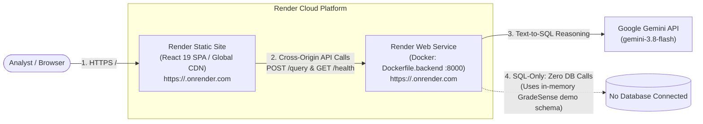

# Deploying QueryPilot (Render SQL-Only Prototype)

> [!WARNING]
> **Historical Documentation Notice (Legacy Prototype Deployment)**
> This document describes the legacy deployment model for the Phase 1–6 prototype (monolithic container running `Dockerfile.backend` against an in-memory demo schema) and does **not** describe the controlled-preview architecture of the decoupled local agent daemon (`querypilot-agent`).
>
> In the current architecture, QueryPilot executes database operations locally through the loopback agent daemon:
> - **Controlled Preview Only**: QueryPilot is currently authorized strictly as a Controlled Preview for local and invited evaluators. Public deployment and distribution remain **BLOCKED**.
> - **Milestone-Verified Evidence**: Milestone B12-F5D verified live Gemini API generation and synthesis payload contracts; Milestone B12-F5E2 verified the complete browser workflow against `QueryPilot_TestDB` (1 live Gemini generation call, 0 DB calls during generation, explicit execution of a read-only query returning 2 records, and deterministic local answer rendering without external synthesis); Milestone B12-F5C verified 32 live SQL Server integration tests; Milestone B12-F5G reported 1,217 passed, 62 deselected, 5 warnings in its offline test reconciliation suite (the 62 deselected tests are live integration tests excluded by the `-m 'not integration'` filter).
> - **Packaging & Distribution Verification**:
>   - **Wheel Building & Asset Staging**: Verified via `python scripts/build_distribution.py`. Stages frontend production assets in isolated staging, enforces deterministic `SOURCE_DATE_EPOCH` (derived from Git metadata or caller env), and packages `query_pilot-0.1.0-py3-none-any.whl` without mutating the repository source tree. Use `--rebuild-frontend` when frontend sources change to ensure fresh asset compilation.
>   - **Packaged-Asset Smoke Testing**: Verified via `pip install --no-deps` in isolated environments (`tests/test_distribution_packaging.py` and `scripts/verify_clean_install.py --mode no-deps`). Confirms asset unpacking and package-internal static discovery without dependency resolution.
>   - **Clean Dependency-Resolved Installation**: Verified via `python scripts/verify_clean_install.py --mode dependency-resolved` (and opt-in `QUERYPILOT_TEST_CLEAN_INSTALL=1`). Creates a fresh external virtual environment without `.pth` repository linkage, installs the wheel with runtime dependency resolution (via index/cache), verifies module origins resolve strictly within `site-packages`, verifies CLI entry points (`querypilot-agent --help`, `querypilot-api --help`, and `auth info`), and confirms loopback static serving on `127.0.0.1:<port>/app/`.
>   - **True Offline Installation**: Supported via `python scripts/verify_clean_install.py --mode offline --wheelhouse <dir>` enforcing `--no-index --find-links <dir>`. True offline installation requires a pre-populated wheelhouse of compatible wheels (including platform C-extensions such as `pyodbc`). If an offline wheelhouse is absent or incomplete, the harness fails closed and tests skip cleanly; offline passes are never fabricated without a verified wheelhouse.
> - **No Standalone Installer or Compliance Claims**: No standalone Windows installer (MSI/exe), service wrapper, or Docker distribution is provided for the local agent. QueryPilot does not claim production readiness, HIPAA/SOC2 compliance, or general regulatory certification.
> - **Execution Ceilings**: Local database execution is hard-clamped to a **15-second statement timeout** (`GLOBAL_MAX_TIMEOUT_SECONDS = 15`) and a **100-row result limit** (`GLOBAL_MAX_ROW_LIMIT = 100`).
>
> For the current supported architecture, configuration, and first-run instructions, refer to:
> - [Root README](../README.md)
> - [Configuration Guide](configuration.md)
> - [Architecture Specification](architecture.md)
> - [API Guide](api.md)

This guide details how to deploy a zero-cost, public **SQL-Only prototype** of QueryPilot on [Render](https://render.com) using a split-origin architecture:
- **Frontend**: Render Static Site (React SPA served globally via CDN).
- **Backend**: Render Web Service (Docker container running FastAPI and Uvicorn).

> [!NOTE]
> This deployment guide provides an architectural blueprint and configuration reference. This deployment configuration has **not been tested live** on Render infrastructure.

---

## Architecture Overview



---

## Prerequisites

1. A [GitHub](https://github.com) account containing your fork or clone of the QueryPilot repository.
2. A [Render](https://render.com) account (the free tier does not require a credit card for initial setup).
3. A [Google Gemini API Key](https://aistudio.google.com/) for natural-language query reasoning.

---

## Step 1: Deploy Backend Web Service

Deploy the backend as a Docker Web Service on Render:

1. Log in to the [Render Dashboard](https://dashboard.render.com/) and click **New +** $\rightarrow$ **Web Service**.
2. Connect your GitHub repository.
3. Configure the service settings:
   - **Name**: `querypilot-backend` (or a name of your choice, yielding `https://<backend-service>.onrender.com`).
   - **Region**: Choose the region closest to you (e.g., `Oregon (US West)` or `Frankfurt (EU Central)`).
   - **Branch**: `main`.
   - **Runtime**: **Docker**.
   - **Dockerfile Path**: `Dockerfile.backend` (in repository root).
   - **Docker Context**: `.` (repository root).
   - **Instance Type**: **Free** (512 MB RAM, 0.1 vCPU).
4. Configure **Environment Variables**:
   | Variable | Value | Purpose |
   | :--- | :--- | :--- |
   | `GEMINI_API_KEY` | `AIzaSy...` (your secret key) | Required for Gemini model reasoning and SQL generation. |
   | `PORT` | `8000` | The backend container dynamically binds to `${PORT:-8000}`. Configuring `PORT=8000` (matching `EXPOSE 8000`) directs Render to route traffic to container port 8000. |
   | `CORS_ALLOWED_ORIGINS` | `https://<frontend-site>.onrender.com` | Whitelists your frontend domain for Cross-Origin Resource Sharing (CORS). *(Update with your exact frontend URL after Step 2).* |
   | `QUERY_PILOT_FORCE_SQL_ONLY` | `true` | Server-side enforcement forcing all queries to SQL-only mode using the in-memory demo schema, preventing any database connection attempts regardless of client request. |
   | `QUERY_PILOT_ACCESS_KEY` | `<your-private-key>` | Shared prototype access key required for `/query` requests via `X-QueryPilot-Access-Key`. |
   | `QUERY_PILOT_REQUIRE_ACCESS_KEY` | `true` | Enforces fail-closed startup validation, preventing unprotected public deployment if the access key is missing. |
5. Click **Create Web Service**. Wait for the Docker image to build and deploy.
6. Note your backend URL: `https://<backend-service>.onrender.com`.

---

## Step 2: Deploy Frontend Static Site

Deploy the React SPA as a Render Static Site:

1. In the Render Dashboard, click **New +** $\rightarrow$ **Static Site**.
2. Connect the same GitHub repository.
3. Configure the static site settings:
   - **Name**: `querypilot-frontend` (yielding `https://<frontend-site>.onrender.com`).
   - **Branch**: `main`.
   - **Root Directory**: `frontend`.
   - **Build Command**: `npm run build`.
   - **Publish Directory**: `dist`.
4. Configure **Build-Time Environment Variables**:
   | Variable | Value | Purpose |
   | :--- | :--- | :--- |
   | `VITE_API_BASE_URL` | `https://<backend-service>.onrender.com` | Base URL used by the frontend API client to reach the backend service directly. |
   | `VITE_DEFAULT_EXECUTION_MODE` | `sql_only` | Sets the initial execution mode selector to **SQL Only** on every fresh page load. |
5. Click **Create Static Site**. Render will run `npm install`, compile the Vite production bundle, and deploy it to their global CDN.
6. Copy your frontend URL: `https://<frontend-site>.onrender.com`.

---

## Step 3: Align Backend CORS Configuration

Now that you have your assigned frontend URL:

1. Return to the **querypilot-backend** service in the Render Dashboard.
2. Navigate to **Environment**.
3. Update `CORS_ALLOWED_ORIGINS` to match your exact frontend site URL:
   ```text
   CORS_ALLOWED_ORIGINS=https://<frontend-site>.onrender.com
   ```
   *(Or a JSON array: `["https://<frontend-site>.onrender.com"]`)*
4. Save changes. Render will automatically redeploy the backend service with the updated CORS policy.

---

## Operational Details & Constraints

### 1. Build-Time vs. Runtime Variables
- Variables prefixed with `VITE_*` (such as `VITE_API_BASE_URL` and `VITE_DEFAULT_EXECUTION_MODE`) are **baked into the client-side JavaScript bundle during the build step** (`npm run build`).
- Modifying a `VITE_*` variable in the Render Dashboard will **not** take effect on running clients until a **Manual Deploy $\rightarrow$ Clear build cache & deploy** is triggered.
- Conversely, backend variables like `GEMINI_API_KEY`, `QUERY_PILOT_ACCESS_KEY`, and `CORS_ALLOWED_ORIGINS` are runtime variables read by Python on service startup.
- **Never** place the prototype access key or Gemini API key into `VITE_*` variables.

### 2. Operational Health Check Semantics
- The `GET /health` endpoint ([src/query_pilot/api/app.py](file:///d:/01.%20Github/query-pilot/src/query_pilot/api/app.py)) is an **application process liveness check**.
- It verifies that the FastAPI server is running and ready to handle incoming HTTP requests.
- It **does not** test downstream Gemini API connectivity or SQL Server database availability. An "Online" status badge indicates the API worker is live, not that downstream external services are reachable.

### 3. Inactivity Sleep & Cold Starts
- Free tier Web Services on Render automatically spin down (sleep) after **15 minutes of inactivity** (no incoming HTTP traffic).
- When a user visits the frontend and sends the first query or liveness check, Render spins up the backend container.
- This "cold start" wake-up typically adds a **30 to 60 second delay** on the first request. Subsequent requests will execute with normal latency.

### 4. SQL-Only Mode Privacy & LLM Usage
- In **SQL-Only mode**, QueryPilot relies entirely on an in-memory representation of the 17 relational tables in the GradeSense demo schema ([src/query_pilot/db/demo_schema.py](file:///d:/01.%20Github/query-pilot/src/query_pilot/db/demo_schema.py)).
- **Zero database connections** are established, and zero queries are executed against a live database.
- **LLM Reasoning Still Occurs**: The user's question, bounded conversation context, and schema metadata are sent to the configured Google Gemini API (`gemini-3.8-flash`) to generate and explain the candidate SQL. Do not submit sensitive personal information in query text.

### 5. Server-Enforced Execution Mode vs. Client UI Default
- The frontend UI initializes to SQL-Only mode via `VITE_DEFAULT_EXECUTION_MODE=sql_only`.
- **Security Boundary**: When `QUERY_PILOT_FORCE_SQL_ONLY=true` is set in the backend environment, the server **strictly overrides** client input. Even if a client crafts a direct API request with `execution_mode="execute"`, the backend forces execution to `sql_only`, ensuring no database engine is initialized, no schema is introspected against a live database, and no SQL is executed.

### 6. Prototype Security & Abuse Protection Safeguards
- **Runtime Access Code Gate**: Protected `/query` requests require the `X-QueryPilot-Access-Key` header verified via constant-time comparison against `QUERY_PILOT_ACCESS_KEY`. Missing or invalid keys return generic HTTP 401 Unauthorized before any LLM or database processing.
- **Client Session Storage**: The frontend provides an Access Key bar that stores the evaluator's code in `sessionStorage` for the current browser session only, without embedding it into compiled bundles.
- **Fail-Closed Deployment**: Setting `QUERY_PILOT_REQUIRE_ACCESS_KEY=true` ensures the application aborts startup validation if `QUERY_PILOT_ACCESS_KEY` is not configured.
- **Payload Size Ceiling**: Enforced while streaming ASGI request-body chunks (default: 64 KB via `QUERY_PILOT_MAX_REQUEST_BYTES`). Oversized requests are rejected with HTTP 413 Content Too Large as soon as accumulated bytes exceed the ceiling, safely handling chunked, absent, or understated Content-Length headers without buffering full bodies into memory.
- **In-Memory Rate & Concurrency Limiting**: Active queries are bounded by `QUERY_PILOT_RATE_LIMIT_PER_MINUTE` (default: 20 RPM) and `QUERY_PILOT_MAX_CONCURRENT_QUERIES` (default: 3). Over-limit requests return HTTP 429 Too Many Requests without invoking Gemini.
- **Limitations & Scope**:
  - A shared prototype access code is appropriate for invited evaluators and course review; it is **not a substitute for user-level authentication** (e.g. Clerk, Supabase Auth) in a public product.
  - In-memory rate and concurrency limits operate per-process and reset upon container restarts or spin-down.
  - Application rate limiting alone does not eliminate all quota exhaustion risks. Configure daily request quotas and spending alerts in Google AI Studio / Google Cloud Console to ensure hard cost protection.
