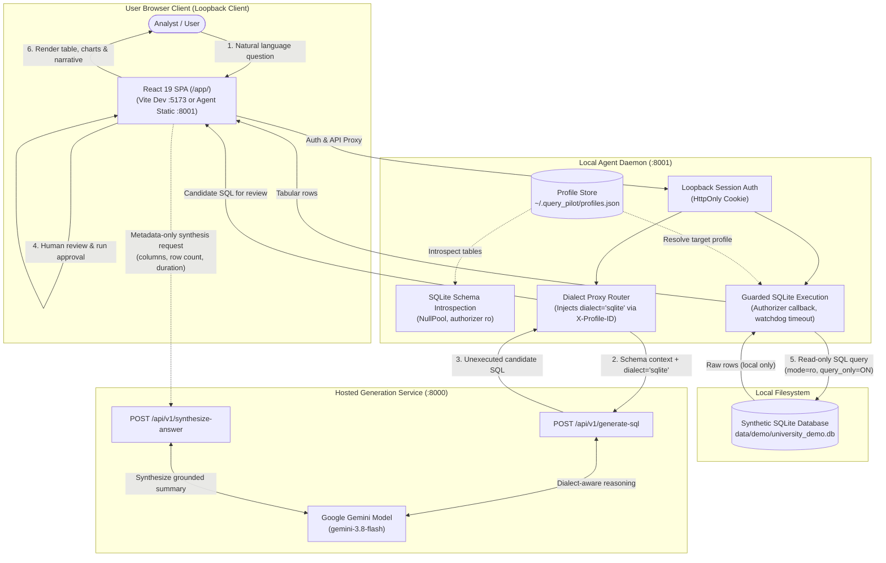

# QueryPilot SQLite Golden Path Demonstration Guide

This guide provides end-to-end instructions for demonstrating QueryPilot's complete SQLite workflow using the actual React frontend, local agent daemon, and hosted API architecture against a synthetic University demonstration database.

---

## 1. Prerequisites & Environment Alignment

Before running the demonstration, ensure the following prerequisites are installed and available on your workstation:

- **Python 3.10+** (with the active virtual environment at `.\.venv`)
- **Node.js 20+** and **npm** (for the React 19 frontend)
- **Active Gemini API Key** (set in `.env` as `GEMINI_API_KEY` or exported in the shell for `querypilot-api`)
- **No external SQL Server required**: The demonstration runs entirely offline or locally against the generated SQLite database.

---

## 2. Dataset Creation & Overwrite Protection

QueryPilot provides a deterministic data generation script: [`scripts/generate_university_sqlite_db.py`](file:///d:/01.%20Github/query-pilot/scripts/generate_university_sqlite_db.py).

### Generating the Demo Database
Run the generator from the repository root:
```powershell
python scripts/generate_university_sqlite_db.py --overwrite
```

This creates the demonstration database at `data/demo/university_demo.db` with:
- **5 Departments**: Computer Science, Mathematics, Physics, Electrical Engineering, Biology.
- **10 Courses**: Including 8 active courses and 2 courses with zero enrollments (*Quantum Computing Lab*, *Bioinformatics Seminar*).
- **16 Students**: Including 14 active students and 2 students with zero enrollments (*Zara Patel*, *Liam Vance*).
- **30 Enrollments**: Distributed across academic years 2022–2024 and semesters (*Fall*, *Spring*), with marks between 65.0 and 96.0.

### Overwrite Protection
Running the script without `--overwrite` when the destination file exists fails closed with an informative error:
```powershell
python scripts/generate_university_sqlite_db.py
# [!] ERROR: Destination database already exists: '...\data\demo\university_demo.db'. Specify overwrite=True or pass --overwrite to replace it.
```

### Self-Verification
To verify the schema and analytical integrity without regenerating:
```powershell
python scripts/generate_university_sqlite_db.py --verify-only
```

---

## 3. Service Startup Architecture

The QueryPilot architecture separates natural language reasoning from local query execution:



### Starting the Services

#### Option A: One-Command Service Launcher (Recommended)
You can start all services concurrently in dedicated background windows without terminal blocking:
```powershell
# Standard mode (Serves UI from Agent at http://127.0.0.1:8001/app/)
powershell -ExecutionPolicy Bypass -File scripts\start_stack.ps1

# Or Development mode (starts Vite hot-reloading dev server at http://localhost:5173/app/)
powershell -ExecutionPolicy Bypass -File scripts\start_stack.ps1 -Dev
```
*(To stop all services later, run `powershell -ExecutionPolicy Bypass -File scripts\stop_stack.ps1`).*

#### Option B: Manual Multi-Terminal Launch
If starting services in separate terminal windows:

##### Terminal 1: Hosted API Service (`querypilot-api`)
```powershell
.\.venv\Scripts\Activate.ps1
python -m query_pilot.api.cli --port 8000
```
*Guarantees: Listens on `http://127.0.0.1:8000`. Does not touch local files or databases.*

##### Terminal 2: Local Agent Daemon (`querypilot-agent`)
```powershell
.\.venv\Scripts\Activate.ps1
python -m query_pilot.agent.cli --port 8001 --allow-dev-origin
```
*Note: In development, `--allow-dev-origin` permits CORS from the Vite dev server (`http://127.0.0.1:5173`).*

##### Terminal 3: React Frontend (`querypilot-frontend` — Only required if using Vite dev server)
```powershell
cd frontend
npm run dev
```
*Vite dev server starts at `http://127.0.0.1:5173`.*

---

## 4. SQLite Onboarding & Connection Verification

1. **Bootstrap Authentication**:
   - Open `http://127.0.0.1:5173` in your browser.
   - The UI requests the single-use bootstrap token displayed in Terminal 2 (or read from `~/.query_pilot/agent.token`).
   - Enter the token to establish an authenticated loopback session cookie.

2. **Add SQLite Connection Profile**:
   - Click **+ Add Profile** in the top navigation or target profile bar.
   - In the **Engine Selection** toggle, select **SQLite**.
   - Fill in:
     - **Profile ID**: `university_demo`
     - **Display Name**: `University Demonstration DB`
     - **Database File Path**: Enter the absolute canonical path to your generated database file (e.g., `D:\01. Github\query-pilot\data\demo\university_demo.db`).
     - **Default Schema**: Automatically locked to `main`.
   - Click **Create Profile**.

3. **Explicit Connection Test**:
   - In the modal or profile dropdown, click **Test Connection**.
   - The local agent opens the database with `mode=ro`, runs a validation probe, and displays:
     `✓ Connection Verified: university_demo (< 5 ms)`.

4. **Schema Introspection**:
   - Select `University Demonstration DB [SQLite]` in the active profile dropdown.
   - The agent introspects the SQLite catalog. The frontend renders the schema inspector displaying `departments`, `courses`, `students`, and `enrollments` with their primary and foreign keys.

---

## 5. Golden Path Question Set

Execute the following 8 questions in sequence to demonstrate analytical coverage, dialect routing, edge-case handling, and conversational follow-up.

### Question 1: Total number of students in each department
- **User Question**: `"What is the total number of students in each department?"`
- **Analytical Intent**: Grouping and counting students joined with department names.
- **Relevant Tables**: `departments`, `students`.
- **Expected Result Shape**: 2 columns (`department_name`, `student_count`), 5 rows.
- **Deterministic Validation Rule**:
  - `Computer Science`: 5
  - `Mathematics`: 4
  - `Physics`: 3
  - `Biology`: 2
  - `Electrical Engineering`: 2
  - **Total Students**: Exactly 16 students across all 5 departments.

### Question 2: Average marks for each course
- **User Question**: `"What is the average mark scored by students in each course?"`
- **Analytical Intent**: Multi-table join calculating `AVG(marks)` grouped by course.
- **Relevant Tables**: `courses`, `enrollments`.
- **Expected Result Shape**: 2 columns (`course_name`, `avg_marks`), 8 rows (courses with enrollments).
- **Deterministic Validation Rule**:
  - Top course: `Classical Mechanics` (exact average: 91.125 across 4 enrollments).
  - Second highest: `Database Management Systems` (exact average: 89.6667 across 3 enrollments).
  - Remaining courses: `Probability and Statistics` (89.0), `Molecular Genetics` (87.625), `Digital Circuit Design` (86.375), `Linear Algebra` (86.125), `Introduction to Programming` (85.75), `Data Structures and Algorithms` (85.0).
  - Unenrolled courses omitted from average (`Quantum Computing Lab`, `Bioinformatics Seminar`).

### Question 3: Top-performing students in a selected semester
- **User Question**: `"Who were the top 3 performing students in Fall 2023 by marks?"`
- **Analytical Intent**: Multi-condition filtering (`semester = 'Fall' AND academic_year = 2023`), sorting descending by marks with `LIMIT 3`.
- **Relevant Tables**: `students`, `enrollments`.
- **Expected Result Shape**: 2-3 columns (`student_name`, `marks`), 3 rows.
- **Deterministic Validation Rule**:
  - Rank 1: `Alice Chen` (96.0)
  - Rank 2: `Elena Rostova` (93.0)
  - Rank 3: `James Wilson` (90.5)

### Question 4: Enrollment count by academic year
- **User Question**: `"Show the total number of enrollments for each academic year."`
- **Analytical Intent**: Temporal aggregation grouped by academic year, sorted chronologically.
- **Relevant Tables**: `enrollments`.
- **Expected Result Shape**: 2 columns (`academic_year`, `enrollment_count`), 3 rows.
- **Deterministic Validation Rule**:
  - `2022`: 6 enrollments
  - `2023`: 14 enrollments
  - `2024`: 10 enrollments
  - Total: 30 enrollments.

### Question 5: Departments with the highest average marks
- **User Question**: `"Rank all departments by their students' average marks from highest to lowest."`
- **Analytical Intent**: Three-way join (`departments` -> `students` -> `enrollments`), grouping by department with descending average marks.
- **Relevant Tables**: `departments`, `students`, `enrollments`.
- **Expected Result Shape**: 2 columns (`department_name`, `avg_marks`), 5 rows.
- **Deterministic Validation Rule**: All 5 departments ranked; averages range between ~86.375 and ~91.125:
  1. `Physics`: 91.1250 (4 enrollments)
  2. `Biology`: 87.6250 (4 enrollments)
  3. `Mathematics`: 87.5625 (8 enrollments)
  4. `Computer Science`: 86.7000 (10 enrollments)
  5. `Electrical Engineering`: 86.3750 (4 enrollments)

### Question 6: Courses with no enrollments (Edge Case)
- **User Question**: `"Which courses currently have no enrolled students?"`
- **Analytical Intent**: Outer join (`LEFT JOIN`) or anti-join (`NOT EXISTS`) filtering for null enrollment references.
- **Relevant Tables**: `courses`, `enrollments`.
- **Expected Result Shape**: 1-2 columns (`course_name`, `course_id`), exactly 2 rows.
- **Deterministic Validation Rule**:
  - Exactly contains: `Bioinformatics Seminar` and `Quantum Computing Lab`.

### Question 7: Students without any enrollments (Edge Case)
- **User Question**: `"List all students who have not enrolled in any courses."`
- **Analytical Intent**: Outer join (`LEFT JOIN`) or anti-join (`NOT EXISTS`) detecting unenrolled students.
- **Relevant Tables**: `students`, `enrollments`.
- **Expected Result Shape**: 1-2 columns (`student_name`, `student_id`), exactly 2 rows.
- **Deterministic Validation Rule**:
  - Exactly contains: `Liam Vance` and `Zara Patel`.

### Question 8: Contextual follow-up conversation
- **Turn 1 Question**: `"Which courses currently have no enrolled students?"`
  *(Generates candidate SQL and returns `Bioinformatics Seminar` and `Quantum Computing Lab`)*
- **Turn 2 (Follow-up) Question**: `"Which departments offer them?"`
- **Analytical Intent**: Conversational pronoun resolution (`"them"` -> courses with no enrollments from Turn 1), joining with `departments`.
- **Relevant Tables**: `courses`, `departments`, `enrollments`.
- **Observed vs. Complete Result Shape**:
  - **Natural Language Parsing**: When asked `"Which departments offer them?"`, language models generate `SELECT DISTINCT d.department_name ...` returning 1 column (`department_name`) with 2 rows (`Biology`, `Computer Science`). Pronoun resolution successfully resolves `"them"` to the unenrolled courses.
  - **Relational Pairing**: To retrieve both the department and the course name (`Biology` -> `Bioinformatics Seminar`, `Computer Science` -> `Quantum Computing Lab`), the question prompt can explicitly specify: `"Which departments offer them? Show the department name and course name."`
- **Deterministic Validation Rule**:
  - Unenrolled courses resolved: `Bioinformatics Seminar` and `Quantum Computing Lab`.
  - Offering departments resolved: `Biology` and `Computer Science`.

---

## 6. Query Approval, Execution & Visualization Flow

1. **Candidate Review**:
   - The user inputs a question and clicks **Generate SQL**.
   - The UI presents the candidate SQLite query with syntax highlighting, analytical explanation, and a notice:
     `Unexecuted candidate SQL. Review the query and click Execute Query on Database.`
2. **Execution & Results**:
   - User clicks **Run Query**.
   - Results are rendered in the interactive **ResultVisualizer**:
     - Sortable, searchable tabular view.
     - Auto-detected chart visualizations (bar chart for counts, line chart for temporal trends).
     - Summary statistics (row count, execution latency, truncated status).
3. **Privacy Boundary Inspection**:
   - In your browser's Developer Tools (Network Tab), inspect requests to `:8000`:
     - Only metadata (`columns`, `row_count`, `execution_time_ms`) is sent for answer synthesis.
     - **No raw data rows** are ever sent to `:8000` or Google Gemini.

---

## 7. Troubleshooting & Operational Tips

| Issue | Cause | Resolution |
| :--- | :--- | :--- |
| `HTTP 401 Unauthorized` | Missing or expired bootstrap session | Run `python -m query_pilot.agent.cli --port 8001` and copy the bootstrap token from the terminal. |
| `Invalid SQLite Path` | Relative path, network path, or non-existent file | Provide an absolute, local canonical path (`C:\...` or `/...`) to an existing `.db` file. |
| `WAL Sidecar Error` | Database path is inside read-only directory preventing WAL creation | Ensure the directory containing the SQLite database allows local file reads. |
| `NOT_READ_ONLY` Rejection | Query attempted mutation (DDL/DML) | QueryPilot strictly forbids non-SELECT statements via SQLite authorizers. |

---

## 8. Known Limitations

1. **Manual Path Entry**: Browsers cannot safely discover host-filesystem absolute paths from `<input type="file">` due to browser sandbox security policies. Users must type or paste the local path.
2. **Local Daemon Requirement**: Both `querypilot-api` (:8000) and `querypilot-agent` (:8001) must run concurrently for natural-language querying.
3. **Strict Execution Ceilings**: Queries are hard-clamped to a **15-second statement timeout** and a **100-row limit**.

